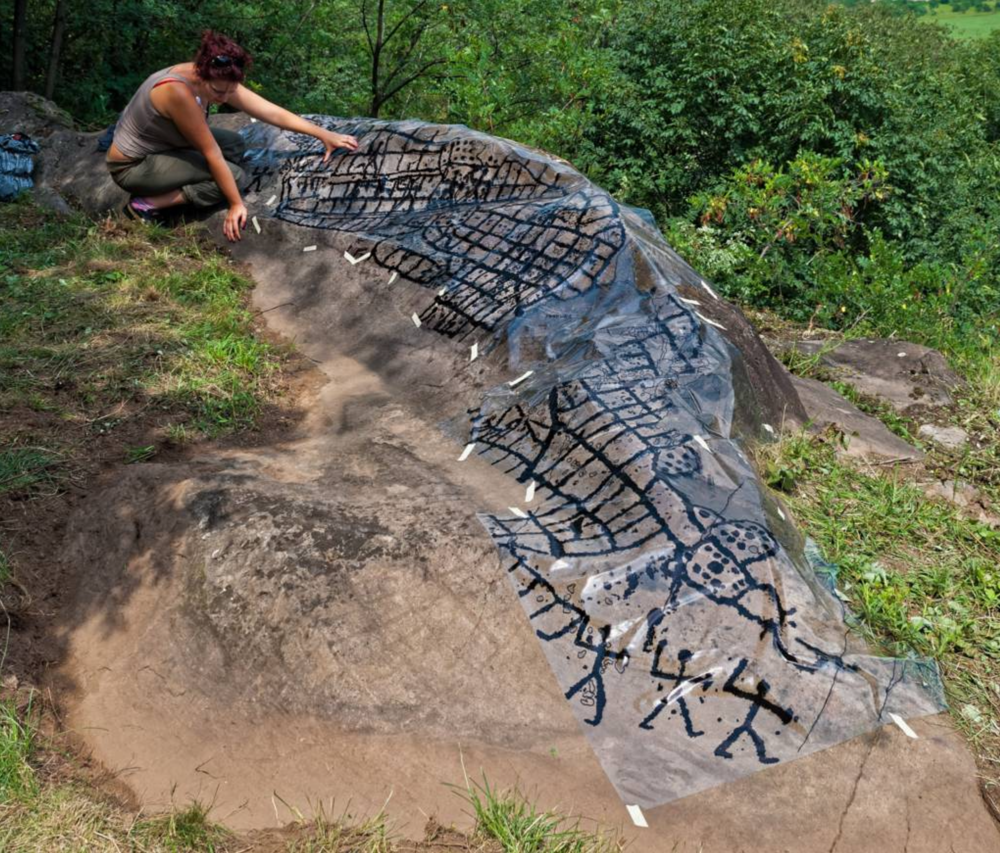
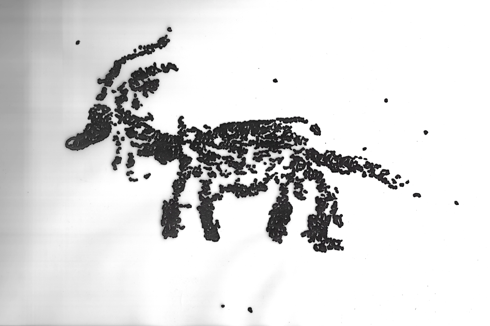

<!-- .slide: id="cover" class="l-cover rays atlas acc-1" data-header="Landscape & documentation" data-talk-section="00" data-auto-animate data-auto-animate-id="cervid-intro" data-auto-animate-duration="1.15" data-transition="none"  -->

<h1>Beyond the Tracing: Digital Documentation and Interactive Analysis of Zoomorphic Figures at Rupe Magna</h1>
Hüseyin Erdoğan · Alma Mater Studiorum - Università di Bologna XXIX Valcamonica Symposium · Capo di Ponte · 22 October 2026

3DARCHEO · INFINITY / Horizon Europe <a class="reference-marker" href="#reference-1-1" aria-label="Reference 1">[1]</a>

<!-- IEEE references:start -->
<aside class="slide-references" aria-label="References"><ol><li id="reference-1-1" data-reference-key="infinity-3darcheo">[1]<a href="https://infinity-eccch.eu/use-cases/">INFINITY Consortium, “Use cases: 3DARCHEO,” INFINITY. Accessed: Oct. 19, 2026. [Online]. Available: https://infinity-eccch.eu/use-cases/</a></li></ol></aside>
<!-- IEEE references:end -->

Note:
TEMPO: 00:00–00:40. Durata prevista: 00:40.

[Pausa.]

Buon pomeriggio a tutti.

Mi chiamo Hüseyin Erdoğan, dottorando all'Università di Bologna.

Il lavoro che presento si inserisce in 3DARCHEO, uno dei casi d'uso del progetto europeo INFINITY, finanziato dal programma Horizon Europe.

Vorrei partire da una domanda semplice: **quando riconosciamo un animale inciso sulla roccia, su quali segni si basa la nostra lettura?**

[Clic]

---

<!-- .slide: id="which-marks" class="l-sub-cols atlas cervid-reading acc-1" data-header="Landscape & documentation" data-talk-section="01" data-auto-animate data-auto-animate-id="cervid-intro" data-auto-animate-duration="1.15" data-transition="none" -->

<h2 class="sub">Which marks?</h2>

<svg class="cervid-analysis" viewBox="0 0 1280 720" role="img" aria-label="Successive clicks colour the legs, head and body, then antlers of the three cervids"><title>Progressive colouring of the supplied cervid feature layers</title><defs><filter id="cervid-tint-legs" x="0" y="0" width="100%" height="100%" color-interpolation-filters="sRGB"><feFlood flood-color="#bca45c" /><feComposite in2="SourceAlpha" operator="in" /></filter><filter id="cervid-tint-body" x="0" y="0" width="100%" height="100%" color-interpolation-filters="sRGB"><feFlood flood-color="#e2cd8c" /><feComposite in2="SourceAlpha" operator="in" /></filter><filter id="cervid-tint-antlers" x="0" y="0" width="100%" height="100%" color-interpolation-filters="sRGB"><feFlood flood-color="#e1dc64" /><feComposite in2="SourceAlpha" operator="in" /></filter></defs><g class="cervid-trait fragment fade-in" data-fragment-index="0" data-trait="legs" style="color:#bca45c"><image class="cervid-tint" data-layer="legs" x="49" y="120" width="715" height="482.99869337979095" preserveAspectRatio="xMidYMid meet" href="assets/images/cervids-legs.png" filter="url(#cervid-tint-legs)" /><g class="cervid-label" transform="translate(842 190)"><text class="trait-number" x="0" y="0">01</text><text class="trait-title" x="0" y="37">Legs</text><text class="trait-detail" x="0" y="65">Visible limb outlines</text><path class="trait-rule" d="M0,83 H374" /></g></g><g class="cervid-trait fragment fade-in" data-fragment-index="1" data-trait="body" style="color:#e2cd8c"><image class="cervid-tint" data-layer="body" x="49" y="120" width="715" height="482.99869337979095" preserveAspectRatio="xMidYMid meet" href="assets/images/cervids-head-body.png" filter="url(#cervid-tint-body)" /><g class="cervid-label" transform="translate(842 353)"><text class="trait-number" x="0" y="0">02</text><text class="trait-title" x="0" y="37">Head and body</text><text class="trait-detail" x="0" y="65">Profile and proportions</text><path class="trait-rule" d="M0,83 H374" /></g></g><g class="cervid-trait fragment fade-in" data-fragment-index="2" data-trait="antlers" style="color:#e1dc64"><image class="cervid-tint" data-layer="antlers" x="49" y="120" width="715" height="482.99869337979095" preserveAspectRatio="xMidYMid meet" href="assets/images/cervids-antlers.png" filter="url(#cervid-tint-antlers)" /><g class="cervid-label" transform="translate(842 516)"><text class="trait-number" x="0" y="0">03</text><text class="trait-title" x="0" y="37">Antlers</text><text class="trait-detail" x="0" y="65">Branching outlines</text><path class="trait-rule" d="M0,83 H374" /></g></g></svg>

Comparative example · supplied tracing · Reading framework: Pessina and Sigari 2023 <a class="reference-marker" href="#reference-2-2" aria-label="Reference 2">[2]</a> · Rupe Magna repertoire: Fossati 1995 <a class="reference-marker" href="#reference-2-3" aria-label="Reference 3">[3]</a>

<!-- IEEE references:start -->
<aside class="slide-references" aria-label="References"><ol><li id="reference-2-2" data-reference-key="pessina-sigari-2023">[2]<a href="https://doi.org/10.36253/aae-2345">G. Pessina and D. Sigari, “Tra assenza e presenza delle figure di cervidi nell’arte rupestre della Valcamonica. Frammenti di una simbologia ricorsiva,” Archivio per l’Antropologia e la Etnologia, vol. 153, pp. 119–136, 2023, doi: 10.36253/aae-2345.</a></li><li id="reference-2-3" data-reference-key="fossati-zoomorphs-1995">[3]A. E. Fossati, “Le figure zoomorfe,” in Rupe Magna: La roccia incisa più grande delle Alpi. Sondrio, Italy: Consorzio per il Parco delle Incisioni Rupestri di Grosio, 1995, pp. 67–71.</li></ol></aside>
<!-- IEEE references:end -->

Note:
TEMPO: 00:40–02:15. Durata prevista: 01:35.

Spesso incontriamo queste figure attraverso un rilievo: una documentazione che rende riconoscibili i segni e le loro relazioni. Ma il rilievo è una rappresentazione della roccia, non la roccia stessa.

Per riconoscere un animale osserviamo alcuni caratteri anatomici, come

[Clic]

le zampe,

[Clic]

la forma del corpo e

[Clic]

i palchi. Sulla superficie rimangono tracce, irregolarità e segni di usura che meritano di essere osservati più da vicino.

Un confronto utile viene dallo studio di Pessina e Sigari sui cervidi della Valcamonica. Gli autori discutono come alcuni caratteri anatomici, come i palchi e la forma del corpo, siano selezionati e rielaborati nelle raffigurazioni. Per questo è importante osservare i dettagli attraverso cui l'animale viene rappresentato.

Alla Rupe Magna, le figure animali sono relativamente poche rispetto alla grande varietà di incisioni. Per questo, capire quali tracce permettono di riconoscerle diventa particolarmente importante.

[Clic]

---

<!-- .slide: id="rupe-magna" class="l-sub-cols atlas rupe-context acc-1" data-header="Landscape &amp; documentation" data-talk-section="02" -->

<h2 class="sub">Rupe Magna</h2>

Grosio

<svg class="context-map" viewBox="0 0 650 430" data-overview="22.63387853 0.00000000 0.00000000 22.63387853 39.81313049 1250.14821211" data-regional="276.08801193 0.00000000 0.00000000 276.08801193 -2457.13924159 14640.16775382" role="img" aria-label="Vector map of Italy, zooming to Rupe Magna and Naquane. The highlighted line is a contemporary road route via Aprica, approximately 65 kilometres."><title>Rupe Magna and Naquane in their Alpine setting</title><g class="map-camera" transform="matrix(22.63387853 0.00000000 0.00000000 22.63387853 39.81313049 1250.14821211)"><path class="map-land" d="M9.524023,-54.151018L9.554395,-54.131641L9.625879,-54.066390L9.609082,-53.955165L9.527539,-53.776568L9.484277,-53.632132L9.479492,-53.521667L9.487695,-53.469898L9.502344,-53.470614L9.580273,-53.462730L9.619922,-53.462873L9.745020,-53.432991L9.845313,-53.389371L9.864648,-53.343343L9.877734,-53.287256L9.996875,-53.210634L10.133496,-53.161139L10.179785,-53.176991L10.349414,-53.356225L10.414941,-53.326383L10.454590,-53.231211L10.452832,-53.180775L10.406055,-52.990755L10.397949,-52.888944L10.438281,-52.821664L10.442480,-52.769287L10.430664,-52.721562L10.363086,-52.717230L10.272266,-52.743078L10.195508,-52.824934L10.137500,-52.815123L10.087012,-52.794085L10.061230,-52.716804L10.038281,-52.624422L10.045605,-52.573168L10.081934,-52.533777L10.109668,-52.449816L10.129883,-52.341420L10.145215,-52.291551L10.128320,-52.269450L10.080566,-52.254628L10.041016,-52.269239L9.971680,-52.398888L9.939258,-52.448329L9.884473,-52.456962L9.787793,-52.425479L9.639453,-52.352867L9.579590,-52.353151L9.528711,-52.367781L9.481055,-52.429440L9.440625,-52.548370L9.427637,-52.623146L9.399316,-52.620735L9.304395,-52.642366L9.260156,-52.612793L9.259766,-52.491007L9.251074,-52.339655L9.203418,-52.241994L9.070996,-52.073367L9.022363,-51.999882L9.003027,-51.947203L8.998926,-51.901443L9.019141,-51.822360L9.046680,-51.746860L9.023730,-51.703950L8.953711,-51.681452L8.904297,-51.727296L8.885156,-51.808812L8.778027,-51.920277L8.826758,-52.013672L8.818555,-52.036897L8.641699,-52.085410L8.565430,-52.156155L8.458398,-52.280535L8.438477,-52.334001L8.442969,-52.507715L8.436816,-52.549929L8.422559,-52.570476L8.370703,-52.569129L8.298535,-52.508636L8.231934,-52.418477L8.095703,-52.316905L8.081543,-52.295152L8.127246,-52.196278L8.125195,-52.157776L8.014258,-52.000514L7.993164,-51.948679L7.852344,-51.850164L7.787891,-51.813304L7.592578,-51.885775L7.538574,-51.894347L7.451563,-51.845810L7.327930,-51.799689L7.129004,-51.753804L7.055762,-51.787408L7.021094,-51.818990L7.003906,-51.866528L6.953711,-51.950437L6.897266,-52.000304L6.858008,-52.054567L6.805664,-52.114081L6.772070,-52.163840L6.816797,-52.322909L6.784180,-52.379020L6.767383,-52.459014L6.776074,-52.513310L6.758105,-52.526552L6.578223,-52.557864L6.428906,-52.547945L6.321875,-52.494546L6.234668,-52.406029L6.224219,-52.386939L6.229590,-52.371032L6.272949,-52.289714L6.199414,-52.204177L6.086621,-52.137687L6.006641,-52.130923L5.971484,-52.143750L5.970020,-52.235431L6.036133,-52.269239L6.095898,-52.328986L6.115918,-52.413313L6.123242,-52.472673L6.060254,-52.544544L6.067969,-52.588620L6.107031,-52.672160L6.129688,-52.746202L6.160742,-52.810290L6.285156,-52.915203L6.410156,-53.020754L6.429004,-53.133013L6.438574,-53.269953L6.456250,-53.302848L6.624805,-53.384932L6.666895,-53.417446L6.688086,-53.464020L6.820703,-53.618199L6.952051,-53.771315L6.978516,-53.822709L7.000586,-53.852885L7.000586,-53.877883L6.984082,-53.897196L6.921484,-53.910026L6.900391,-53.958770L6.968359,-54.045953L7.053418,-54.099406L7.136035,-54.100129L7.169238,-54.075564L7.167480,-54.046674L7.203125,-54.015630L7.265723,-54.005380L7.343164,-54.016206L7.420020,-54.048841L7.467383,-54.126509L7.494922,-54.185298L7.615625,-54.252532L7.698047,-54.218655L7.927051,-54.209753L8.093750,-54.227991L8.198242,-54.273604L8.327832,-54.273604L8.414746,-54.247899L8.430078,-54.251663L8.454004,-54.257672L8.477637,-54.282150L8.559473,-54.298955L8.570508,-54.319388L8.567090,-54.340333L8.552344,-54.351062L8.451758,-54.340189L8.413281,-54.356354L8.403418,-54.393628L8.435742,-54.458357L8.509863,-54.511224L8.572656,-54.524228L8.617871,-54.510061L8.728320,-54.411837L8.754785,-54.408862L8.770117,-54.426493L8.793066,-54.436363L8.831152,-54.417133L8.874023,-54.356354L8.881152,-54.347002L9.127539,-54.368245L9.182813,-54.368245L9.350000,-54.261728L9.524023,-54.151018Z"/><path class="map-land" d="M16.516211,-52.648678L16.427637,-52.684295L16.321191,-52.699128L16.301172,-52.679896L16.258398,-52.660312L16.236719,-52.625344L16.253320,-52.487891L16.227441,-52.464323L16.106445,-52.477911L16.066504,-52.462128L16.000684,-52.366579L15.933301,-52.326442L15.847559,-52.297835L15.784277,-52.263309L15.704199,-52.233314L15.635938,-52.215252L15.608984,-52.173641L15.592578,-52.127540L15.596875,-52.083157L15.666211,-51.995589L15.675586,-51.902286L15.668066,-51.788319L15.652148,-51.727576L15.624805,-51.687199L15.454102,-51.634935L15.277051,-51.541773L15.272949,-51.520441L15.353711,-51.437680L15.356934,-51.417074L15.290137,-51.370081L15.283594,-51.322977L15.291211,-51.268512L15.326660,-51.212480L15.339453,-51.162197L15.242090,-51.125652L15.110449,-51.139015L14.954590,-51.209066L14.900000,-51.198757L14.847070,-51.162614L14.793066,-51.178142L14.733594,-51.221328L14.649512,-51.311258L14.608594,-51.366452L14.591797,-51.425316L14.568848,-51.433839L14.533984,-51.416725L14.505176,-51.345166L14.427344,-51.217427L14.369922,-51.182738L14.283008,-51.190120L14.161230,-51.188031L14.085547,-51.177585L13.992773,-51.222652L13.970313,-51.214013L13.970117,-51.184409L13.935645,-51.137624L13.878711,-51.107074L13.615234,-51.176053L13.577930,-51.233314L13.637305,-51.260494L13.719824,-51.334281L13.775977,-51.326256L13.844727,-51.341816L13.874707,-51.373223L13.831152,-51.467028L13.721680,-51.582846L13.663477,-51.626882L13.583398,-51.656090L13.569629,-51.687340L13.613965,-51.870601L13.600586,-51.896665L13.509180,-51.888023L13.487695,-51.907205L13.480273,-51.939047L13.486426,-51.982717L13.548047,-52.054144L13.616602,-52.117604L13.634961,-52.153195L13.632520,-52.181045L13.544727,-52.209256L13.491797,-52.238184L13.449805,-52.248204L13.420996,-52.231974L13.399609,-52.250251L13.378223,-52.303273L13.399512,-52.384180L13.478516,-52.459014L13.563281,-52.525561L13.637109,-52.574090L13.679688,-52.594929L13.700000,-52.678264L13.743945,-52.669607L13.831348,-52.665136L13.928809,-52.646195L14.019629,-52.622933L14.099512,-52.593510L14.267285,-52.562753L14.419922,-52.544190L14.465918,-52.527048L14.503516,-52.528394L14.549805,-52.503254L14.577148,-52.522444L14.596973,-52.556021L14.680176,-52.595708L14.756738,-52.647543L14.810547,-52.713610L14.840625,-52.765807L14.893262,-52.802827L14.949414,-52.813488L15.000684,-52.832044L15.216992,-52.856790L15.439258,-52.837377L15.545313,-52.873791L15.632617,-52.937625L15.760254,-52.955569L15.766895,-52.956352L15.957617,-52.907303L15.972266,-52.935846L15.980469,-52.948448L15.976855,-53.087848L16.037207,-53.151358L16.093066,-53.178347L16.283594,-53.169564L16.308496,-53.126734L16.318457,-53.060320L16.335449,-52.971451L16.367188,-52.946882L16.384570,-52.911929L16.381250,-52.850532L16.418457,-52.804747L16.505664,-52.680888L16.516211,-52.648678Z"/><path class="map-land map-italy" d="M7.021094,-51.818990L7.055762,-51.787408L7.129004,-51.753804L7.327930,-51.799689L7.451563,-51.845810L7.538574,-51.894347L7.592578,-51.885775L7.787891,-51.813304L7.852344,-51.850164L7.993164,-51.948679L8.014258,-52.000514L8.125195,-52.157776L8.127246,-52.196278L8.081543,-52.295152L8.095703,-52.316905L8.231934,-52.418477L8.298535,-52.508636L8.370703,-52.569129L8.422559,-52.570476L8.436816,-52.549929L8.442969,-52.507715L8.438477,-52.334001L8.458398,-52.280535L8.565430,-52.156155L8.641699,-52.085410L8.818555,-52.036897L8.826758,-52.013672L8.778027,-51.920277L8.885156,-51.808812L8.904297,-51.727296L8.953711,-51.681452L9.023730,-51.703950L9.046680,-51.746860L9.019141,-51.822360L8.998926,-51.901443L9.003027,-51.947203L9.022363,-51.999882L9.070996,-52.073367L9.203418,-52.241994L9.251074,-52.339655L9.259766,-52.491007L9.260156,-52.612793L9.304395,-52.642366L9.399316,-52.620735L9.427637,-52.623146L9.440625,-52.548370L9.481055,-52.429440L9.528711,-52.367781L9.579590,-52.353151L9.639453,-52.352867L9.787793,-52.425479L9.884473,-52.456962L9.939258,-52.448329L9.971680,-52.398888L10.041016,-52.269239L10.080566,-52.254628L10.128320,-52.269450L10.145215,-52.291551L10.129883,-52.341420L10.109668,-52.449816L10.081934,-52.533777L10.045605,-52.573168L10.038281,-52.624422L10.061230,-52.716804L10.087012,-52.794085L10.137500,-52.815123L10.195508,-52.824934L10.272266,-52.743078L10.363086,-52.717230L10.430664,-52.721562L10.442480,-52.769287L10.438281,-52.821664L10.397949,-52.888944L10.406055,-52.990755L10.452832,-53.180775L10.479395,-53.166423L10.579785,-53.164352L10.689258,-53.153643L10.759766,-53.076080L10.828906,-53.049695L10.927344,-53.041282L10.993262,-53.052262L11.025098,-53.081429L11.063477,-53.172278L11.133887,-53.285040L11.244434,-53.342914L11.433203,-53.353720L11.527539,-53.374765L11.625488,-53.373548L11.699414,-53.356082L11.775684,-53.358158L11.969531,-53.436788L12.169434,-53.499076L12.197168,-53.488608L12.201270,-53.467891L12.165527,-53.419881L12.130762,-53.356225L12.154102,-53.283681L12.267969,-53.138296L12.330078,-53.027168L12.388281,-52.943749L12.479199,-52.899831L12.598633,-52.873008L12.699805,-52.863334L12.805566,-52.831902L13.168750,-52.754441L13.351562,-52.732993L13.490039,-52.729584L13.700000,-52.678264L13.679688,-52.594929L13.637109,-52.574090L13.563281,-52.525561L13.478516,-52.459014L13.399512,-52.384180L13.378223,-52.303273L13.399609,-52.250251L13.420996,-52.231974L13.449805,-52.248204L13.491797,-52.238184L13.544727,-52.209256L13.632520,-52.181045L13.634961,-52.153195L13.616602,-52.117604L13.548047,-52.054144L13.486426,-51.982717L13.480273,-51.939047L13.487695,-51.907205L13.509180,-51.888023L13.600586,-51.896665L13.613965,-51.870601L13.569629,-51.687340L13.583398,-51.656090L13.663477,-51.626882L13.721680,-51.582846L13.831152,-51.467028L13.874707,-51.373223L13.844727,-51.341816L13.775977,-51.326256L13.719824,-51.334281L13.783301,-51.390956L13.628320,-51.596706L13.558203,-51.596356L13.465137,-51.509322L13.206348,-51.597336L13.156738,-51.561783L13.120117,-51.492051L13.030273,-51.405620L12.903027,-51.367429L12.761230,-51.272416L12.611719,-51.205236L12.497559,-51.154538L12.432129,-51.163450L12.536133,-51.273323L12.491797,-51.275274L12.353809,-51.197782L12.274316,-51.132264L12.248828,-51.022306L12.225684,-50.841248L12.286328,-50.793274L12.392480,-50.555285L12.523438,-50.453701L12.497949,-50.356861L12.463574,-50.280383L12.384473,-50.214297L12.319043,-50.263304L12.278906,-50.262066L12.248340,-50.107502L12.304980,-49.696075L12.396289,-49.408718L12.486816,-49.283714L12.691113,-49.089572L12.907031,-48.987418L13.295313,-48.661656L13.508203,-48.558815L13.564160,-48.503061L13.693262,-48.253069L13.804688,-47.965244L13.924902,-47.515536L14.010449,-47.294836L14.182715,-47.046091L14.540723,-46.691221L14.866113,-46.432595L15.168750,-46.273146L15.404980,-46.245189L15.964063,-46.280432L16.061523,-46.265204L16.164648,-46.222292L16.189160,-46.111963L16.151270,-46.037506L16.033691,-45.960170L15.913770,-45.853181L15.900488,-45.707777L16.012598,-45.605461L16.551855,-45.334619L17.103418,-45.109030L17.275195,-44.994094L17.474219,-44.815647L17.954980,-44.570923L18.036133,-44.452061L18.328223,-44.196936L18.460645,-44.000526L18.485840,-43.848460L18.422559,-43.694358L18.393457,-43.585768L18.343750,-43.478645L18.219336,-43.519214L18.077930,-43.629252L17.865039,-44.078001L17.476172,-44.123583L17.395801,-44.156760L17.257715,-44.233987L17.249414,-44.284976L17.215332,-44.348767L17.179980,-44.370277L17.031250,-44.384342L16.928223,-44.311475L16.807031,-44.138697L16.669629,-43.890795L16.529980,-43.528501L16.521875,-43.382571L16.597754,-43.241380L16.824316,-43.162727L16.999219,-43.037316L17.114551,-42.906583L17.122949,-42.591403L17.174609,-42.413047L17.098535,-42.311761L16.951465,-42.338061L16.755469,-42.273674L16.616699,-42.158695L16.558984,-42.049243L16.574219,-41.766137L16.545605,-41.658272L16.282422,-41.454921L16.144141,-41.247361L16.109766,-41.161355L16.056836,-41.063913L15.724512,-41.060445L15.645801,-41.181129L15.643066,-41.360523L15.700195,-41.471150L15.822363,-41.522966L15.904785,-41.753286L15.878906,-41.920047L15.926953,-41.994066L15.972363,-42.046428L16.065527,-42.076970L16.196777,-42.106208L16.209961,-42.339755L16.107422,-42.446163L16.071484,-42.595117L16.023633,-42.871656L15.854395,-43.225277L15.763672,-43.542050L15.692773,-43.698693L15.585156,-43.780497L15.390918,-43.779604L15.294531,-43.802955L14.950879,-44.024062L14.926953,-44.057778L14.929102,-44.116539L14.986133,-44.205652L14.947656,-44.326300L14.906934,-44.440365L14.839551,-44.537718L14.765723,-44.588367L14.611230,-44.557214L14.556934,-44.533022L14.459375,-44.541321L14.382715,-44.498031L14.339941,-44.496680L14.460547,-44.667906L14.428125,-44.708315L14.308887,-44.778736L14.147168,-44.789383L14.102344,-44.797900L14.075879,-44.754031L14.044336,-44.778221L14.047656,-44.854962L13.859766,-45.199027L13.733398,-45.339424L13.669727,-45.364490L13.554785,-45.334814L13.361914,-45.396452L13.246875,-45.410227L13.183398,-45.395348L13.088672,-45.350333L13.041016,-45.380080L13.024219,-45.426280L12.849219,-45.569908L12.630859,-45.651196L12.205664,-46.110127L12.075293,-46.282335L11.807031,-46.472322L11.637305,-46.749681L11.498438,-46.851651L11.296289,-46.933370L11.249707,-46.923118L11.188867,-46.892501L11.141211,-46.888138L11.103223,-46.924309L11.141797,-46.961553L11.184766,-46.978494L11.167773,-47.085046L10.937793,-47.361757L10.803125,-47.451090L10.765137,-47.506147L10.737109,-47.581566L10.708398,-47.631240L10.644629,-47.659724L10.590234,-47.654853L10.514844,-47.673868L10.517285,-47.807366L10.532324,-47.910087L10.520801,-47.997392L10.447559,-48.227338L10.320508,-48.422767L10.245801,-48.891553L10.188086,-49.023965L10.047656,-49.124670L9.730859,-49.237668L9.289355,-49.541896L9.195996,-49.547152L8.930371,-49.665723L8.765820,-49.686093L8.551953,-49.579510L8.292383,-49.286911L8.081641,-48.984300L8.004980,-48.925753L7.733301,-48.822923L7.493164,-48.773820L7.490527,-48.851139L7.482031,-48.909295L7.522656,-48.973387L7.589648,-49.048859L7.651465,-49.143685L7.677148,-49.212581L7.665039,-49.258342L7.637207,-49.326382L7.599414,-49.331282L7.370898,-49.274190L7.318555,-49.288952L7.149414,-49.377789L6.967285,-49.487112L6.900195,-49.564967L6.874805,-49.643716L6.893848,-49.694298L6.878613,-49.743474L6.842969,-49.809932L6.875195,-49.885491L6.931934,-49.979712L6.960352,-50.043684L7.007910,-50.060304L7.030664,-50.099324L6.992676,-50.255112L6.972852,-50.280108L6.939844,-50.299461L6.889355,-50.301666L6.801074,-50.333910L6.738184,-50.387887L6.724707,-50.460809L6.691406,-50.530964L6.634766,-50.595443L6.627734,-50.665992L6.692285,-50.703297L6.780371,-50.704750L6.842285,-50.691045L6.981250,-50.804433L7.032422,-50.814414L7.078320,-50.839028L7.116797,-50.994092L7.146387,-51.040656L7.153418,-51.067982L7.126074,-51.100395L7.013672,-51.209902L6.962402,-51.324233L6.881445,-51.452632L6.806250,-51.509392L6.790918,-51.553596L6.789160,-51.609797L6.804492,-51.659242L6.940820,-51.736481L7.021094,-51.818990ZM12.439160,-46.225245L12.438379,-46.235741L12.430566,-46.234757L12.427539,-46.228393L12.430566,-46.224130L12.439160,-46.225245ZM12.485254,-48.959968L12.514648,-49.031561L12.503711,-49.082649L12.441113,-49.072470L12.396875,-49.005994L12.426367,-48.949804L12.485254,-48.959968ZM10.395117,-47.524528L10.428320,-47.471390L10.432227,-47.440575L10.409961,-47.405713L10.419336,-47.326994L10.335645,-47.392278L10.208984,-47.359297L10.131250,-47.366278L10.109766,-47.424872L10.127539,-47.459276L10.248242,-47.466730L10.285742,-47.483507L10.358984,-47.475650L10.395117,-47.524528ZM13.938281,-44.637434L13.893652,-44.626035L13.867676,-44.641557L13.853516,-44.661785L13.871191,-44.711602L13.962109,-44.682018L13.960840,-44.653990L13.938281,-44.637434ZM12.051270,-39.573429L12.003320,-39.559656L11.940625,-39.602565L11.936426,-39.662816L11.948047,-39.680874L12.024219,-39.653239L12.048047,-39.597566L12.051270,-39.573429ZM15.576563,-41.417683L15.508887,-41.273110L15.475684,-41.217587L15.234473,-40.865006L15.206836,-40.783736L15.189844,-40.695504L15.164844,-40.618263L15.131055,-40.545517L15.099512,-40.453142L15.105664,-40.348505L15.116992,-40.297213L15.145996,-40.263628L15.193652,-40.232017L15.230273,-40.183610L15.174121,-40.139458L15.236035,-40.051031L15.288672,-39.998614L15.295703,-39.946288L15.294531,-39.893806L15.185156,-39.795588L15.142383,-39.741542L15.115820,-39.676116L15.104297,-39.608662L15.116309,-39.547775L15.112598,-39.487109L15.002441,-39.494659L14.889648,-39.531630L14.775977,-39.515244L14.614355,-39.585376L14.555469,-39.598054L14.501855,-39.625430L14.367285,-39.843188L14.259082,-39.935337L14.142969,-40.007062L14.024316,-40.011409L13.905469,-40.003267L13.800586,-40.047479L13.587109,-40.195939L13.360938,-40.314839L13.264941,-40.392387L13.221094,-40.444592L13.169922,-40.479226L13.040332,-40.513566L12.924121,-40.594234L12.871191,-40.600147L12.757324,-40.590291L12.699023,-40.595896L12.640234,-40.624301L12.526758,-40.719251L12.454395,-40.851045L12.435547,-40.909253L12.486816,-41.059950L12.547656,-41.204875L12.601660,-41.245562L12.664355,-41.274723L12.702344,-41.317675L12.734375,-41.370275L12.850684,-41.218580L12.902734,-41.181934L12.955469,-41.190119L13.049023,-41.244445L13.056836,-41.303955L13.159961,-41.379531L13.291113,-41.380960L13.351660,-41.367045L13.383496,-41.298742L13.433496,-41.277702L13.491309,-41.268642L13.681543,-41.138611L13.734863,-41.117422L13.788867,-41.113829L13.936621,-41.168359L14.050000,-41.189126L14.287695,-41.159062L14.416211,-41.191730L14.505957,-41.195450L14.636719,-41.245686L14.737207,-41.329223L14.789648,-41.349840L14.845898,-41.355803L14.981934,-41.350585L15.118750,-41.331707L15.176074,-41.351206L15.224023,-41.405876L15.279590,-41.430488L15.340723,-41.413893L15.498730,-41.507536L15.568359,-41.513943L15.634668,-41.477866L15.576563,-41.417683ZM9.632031,-44.870460L9.682031,-44.785963L9.794336,-44.440557L9.805273,-44.366039L9.782813,-44.289723L9.754199,-44.235591L9.642969,-44.062577L9.659473,-43.919605L9.700781,-43.831416L9.706738,-43.733751L9.686035,-43.612823L9.616992,-42.872667L9.583594,-42.742360L9.562500,-42.629371L9.486328,-42.595243L9.388086,-42.631323L9.264160,-42.694892L9.206934,-42.691047L9.149316,-42.669308L9.101758,-42.687770L9.056348,-42.723761L9.022656,-42.471182L8.966602,-42.368827L8.881348,-42.303478L8.801172,-42.299336L8.718555,-42.321238L8.648535,-42.321049L8.595410,-42.369581L8.553320,-42.454523L8.486230,-42.557793L8.418164,-42.680587L8.410742,-42.791748L8.399121,-43.037316L8.418652,-43.091043L8.447070,-43.142584L8.461035,-43.252794L8.451172,-43.348919L8.471094,-43.383270L8.510742,-43.348919L8.540527,-43.361807L8.538672,-43.411344L8.547754,-43.501852L8.495898,-43.577748L8.407813,-43.603528L8.399316,-43.683016L8.408594,-43.760660L8.455078,-43.812845L8.470801,-43.882301L8.471289,-44.094387L8.409180,-44.172649L8.385352,-44.291263L8.353223,-44.367323L8.295508,-44.443771L8.230273,-44.506070L8.189941,-44.566224L8.180859,-44.723788L8.203809,-44.855479L8.224219,-44.911868L8.245215,-44.903533L8.310156,-44.838047L8.363281,-44.823264L8.468457,-44.807386L8.571875,-44.828363L8.698926,-44.887965L8.821191,-44.960276L8.998145,-45.172972L9.107227,-45.216208L9.163086,-45.272311L9.182129,-45.348125L9.228418,-45.367933L9.283008,-45.294244L9.350781,-45.286586L9.455176,-45.225804L9.500195,-45.167658L9.538770,-45.097763L9.575684,-45.067077L9.615332,-45.049537L9.621191,-45.033102L9.589746,-45.016668L9.553711,-44.936748L9.574023,-44.913742L9.632031,-44.870460ZM8.478906,-42.502433L8.421484,-42.375169L8.360938,-42.465273L8.358594,-42.542691L8.366797,-42.564778L8.440625,-42.532185L8.478906,-42.502433ZM8.286035,-45.079441L8.252734,-45.018868L8.205664,-45.023267L8.224023,-45.068113L8.267383,-45.158067L8.320215,-45.188267L8.343750,-45.161371L8.318945,-45.109807L8.286035,-45.079441Z"/><path class="map-land" d="M9.480371,-47.452620L9.454199,-47.252731L9.473242,-47.194255L9.509375,-47.153526L9.526172,-47.108773L9.556445,-46.578704L9.550684,-46.536623L9.428418,-46.324752L9.400879,-46.262645L9.394824,-46.000923L9.374219,-45.930747L9.330859,-45.861606L9.253418,-45.638359L9.186133,-45.538144L9.003027,-45.660383L8.895020,-45.713254L8.842090,-45.770333L8.807520,-45.809756L8.829785,-45.862326L8.879004,-45.917019L8.886816,-45.960040L8.770996,-46.008840L8.717969,-46.041434L8.718652,-46.098533L8.758691,-46.187664L8.740430,-46.261200L8.673633,-46.257460L8.621875,-46.268683L8.615137,-46.306890L8.653418,-46.355889L8.702539,-46.419904L8.700977,-46.490613L8.641602,-46.521086L8.587793,-46.578573L8.566211,-46.656798L8.607910,-46.710351L8.675488,-46.744928L8.625879,-46.825222L8.592383,-46.827007L8.565625,-46.844581L8.587500,-46.881923L8.640039,-46.937801L8.713086,-47.104862L8.814844,-47.183839L8.994922,-47.234672L9.043652,-47.256913L9.088379,-47.315830L9.137891,-47.353846L9.198047,-47.348794L9.253516,-47.325997L9.287695,-47.301745L9.313379,-47.326994L9.338379,-47.400126L9.323047,-47.464400L9.330957,-47.641445L9.363184,-47.742027L9.415234,-47.747636L9.463281,-47.692288L9.460840,-47.643379L9.478613,-47.527726L9.480371,-47.452620ZM7.615625,-54.252532L7.494922,-54.185298L7.467383,-54.126509L7.420020,-54.048841L7.343164,-54.016206L7.265723,-54.005380L7.203125,-54.015630L7.167480,-54.046674L7.169238,-54.075564L7.136035,-54.100129L7.053418,-54.099406L6.968359,-54.045953L6.900391,-53.958770L6.921484,-53.910026L6.984082,-53.897196L7.000586,-53.877883L7.000586,-53.852885L6.978516,-53.822709L6.952051,-53.771315L6.820703,-53.618199L6.688086,-53.464020L6.666895,-53.417446L6.624805,-53.384932L6.456250,-53.302848L6.438574,-53.269953L6.429004,-53.133013L6.410156,-53.020754L6.285156,-52.915203L6.160742,-52.810290L6.129688,-52.746202L6.107031,-52.672160L6.067969,-52.588620L6.060254,-52.544544L6.123242,-52.472673L6.115918,-52.413313L6.095898,-52.328986L6.036133,-52.269239L5.970020,-52.235431L5.971484,-52.143750L6.006641,-52.130923L6.086621,-52.137687L6.199414,-52.204177L6.272949,-52.289714L6.229590,-52.371032L6.224219,-52.386939L6.234668,-52.406029L6.321875,-52.494546L6.428906,-52.547945L6.578223,-52.557864L6.758105,-52.526552L6.776074,-52.513310L6.767383,-52.459014L6.784180,-52.379020L6.816797,-52.322909L6.772070,-52.163840L6.805664,-52.114081L6.858008,-52.054567L6.897266,-52.000304L6.953711,-51.950437L7.003906,-51.866528L7.021094,-51.818990L6.940820,-51.736481L6.804492,-51.659242L6.789160,-51.609797L6.790918,-51.553596L6.806250,-51.509392L6.881445,-51.452632L6.962402,-51.324233L7.013672,-51.209902L7.126074,-51.100395L7.153418,-51.067982L7.146387,-51.040656L7.116797,-50.994092L7.078320,-50.839028L7.032422,-50.814414L6.981250,-50.804433L6.842285,-50.691045L6.780371,-50.704750L6.692285,-50.703297L6.627734,-50.665992L6.634766,-50.595443L6.691406,-50.530964L6.724707,-50.460809L6.738184,-50.387887L6.801074,-50.333910L6.889355,-50.301666L6.939844,-50.299461L6.972852,-50.280108L6.992676,-50.255112L7.030664,-50.099324L7.007910,-50.060304L6.960352,-50.043684L6.931934,-49.979712L6.875195,-49.885491L6.842969,-49.809932L6.878613,-49.743474L6.893848,-49.694298L6.874805,-49.643716L6.900195,-49.564967L6.967285,-49.487112L7.149414,-49.377789L7.318555,-49.288952L7.370898,-49.274190L7.599414,-49.331282L7.637207,-49.326382L7.665039,-49.258342L7.677148,-49.212581L7.651465,-49.143685L7.589648,-49.048859L7.522656,-48.973387L7.482031,-48.909295L7.490527,-48.851139L7.493164,-48.773820L7.438672,-48.750698L7.436914,-48.765978L7.414453,-48.779026L7.395020,-48.771318L7.380078,-48.754552L7.377734,-48.724814L7.261523,-48.675500L7.181445,-48.624392L6.864746,-48.319750L6.716602,-48.230630L6.687402,-48.176974L6.657227,-48.076809L6.570215,-47.990894L6.494043,-47.950046L6.305371,-47.908147L6.115918,-47.817257L6.030566,-47.856437L5.809473,-47.852223L5.671582,-47.961763L5.406543,-48.031295L5.320215,-48.191208L5.199512,-48.201615L5.120410,-48.196781L5.073145,-48.221025L5.060840,-48.275648L5.059766,-48.328290L4.975977,-48.304083L4.911914,-48.304083L4.873730,-48.282974L4.843555,-48.258645L4.807910,-48.274170L4.787207,-48.268927L4.789062,-48.237951L4.712109,-48.230226L4.628711,-48.249238L4.409766,-48.331990L4.376172,-48.344634L4.224219,-48.376659L4.162793,-48.409773L4.113086,-48.491673L4.075098,-48.517620L4.052637,-48.533124L3.910840,-48.491740L3.861621,-48.427277L3.784766,-48.351832L3.258887,-47.982857L3.162891,-47.828756L3.051758,-47.602299L3.043066,-47.496891L3.090918,-47.160689L3.197852,-46.984715L3.211426,-46.944019L3.152148,-46.943822L3.052637,-46.965788L2.970020,-46.992922L2.891406,-46.977766L2.815625,-46.941440L2.749414,-46.919480L2.701855,-46.913329L2.670020,-46.892369L2.654785,-46.850528L2.651660,-46.821260L2.567969,-46.828460L2.374414,-46.888666L2.200391,-46.930194L2.098340,-46.882981L2.032715,-46.838899L1.986523,-46.845638L1.951465,-46.892037L1.927930,-46.937470L1.859766,-46.979155L1.706055,-47.041853L1.713965,-47.072126L1.740234,-47.114340L1.739453,-47.140396L1.709863,-47.179128L1.568164,-47.220667L1.501367,-47.231155L1.458887,-47.202550L1.428320,-47.167520L1.349414,-47.296364L1.293262,-47.322608L1.208301,-47.326928L1.111133,-47.366278L1.010059,-47.416556L0.764453,-47.497090L0.696875,-47.506745L0.669824,-47.493960L0.651758,-47.445831L0.641992,-47.309917L0.631641,-47.294903L0.517676,-47.290385L0.377246,-47.309252L0.312891,-47.299885L0.255469,-47.299420L0.201367,-47.335368L-0.041162,-47.294238L-0.081494,-47.314301L-0.140039,-47.375653L-0.205322,-47.425205L-0.256055,-47.450623L-0.299316,-47.479779L-0.338574,-47.484506L-0.398438,-47.456280L-0.481152,-47.444301L-0.549805,-47.447962L-0.586426,-47.443836L-0.740186,-47.594632L-0.762646,-47.635975L-0.839209,-47.647448L-0.933838,-47.649250L-1.175439,-47.747169L-1.285449,-47.799813L-1.301562,-47.831096L-1.300049,-47.856437L-1.318848,-47.850954L-1.352734,-47.806163L-1.370508,-47.769680L-1.394043,-47.762865L-1.428760,-47.768544L-1.460840,-47.789055L-1.480469,-47.815587L-1.459424,-47.861920L-1.422607,-47.922400L-1.407324,-47.988215L-1.410693,-48.047178L-1.471729,-48.085057L-1.561475,-48.100883L-1.627148,-48.105377L-1.712842,-48.139121L-1.753271,-48.163415L-1.792725,-48.229219L-1.794043,-48.277059L-1.631445,-48.319346L-1.484863,-48.492684L-1.345996,-49.125009L-1.245508,-49.878912L-1.170801,-50.022125L-1.076953,-50.061541L-1.152881,-50.165937L-1.200391,-50.113069L-1.220312,-50.057007L-1.245215,-50.028991L-1.189062,-50.727670L-1.149072,-50.984992L-1.081006,-51.255476L-0.941748,-51.147995L-0.826318,-51.039127L-0.766650,-50.944778L-0.691113,-50.631263L-0.633984,-50.565650L-0.548486,-50.499815L-0.582275,-50.571663L-0.641113,-50.626630L-0.733105,-51.044758L-0.790771,-51.163590L-0.880664,-51.263702L-1.169971,-51.474925L-1.195996,-51.515755L-1.209961,-51.596635L-1.114355,-51.593206L-1.031738,-51.553876L-1.041504,-51.599156L-1.066016,-51.646492L-1.104395,-51.818359L-1.136377,-52.221178L-1.132031,-52.290351L-1.146289,-52.375274L-1.238818,-52.394292L-1.312793,-52.397756L-1.392480,-52.431351L-1.786523,-52.670387L-1.921436,-52.917764L-2.059375,-53.100903L-2.092480,-53.180918L-2.090283,-53.262089L-2.018896,-53.433779L-2.081934,-53.542398L-2.143555,-53.563996L-2.197070,-53.617839L-2.148584,-53.707588L-2.108301,-53.765055L-2.027588,-53.780742L-1.921729,-53.761674L-1.821289,-53.709673L-1.742529,-53.695870L-1.975391,-53.835454L-2.353027,-53.788371L-2.434424,-53.806366L-2.503125,-53.837472L-2.530029,-53.940092L-2.476318,-53.986401L-2.427686,-54.072096L-2.482715,-54.132364L-2.554053,-54.155211L-2.665918,-54.153910L-2.770312,-54.135689L-2.796777,-54.170326L-2.733105,-54.266000L-2.787207,-54.301201L-2.859375,-54.284757L-2.964062,-54.264913L-3.064209,-54.294972L-3.158838,-54.403857L-3.221582,-54.403059L-3.264697,-54.389638L-3.328613,-54.431573L-3.395898,-54.442096L-3.443945,-54.428162L-3.507812,-54.490740L-3.900928,-54.616412L-4.070703,-54.631763L-4.226416,-54.574814L-4.312109,-54.594591L-4.375098,-54.675866L-4.427979,-54.812413L-4.678809,-54.917868L-4.629199,-54.987130L-4.512402,-55.003505L-4.377832,-55.051553L-4.329443,-55.113248L-4.434619,-55.185251L-4.512207,-55.202913L-4.544336,-55.228793L-4.577148,-55.293492L-4.530664,-55.323072L-4.497900,-55.307364L-4.403320,-55.298041L-4.241406,-55.313969L-4.301758,-55.379254L-4.364404,-55.393802L-4.393164,-55.410191L-4.524805,-55.417246L-4.584717,-55.394979L-4.719385,-55.403430L-4.748535,-55.474014L-4.762500,-55.534650L-4.720752,-55.669932L-4.531201,-55.790973L-4.058887,-55.923527L-3.855664,-55.904144L-3.714795,-55.928040L-3.545996,-56.011703L-3.471484,-56.083444L-3.231445,-56.125795L-3.003223,-56.049641L-2.792871,-55.762392L-2.692334,-55.665284L-2.446191,-55.833826L-2.079443,-55.828875L-2.003711,-55.733675L-1.973145,-55.813873L-1.905713,-55.907768L-1.851953,-55.864947L-1.824707,-55.806930L-1.437646,-55.823406L-1.376465,-55.840330L-1.480469,-55.908507L-1.565479,-56.072176L-1.583105,-56.677166L-1.690332,-56.846920L-1.813428,-57.118841L-1.870068,-57.280627L-1.875391,-57.336618L-1.856445,-57.417552L-1.705127,-57.413175L-1.588232,-57.392653L-1.365723,-57.453861L-1.258643,-57.411968L-1.264941,-57.285449L-1.232275,-57.126133L-1.194971,-57.049116L-1.138525,-56.961602L-0.959131,-56.969703L-0.765527,-56.918332L-0.520898,-56.910385L-0.163477,-56.821757L-0.011182,-56.873064L0.136133,-56.982533L0.416895,-57.054599L0.439258,-57.092761L0.277637,-57.077509L0.129395,-57.147034L0.109375,-57.222646L0.126563,-57.290571L0.186719,-57.447292L0.616211,-57.694955L0.924121,-57.768315L1.245508,-57.905146L1.407227,-58.045729L1.514063,-58.227609L1.548438,-58.267672L1.592773,-58.301264L1.551563,-58.366584L1.579492,-59.066929L1.609570,-59.193804L1.672266,-59.297599L1.767676,-59.377979L1.912500,-59.465198L2.445703,-59.585845L2.524902,-59.634579L2.536035,-59.558811L2.574805,-59.461940L2.601465,-59.409056L2.579297,-59.340025L2.596777,-59.283204L2.669141,-59.181053L2.759375,-59.084908L2.839746,-59.023503L2.862402,-59.030212L2.921973,-59.047642L3.022852,-59.110612L3.106836,-59.130454L3.154883,-59.082207L3.182031,-59.054970L3.234961,-58.946431L3.249805,-58.833284L3.273340,-58.739433L3.316211,-58.701418L3.476953,-58.688982L3.595410,-58.654216L3.626758,-58.622764L3.667285,-58.414905L3.689355,-58.385542L3.718848,-58.410011L3.748047,-58.444203L3.788574,-58.449636L3.858105,-58.436475L3.949707,-58.432345L4.044141,-58.409475L4.174609,-58.292330L4.169629,-58.253704L4.144141,-58.185967L4.135254,-58.131928L4.157715,-58.110217L4.192188,-58.054482L4.183887,-57.990118L4.150293,-57.945036L4.136816,-57.907881L4.137012,-57.883729L4.149316,-57.863684L4.176074,-57.846073L4.368750,-57.822320L4.545020,-57.846073L4.656152,-57.911679L4.675098,-57.980841L4.706641,-58.059048L4.772852,-58.124537L4.818652,-58.146558L4.860547,-58.119586L4.790039,-57.845010L4.841504,-57.774988L4.849121,-57.670418L4.867578,-57.579001L4.930566,-57.580741L5.006934,-57.563876L5.061035,-57.530084L5.124121,-57.475836L5.215039,-57.426006L5.278809,-57.408497L5.301953,-57.366856L5.353516,-57.318754L5.434668,-57.217978L5.507324,-57.150795L5.542383,-57.151020L5.610059,-57.177496L5.710449,-57.194424L5.789746,-57.192994L5.823438,-57.141846L5.901367,-57.118239L5.928906,-57.099450L5.959473,-57.064213L6.011426,-57.050093L6.074121,-57.064213L6.119922,-57.111249L6.181055,-57.132373L6.242188,-57.125306L6.277344,-57.099450L6.344336,-57.061283L6.382227,-57.069621L6.458105,-57.046112L6.534277,-56.972029L6.566309,-56.897567L6.574707,-56.856882L6.607617,-56.812699L6.735449,-56.613224L6.776270,-56.603367L6.820703,-56.633611L6.849512,-56.676493L6.891211,-56.685013L6.958301,-56.665285L7.001465,-56.642723L7.022168,-56.556422L7.036719,-56.540009L7.065723,-56.558587L7.117383,-56.562690L7.199902,-56.541427L7.313379,-56.565750L7.404199,-56.601725L7.450586,-56.600381L7.525488,-56.499814L7.610938,-56.462247L7.799219,-56.431924L8.001270,-56.384712L8.080664,-56.346533L8.134863,-56.327785L8.140332,-56.195120L8.124023,-56.175147L7.922754,-55.909913L7.837988,-55.815278L7.794824,-55.680404L7.765137,-55.474014L7.705664,-55.278449L7.616602,-55.093482L7.584180,-54.954976L7.608496,-54.862678L7.593262,-54.717956L7.538574,-54.521249L7.529395,-54.372959L7.565430,-54.273024L7.615625,-54.252532ZM-1.178320,-51.787759L-1.213574,-51.662185L-1.280273,-51.777795L-1.368701,-51.879242L-1.388867,-51.973221L-1.388672,-51.998334L-1.285059,-51.929627L-1.178320,-51.787759ZM45.180273,13.089146L45.117578,13.097564L45.087695,13.070406L45.069434,13.005880L45.088281,12.943774L45.093555,12.893600L45.042578,12.806593L45.092383,12.757145L45.134766,12.814702L45.158789,12.818605L45.223145,12.858753L45.204297,12.932756L45.208594,12.956995L45.179395,13.031128L45.180273,13.089146ZM55.797363,21.850525L55.656152,21.882402L55.557617,21.870867L55.362695,21.779982L55.310352,21.719630L55.232813,21.549176L55.250000,21.489226L55.311328,21.383923L55.450488,21.342218L55.596484,21.357686L55.661914,21.386223L55.739160,21.509625L55.839063,21.635113L55.822461,21.784488L55.797363,21.850525ZM-60.826270,-14.651603L-60.836621,-14.592654L-60.862109,-14.581160L-60.899414,-14.630221L-61.063721,-14.623312L-61.088867,-14.667188L-61.090332,-14.687968L-61.011328,-14.762584L-61.104297,-14.782566L-61.141113,-14.814764L-61.219727,-14.971930L-61.213330,-15.017641L-61.180811,-15.041789L-61.127393,-15.045274L-61.027100,-14.994456L-60.952539,-14.922137L-60.927148,-14.921027L-60.918652,-14.900528L-60.933691,-14.849691L-60.889160,-14.806638L-60.869971,-14.774795L-60.826270,-14.651603ZM-61.327148,-16.451945L-61.444824,-16.440350L-61.522168,-16.449453L-61.539990,-16.524019L-61.500586,-16.587162L-61.528906,-16.663866L-61.510645,-16.709638L-61.471191,-16.739835L-61.406445,-16.699861L-61.396143,-16.642639L-61.355469,-16.590267L-61.172607,-16.478697L-61.327148,-16.451945ZM-61.589551,-16.219314L-61.670459,-16.172636L-61.710254,-16.187060L-61.759424,-16.276673L-61.794092,-16.525444L-61.767139,-16.566605L-61.748047,-16.582022L-61.641504,-16.551493L-61.597021,-16.516286L-61.552344,-16.494108L-61.575049,-16.448537L-61.563867,-16.261785L-61.589551,-16.219314ZM-61.230469,-16.097638L-61.286230,-16.093576L-61.310742,-16.102563L-61.318408,-16.165171L-61.275293,-16.208189L-61.250000,-16.218653L-61.212354,-16.170401L-61.203418,-16.130183L-61.230469,-16.097638ZM-54.616260,-2.327398L-54.604736,-2.336438L-54.568408,-2.343231L-54.535937,-2.343965L-54.485547,-2.416829L-54.402002,-2.462281L-54.256738,-2.714736L-54.195508,-2.819008L-54.188086,-2.876061L-54.170703,-2.994967L-54.203125,-3.139754L-54.188037,-3.180392L-54.063184,-3.355236L-54.009570,-3.450619L-54.005957,-3.532754L-53.990479,-3.591901L-54.005908,-3.622822L-54.034229,-3.631825L-54.081982,-3.708544L-54.112793,-3.772156L-54.197461,-3.837289L-54.255518,-3.904092L-54.350732,-4.057489L-54.342139,-4.143646L-54.369141,-4.174636L-54.398389,-4.206263L-54.396240,-4.245285L-54.416016,-4.341795L-54.440674,-4.432442L-54.449609,-4.489597L-54.426074,-4.587903L-54.440234,-4.697245L-54.471143,-4.754764L-54.479687,-4.842277L-54.473340,-4.920735L-54.446875,-4.964991L-54.452197,-5.019887L-54.331641,-5.194503L-54.240186,-5.295756L-54.155957,-5.366815L-54.085303,-5.419881L-53.989600,-5.685332L-53.919922,-5.778767L-53.847168,-5.792067L-53.454443,-5.572240L-53.270361,-5.551930L-52.899316,-5.433173L-52.764990,-5.280947L-52.453955,-5.027778L-52.290527,-4.948327L-52.288916,-4.882020L-52.324609,-4.776421L-52.219971,-4.868641L-52.058105,-4.722722L-52.012305,-4.651096L-51.961914,-4.519082L-51.979346,-4.434303L-52.001709,-4.390521L-52.002930,-4.356487L-51.954785,-4.403400L-51.927686,-4.440572L-51.919580,-4.529025L-51.880273,-4.638800L-51.827539,-4.640759L-51.785645,-4.575363L-51.698633,-4.290821L-51.665820,-4.232654L-51.653271,-4.142374L-51.658105,-4.101986L-51.652539,-4.064684L-51.683447,-4.043048L-51.767090,-3.995911L-51.805273,-3.933017L-51.827490,-3.872525L-51.879492,-3.831416L-51.928906,-3.779691L-51.944336,-3.737755L-51.990625,-3.704580L-51.999512,-3.649340L-52.116113,-3.454386L-52.162598,-3.366633L-52.229443,-3.273459L-52.271240,-3.238833L-52.327881,-3.183375L-52.356641,-3.119265L-52.356641,-3.053006L-52.396387,-2.973551L-52.418408,-2.905101L-52.455859,-2.865354L-52.554688,-2.648599L-52.559473,-2.574010L-52.583008,-2.529728L-52.653174,-2.426457L-52.700635,-2.364343L-52.783398,-2.317819L-52.870410,-2.267241L-52.903467,-2.212072L-52.964844,-2.184074L-53.009717,-2.182265L-53.082275,-2.202251L-53.180078,-2.211877L-53.229785,-2.205427L-53.252197,-2.232840L-53.285498,-2.295829L-53.334424,-2.340397L-53.366016,-2.324857L-53.431836,-2.280045L-53.508984,-2.253706L-53.563965,-2.262502L-53.683691,-2.293532L-53.734717,-2.309170L-53.750146,-2.335657L-53.767773,-2.355497L-53.794238,-2.346652L-53.829541,-2.313567L-53.876611,-2.278872L-53.946436,-2.233133L-54.089746,-2.150993L-54.130078,-2.121530L-54.167383,-2.137557L-54.227979,-2.153827L-54.293066,-2.154756L-54.433105,-2.208066L-54.515088,-2.246034L-54.550488,-2.293678L-54.591943,-2.314399L-54.616260,-2.327398Z"/><path class="map-land" d="M13.577930,-51.233314L13.615234,-51.176053L13.878711,-51.107074L13.935645,-51.137624L13.970117,-51.184409L13.970313,-51.214013L13.992773,-51.222652L14.085547,-51.177585L14.161230,-51.188031L14.283008,-51.190120L14.369922,-51.182738L14.427344,-51.217427L14.505176,-51.345166L14.533984,-51.416725L14.568848,-51.433839L14.591797,-51.425316L14.608594,-51.366452L14.649512,-51.311258L14.733594,-51.221328L14.793066,-51.178142L14.847070,-51.162614L14.900000,-51.198757L14.954590,-51.209066L15.110449,-51.139015L15.242090,-51.125652L15.339453,-51.162197L15.326660,-51.212480L15.291211,-51.268512L15.283594,-51.322977L15.290137,-51.370081L15.356934,-51.417074L15.353711,-51.437680L15.272949,-51.520441L15.277051,-51.541773L15.454102,-51.634935L15.624805,-51.687199L15.652148,-51.727576L15.668066,-51.788319L15.675586,-51.902286L15.666211,-51.995589L15.596875,-52.083157L15.592578,-52.127540L15.608984,-52.173641L15.635938,-52.215252L15.704199,-52.233314L15.784277,-52.263309L15.847559,-52.297835L15.933301,-52.326442L16.000684,-52.366579L16.066504,-52.462128L16.106445,-52.477911L16.227441,-52.464323L16.253320,-52.487891L16.236719,-52.625344L16.258398,-52.660312L16.301172,-52.679896L16.321191,-52.699128L16.427637,-52.684295L16.516211,-52.648678L16.569922,-52.627046L16.748047,-52.527473L16.871484,-52.415719L16.939941,-52.291762L17.032715,-52.195855L17.149609,-52.128033L17.242188,-52.036123L17.310645,-51.920208L17.406348,-51.855360L17.529199,-51.841316L17.607031,-51.801724L17.639648,-51.736481L17.706445,-51.677458L17.807129,-51.624642L17.963867,-51.595726L18.263965,-51.588867L18.290625,-51.587396L18.358301,-51.571019L18.437305,-51.591526L18.533594,-51.632836L18.564648,-51.657420L18.666016,-51.792671L18.721777,-51.781022L18.833008,-51.797513L18.900293,-51.827554L18.905371,-51.827554L18.901074,-51.792881L18.893555,-51.732414L18.839063,-51.689652L18.894531,-51.591176L18.947266,-51.431813L18.917871,-51.353191L18.953711,-51.292010L19.055078,-51.248088L19.064258,-51.230595L19.033301,-51.212341L19.007617,-51.160456L19.004688,-51.065966L19.093066,-50.976864L19.272852,-50.893067L19.330273,-50.878980L19.352246,-50.846795L19.382324,-50.825785L19.400000,-50.800066L19.400977,-50.766803L19.388086,-50.744013L19.303027,-50.735910L19.205957,-50.736602L19.136914,-50.776989L19.130762,-50.747545L19.129688,-50.713820L19.062891,-50.693260L19.100000,-50.461913L19.085254,-50.395473L19.060547,-50.373200L19.037598,-50.382439L19.009570,-50.385060L18.995508,-50.363341L19.007129,-50.314203L18.941309,-50.308555L18.836426,-50.334048L18.788379,-50.378716L18.780176,-50.424375L18.779395,-50.466814L18.746094,-50.536492L18.662598,-50.608579L18.488281,-50.620474L18.423926,-50.643368L18.357617,-50.669660L18.284961,-50.689106L18.217969,-50.687168L18.137207,-50.667999L17.996289,-50.699767L17.948633,-50.657342L17.874414,-50.608303L17.812793,-50.609548L17.690137,-50.723306L17.653516,-50.730509L17.546289,-50.672497L17.502637,-50.669382L17.469141,-50.687723L17.324121,-50.731201L17.258691,-50.740551L17.210645,-50.719983L17.125391,-50.742281L16.918652,-50.891053L16.790820,-50.777890L16.530664,-50.806027L16.453516,-50.728431L16.365039,-50.581548L16.293359,-50.511486L16.231055,-50.536629L16.157324,-50.601181L16.028320,-50.767567L15.963184,-50.797641L15.888281,-50.804642L15.822852,-50.786274L15.788086,-50.752464L15.761523,-50.509622L15.737988,-50.296154L15.736621,-50.168480L15.880078,-50.050415L16.049023,-49.847669L16.103418,-49.824381L16.130273,-49.758115L16.169824,-49.587703L16.214258,-49.396522L16.300098,-49.270177L16.377539,-49.179824L16.472070,-49.100500L16.590527,-48.976302L16.687695,-48.840176L16.713477,-48.789982L16.901855,-48.610421L17.084570,-48.427547L17.248047,-48.363673L17.273828,-48.329972L17.275293,-48.189731L17.293066,-48.137175L17.402246,-47.990694L17.624805,-47.776760L17.650488,-47.727269L17.657813,-47.691020L17.643457,-47.663260L17.585156,-47.634041L17.537305,-47.666662L17.329883,-47.875499L17.129395,-48.007441L16.903125,-48.256563L16.600293,-48.355195L16.393945,-48.464521L16.268945,-48.447817L16.131055,-48.413409L16.045996,-48.412332L15.985547,-48.431991L15.942578,-48.499826L15.949121,-48.552341L15.941504,-48.620950L15.820605,-48.730625L15.655664,-48.834965L15.499414,-48.970202L15.185840,-49.336524L15.122949,-49.454654L15.184668,-49.477155L15.231348,-49.475110L15.284277,-49.499389L15.369727,-49.500004L15.470996,-49.475860L15.381348,-49.554523L15.269824,-49.631759L14.981348,-49.939377L14.895215,-50.085102L14.885254,-50.242377L14.906543,-50.458532L14.854590,-50.613628L14.632031,-50.814830L14.550488,-50.921105L14.386133,-50.984298L14.312695,-50.978115L14.268555,-50.899520L14.236328,-50.725107L14.090625,-50.495603L14.041992,-50.396093L13.965820,-50.266886L13.899805,-50.258004L13.860742,-50.269364L13.742480,-50.486972L13.629297,-50.652154L13.613477,-50.730439L13.603320,-50.826894L13.517188,-51.183225L13.577930,-51.233314ZM16.650684,-47.713582L16.835547,-47.675403L16.971094,-47.692955L17.093652,-47.669531L17.169824,-47.626171L17.188281,-47.604899L17.089355,-47.601966L16.977539,-47.619569L16.850684,-47.575501L16.738867,-47.599032L16.696387,-47.627638L16.666309,-47.663459L16.650684,-47.713582ZM17.194043,-47.890415L17.124121,-47.876234L16.679199,-47.886804L16.549805,-47.915239L16.405859,-47.988550L16.376465,-48.011059L16.521387,-48.032299L16.655957,-48.011059L16.697266,-47.957812L17.061133,-47.915239L17.194043,-47.890415ZM16.785254,-48.089147L16.627441,-48.085592L16.490332,-48.110475L16.423145,-48.153146L16.428125,-48.189126L16.448926,-48.249172L16.601562,-48.242050L16.834375,-48.199332L16.891309,-48.149589L16.873633,-48.126642L16.785254,-48.089147ZM15.231055,-49.183562L15.246680,-49.134516L15.121875,-49.226722L15.074609,-49.288749L15.065820,-49.316376L15.231055,-49.183562ZM14.810254,-50.466538L14.687012,-50.436241L14.628320,-50.490424L14.612988,-50.534971L14.511719,-50.549065L14.450391,-50.611069L14.437891,-50.638595L14.524609,-50.706897L14.571094,-50.817466L14.629980,-50.751147L14.701172,-50.626421L14.739160,-50.591641L14.810254,-50.466538ZM14.831445,-50.158785L14.856641,-50.096714L14.762500,-50.152734L14.678223,-50.174189L14.660352,-50.216361L14.672461,-50.250981L14.690527,-50.284515L14.754199,-50.279831L14.763770,-50.246782L14.831445,-50.158785ZM15.188477,-49.564967L15.162598,-49.527839L15.097949,-49.596307L15.038574,-49.645084L14.996094,-49.702913L14.912793,-49.775088L14.884668,-49.857671L14.760449,-50.026245L14.741895,-50.072118L14.803809,-50.003662L14.855371,-49.960914L14.898047,-49.950488L15.006445,-49.842943L15.112988,-49.704896L15.239941,-49.585176L15.213574,-49.581490L15.188477,-49.564967ZM15.188770,-48.989045L15.203027,-48.968711L15.201660,-48.954886L15.149805,-48.974403L15.135840,-48.968100L14.891309,-49.271604L14.865039,-49.330738L14.952539,-49.259974L15.188770,-48.989045ZM15.371387,-49.060527L15.437207,-48.957326L15.374219,-48.978539L15.308594,-49.042414L15.270020,-49.111837L15.371387,-49.060527ZM14.488086,-50.019655L14.480371,-49.965098L14.419531,-50.034071L14.388867,-50.157891L14.312402,-50.358241L14.302539,-50.414786L14.342188,-50.470611L14.340039,-50.527235L14.285840,-50.703782L14.331250,-50.732655L14.358203,-50.736118L14.369141,-50.613558L14.393750,-50.543193L14.467383,-50.456875L14.452539,-50.314203L14.467578,-50.111488L14.482520,-50.066485L14.488086,-50.019655ZM17.607813,-47.403052L17.744238,-47.309518L17.344141,-47.432124L17.389551,-47.443370L17.431934,-47.445766L17.607813,-47.403052ZM18.436328,-47.118385L18.438086,-47.068482L18.476660,-47.011724L18.517480,-46.946401L18.333008,-47.075174L18.160645,-47.219339L17.823828,-47.441706L17.584961,-47.495891L17.258203,-47.675136L17.045410,-47.738621L17.126465,-47.753247L17.219824,-47.753648L17.723633,-47.514339L17.667578,-47.577701L17.740234,-47.602766L17.801953,-47.584699L17.841309,-47.506679L17.918848,-47.455349L18.044531,-47.365214L18.123926,-47.296231L18.304004,-47.172296L18.346582,-47.154985L18.436328,-47.118385Z"/><path class="map-land" d="M9.527539,-53.776568L9.609082,-53.955165L9.625879,-54.066390L9.554395,-54.131641L9.524023,-54.151018L9.548926,-54.165552L9.650586,-54.153476L9.715137,-54.190362L9.748926,-54.227050L9.839160,-54.192606L9.971582,-54.123039L10.034082,-54.076070L10.059863,-54.039814L10.074219,-54.009423L10.066309,-53.957472L10.096484,-53.937135L10.158789,-53.929276L10.200293,-53.913271L10.185742,-53.845033L10.183008,-53.788443L10.240625,-53.796288L10.312793,-53.839488L10.369141,-53.917162L10.403906,-53.992390L10.430371,-54.175967L10.439453,-54.191520L10.482813,-54.177053L10.658691,-54.185082L10.741602,-54.150872L10.873047,-54.145088L10.870605,-54.116317L10.893945,-54.071447L10.952148,-54.006752L10.980859,-53.964542L11.041992,-53.957111L11.136035,-53.980413L11.191211,-54.004514L11.211914,-53.987411L11.297949,-54.004081L11.374121,-54.056351L11.392969,-54.096154L11.469922,-54.124196L11.573926,-54.188844L11.716797,-54.238849L12.185645,-54.292291L12.203809,-54.332651L12.196875,-54.425260L12.209277,-54.438903L12.268359,-54.415826L12.363184,-54.394209L12.435742,-54.361429L12.482910,-54.318664L12.526563,-54.316925L12.594238,-54.346858L12.685840,-54.366215L12.771387,-54.321779L12.796191,-54.273748L12.781152,-54.249129L12.782813,-54.210187L12.809375,-54.177630L12.878906,-54.124701L12.968066,-54.079177L13.014355,-54.082716L13.031543,-54.127015L13.047949,-54.232406L13.054102,-54.345118L13.033594,-54.409877L12.985547,-54.425768L12.928125,-54.430848L12.897656,-54.444274L12.908301,-54.479848L12.954199,-54.572052L12.953516,-54.695525L12.849902,-54.836119L12.760059,-54.972440L12.760352,-55.018859L12.814258,-55.099558L12.897461,-55.163855L13.082129,-55.271040L13.140430,-55.293344L13.215234,-55.311326L13.322852,-55.355455L13.374609,-55.400784L13.409375,-55.450111L13.459863,-55.707183L13.471680,-55.718177L13.486621,-55.733306L13.675195,-55.644492L13.692188,-55.659165L13.723926,-55.673692L13.785352,-55.741795L13.798828,-55.793558L13.797461,-55.891569L13.802930,-55.984151L13.814746,-56.013629L13.843164,-56.002888L13.924316,-55.954609L13.988770,-55.900667L14.049121,-55.764533L14.189844,-55.728361L14.367578,-55.724819L14.431055,-55.785360L14.488672,-55.799394L14.553906,-55.780928L14.691309,-55.759587L14.706641,-55.869605L14.785938,-55.983928L14.821875,-56.024371L14.922559,-56.020371L14.947363,-56.105915L14.972168,-56.343557L14.993457,-56.369751L15.066797,-56.364765L15.139746,-56.321314L15.161719,-56.286214L15.199609,-56.289040L15.252734,-56.312983L15.310938,-56.328454L15.402930,-56.303092L15.599414,-56.195046L15.700781,-56.155625L15.765039,-56.163197L15.825195,-56.161711L16.057227,-55.995185L16.219336,-55.971859L16.367285,-55.971193L16.414844,-56.021408L16.477930,-56.063947L16.543555,-56.058090L16.600977,-56.036302L16.712695,-55.964012L16.764453,-55.945505L16.833203,-55.933813L16.883691,-55.917756L16.928320,-55.792375L16.953125,-55.758996L16.948828,-55.743492L16.943359,-55.686600L16.904492,-55.615009L16.862695,-55.521326L16.865430,-55.439228L16.972656,-55.155431L17.067871,-54.983329L17.085938,-54.917941L17.147363,-54.867713L17.089063,-54.804465L17.077734,-54.710818L17.039941,-54.669169L17.030078,-54.615757L17.045898,-54.567253L17.045605,-54.506575L17.066602,-54.423010L16.973438,-54.404799L16.862695,-54.407702L16.823047,-54.402840L16.785938,-54.380065L16.747559,-54.391379L16.647461,-54.469755L16.590918,-54.486891L16.550977,-54.482171L16.521094,-54.448121L16.469629,-54.404436L16.421289,-54.373829L16.432129,-54.346858L16.639746,-54.276501L16.676563,-54.168517L16.636621,-54.080548L16.623047,-54.037577L16.574414,-54.003720L16.514746,-53.973992L16.442871,-53.966562L16.434375,-53.919182L16.462598,-53.780095L16.439746,-53.750019L16.416895,-53.706868L16.438379,-53.592780L16.482813,-53.584668L16.492676,-53.558614L16.484766,-53.512487L16.476953,-53.463446L16.461230,-53.411501L16.453418,-53.388512L16.423926,-53.374121L16.331836,-53.381781L16.252539,-53.337403L16.093066,-53.178347L16.037207,-53.151358L15.976855,-53.087848L15.980469,-52.948448L15.972266,-52.935846L15.957617,-52.907303L15.766895,-52.956352L15.760254,-52.955569L15.632617,-52.937625L15.545313,-52.873791L15.439258,-52.837377L15.216992,-52.856790L15.000684,-52.832044L14.949414,-52.813488L14.893262,-52.802827L14.840625,-52.765807L14.810547,-52.713610L14.756738,-52.647543L14.680176,-52.595708L14.596973,-52.556021L14.577148,-52.522444L14.549805,-52.503254L14.503516,-52.528394L14.465918,-52.527048L14.419922,-52.544190L14.267285,-52.562753L14.099512,-52.593510L14.019629,-52.622933L13.928809,-52.646195L13.831348,-52.665136L13.743945,-52.669607L13.700000,-52.678264L13.490039,-52.729584L13.351562,-52.732993L13.168750,-52.754441L12.805566,-52.831902L12.699805,-52.863334L12.598633,-52.873008L12.479199,-52.899831L12.388281,-52.943749L12.330078,-53.027168L12.267969,-53.138296L12.154102,-53.283681L12.130762,-53.356225L12.165527,-53.419881L12.201270,-53.467891L12.197168,-53.488608L12.169434,-53.499076L11.969531,-53.436788L11.775684,-53.358158L11.699414,-53.356082L11.625488,-53.373548L11.527539,-53.374765L11.433203,-53.353720L11.244434,-53.342914L11.133887,-53.285040L11.063477,-53.172278L11.025098,-53.081429L10.993262,-53.052262L10.927344,-53.041282L10.828906,-53.049695L10.759766,-53.076080L10.689258,-53.153643L10.579785,-53.164352L10.479395,-53.166423L10.452832,-53.180775L10.454590,-53.231211L10.414941,-53.326383L10.349414,-53.356225L10.179785,-53.176991L10.133496,-53.161139L9.996875,-53.210634L9.877734,-53.287256L9.864648,-53.343343L9.845313,-53.389371L9.745020,-53.432991L9.619922,-53.462873L9.580273,-53.462730L9.595703,-53.489827L9.610547,-53.535798L9.601172,-53.572466L9.571875,-53.610443L9.555762,-53.651025L9.551074,-53.690407L9.542188,-53.722616L9.536816,-53.752825L9.527539,-53.776568Z"/><path class="map-lake" d="M8.846088,-52.169515L8.847854,-52.166964L8.849031,-52.163563L8.841672,-52.148264L8.780150,-52.095165L8.753363,-52.069265L8.747770,-52.061624L8.746004,-52.059077L8.744826,-52.055681L8.741883,-52.045920L8.741883,-52.017915L8.743943,-52.002643L8.752774,-51.967445L8.753069,-51.964902L8.753363,-51.950912L8.753069,-51.948792L8.752774,-51.948369L8.752185,-51.946249L8.750419,-51.941164L8.746004,-51.931415L8.738056,-51.917856L8.732463,-51.911077L8.720100,-51.899215L8.648569,-51.846703L8.618838,-51.814537L8.616778,-51.811152L8.607947,-51.794227L8.607947,-51.793805L8.607947,-51.793805L8.607947,-51.792958L8.607358,-51.792112L8.606475,-51.790420L8.606181,-51.789574L8.604415,-51.757007L8.621488,-51.705858L8.621488,-51.677127L8.618250,-51.666567L8.613246,-51.658542L8.607358,-51.652630L8.580277,-51.636162L8.574978,-51.630251L8.574978,-51.630251L8.574978,-51.629829L8.574978,-51.629829L8.572918,-51.625607L8.571151,-51.620963L8.570268,-51.615054L8.570268,-51.608300L8.570563,-51.607456L8.572035,-51.604502L8.572035,-51.603236L8.572623,-51.601547L8.576744,-51.592686L8.577039,-51.591841L8.577627,-51.590576L8.620605,-51.531520L8.618544,-51.529412L8.616484,-51.528568L8.614423,-51.528147L8.612068,-51.526882L8.594112,-51.537845L8.578805,-51.555137L8.566147,-51.576652L8.555845,-51.600281L8.548780,-51.625607L8.552018,-51.639118L8.559966,-51.649251L8.567030,-51.664878L8.574389,-51.713042L8.566442,-51.738827L8.521110,-51.778577L8.513750,-51.789151L8.495500,-51.824694L8.492851,-51.836121L8.494322,-51.839084L8.496383,-51.841201L8.498738,-51.842894L8.501387,-51.843318L8.503742,-51.843741L8.514634,-51.841201L8.540538,-51.829350L8.560260,-51.828079L8.591463,-51.843741L8.615600,-51.861099L8.627081,-51.873378L8.678300,-51.940739L8.687720,-51.947098L8.696551,-51.955152L8.713624,-51.981438L8.713918,-52.000523L8.706853,-52.018763L8.700377,-52.042525L8.700083,-52.053559L8.700377,-52.057804L8.700377,-52.058228L8.710680,-52.084973L8.733346,-52.113852L8.763371,-52.141041L8.795163,-52.162714L8.831369,-52.173340L8.841083,-52.172914L8.843733,-52.171215L8.846088,-52.169515Z"/><path class="map-lake" d="M10.855123,-51.775615L10.867780,-51.752780L10.869841,-51.724878L10.862776,-51.692337L10.848058,-51.657698L10.784475,-51.557246L10.776233,-51.540375L10.762398,-51.525195L10.720010,-51.452708L10.710884,-51.426594L10.692045,-51.348304L10.689690,-51.317600L10.710884,-51.324749L10.712945,-51.302462L10.725308,-51.249921L10.731195,-51.235215L10.718243,-51.183978L10.712356,-51.172224L10.705586,-51.150398L10.704114,-51.143264L10.700876,-51.136969L10.693222,-51.139487L10.679976,-51.148300L10.655838,-51.151238L10.630523,-51.162149L10.611978,-51.182719L10.608446,-51.215472L10.602558,-51.182300L10.583130,-51.169285L10.559287,-51.172643L10.538976,-51.186497L10.546629,-51.196155L10.538387,-51.201613L10.530439,-51.204973L10.521314,-51.206654L10.511600,-51.206654L10.511600,-51.215472L10.516310,-51.215893L10.519253,-51.218413L10.521608,-51.222193L10.567529,-51.267150L10.573711,-51.279340L10.567529,-51.296996L10.557521,-51.312553L10.555460,-51.325169L10.573711,-51.333582L10.567823,-51.349988L10.556932,-51.360086L10.542214,-51.364293L10.525435,-51.363452L10.591078,-51.402594L10.602853,-51.412278L10.628168,-51.441755L10.714417,-51.519715L10.729429,-51.538268L10.763576,-51.619697L10.783004,-51.638273L10.787713,-51.647563L10.823920,-51.701210L10.831574,-51.719805L10.835695,-51.740096L10.841876,-51.759968L10.855123,-51.775615Z"/><path class="map-grid" d="M9.5,-51.20920596906448L9.5,-52.93990418505807"/><path class="map-grid" d="M10,-51.20920596906448L10,-52.93990418505807"/><path class="map-grid" d="M10.5,-51.20920596906448L10.5,-52.93990418505807"/><path class="map-grid" d="M11,-51.20920596906448L11,-52.93990418505807"/><path class="map-grid" d="M9.5,-51.56668086289303L11,-51.56668086289303"/><path class="map-grid" d="M9.5,-51.92576052104638L11,-51.92576052104638"/><path class="map-grid" d="M9.5,-52.286466314984324L11,-52.286466314984324"/><path class="map-grid" d="M9.5,-52.648819970185684L11,-52.648819970185684"/><g class="map-valley-boundaries" role="group" aria-label="External territorial outlines based on Regione Lombardia Comunità Montana areas"><path class="map-valley-outline outline-valtellina" data-valley="valtellina" d="M9.412758,-52.091826L9.414371,-52.117557L9.413586,-52.123023L9.419154,-52.136821L9.423642,-52.137708L9.421532,-52.142510L9.424289,-52.149233L9.423921,-52.200335L9.443792,-52.193899L9.444589,-52.192189L9.444678,-52.189079L9.451090,-52.189155L9.460982,-52.186770L9.463448,-52.185581L9.467117,-52.184760L9.470023,-52.182577L9.470376,-52.181325L9.471379,-52.181039L9.477177,-52.183718L9.487823,-52.184521L9.491635,-52.185437L9.495757,-52.188315L9.496109,-52.189132L9.500281,-52.189511L9.505478,-52.187759L9.507645,-52.187567L9.512719,-52.188623L9.514255,-52.189886L9.518431,-52.190655L9.520498,-52.191977L9.522949,-52.192487L9.526018,-52.195360L9.530859,-52.195257L9.533818,-52.196035L9.537160,-52.197775L9.539224,-52.197884L9.540698,-52.198768L9.541318,-52.201255L9.544843,-52.202949L9.549062,-52.203762L9.551781,-52.205102L9.554575,-52.204850L9.560270,-52.206676L9.561624,-52.207958L9.562210,-52.210363L9.563804,-52.211742L9.563847,-52.213168L9.563594,-52.214939L9.561602,-52.216900L9.562234,-52.220801L9.559730,-52.226617L9.560953,-52.228330L9.560451,-52.231630L9.561419,-52.233783L9.559114,-52.236254L9.557923,-52.240552L9.558737,-52.242534L9.558625,-52.244498L9.560239,-52.251384L9.557356,-52.253382L9.557385,-52.255356L9.554148,-52.260175L9.554097,-52.262880L9.552392,-52.264195L9.547282,-52.270924L9.549278,-52.273111L9.549850,-52.274708L9.551731,-52.276331L9.552841,-52.278389L9.554040,-52.283093L9.554918,-52.283791L9.555806,-52.285811L9.556734,-52.294968L9.557064,-52.295548L9.559765,-52.296462L9.560176,-52.297582L9.562210,-52.299654L9.563910,-52.299321L9.564252,-52.301529L9.566663,-52.306308L9.566783,-52.307709L9.562943,-52.314114L9.563494,-52.317215L9.564444,-52.318725L9.563985,-52.319423L9.563702,-52.325041L9.563207,-52.325682L9.564004,-52.329232L9.566390,-52.332183L9.570880,-52.334873L9.573133,-52.337837L9.574730,-52.338782L9.577935,-52.344470L9.580399,-52.346544L9.583180,-52.350663L9.585073,-52.351076L9.586471,-52.352192L9.587720,-52.351525L9.590074,-52.351820L9.592766,-52.349592L9.599219,-52.352683L9.602419,-52.351232L9.604470,-52.351425L9.606551,-52.350588L9.609417,-52.350410L9.610265,-52.350924L9.611444,-52.348466L9.615606,-52.344058L9.617879,-52.342483L9.618763,-52.340647L9.622794,-52.341195L9.623026,-52.341857L9.624169,-52.342141L9.626510,-52.340872L9.628125,-52.341100L9.632651,-52.339104L9.639107,-52.338759L9.642625,-52.340241L9.645305,-52.342589L9.649371,-52.343904L9.650296,-52.347458L9.652642,-52.348963L9.655312,-52.348993L9.658532,-52.351962L9.659994,-52.352939L9.661727,-52.353172L9.662588,-52.354299L9.665648,-52.354344L9.668263,-52.352922L9.669385,-52.353375L9.670102,-52.358670L9.672968,-52.360320L9.674926,-52.362863L9.676081,-52.363231L9.680991,-52.358844L9.681690,-52.354435L9.689013,-52.349350L9.693640,-52.349922L9.694863,-52.348999L9.696340,-52.348980L9.697979,-52.347155L9.702427,-52.345780L9.706567,-52.347287L9.709458,-52.347202L9.711497,-52.348193L9.713334,-52.348379L9.714770,-52.351746L9.714047,-52.354579L9.718165,-52.368005L9.721314,-52.370575L9.721478,-52.371467L9.724263,-52.372952L9.725901,-52.378520L9.725555,-52.383761L9.726272,-52.386074L9.725833,-52.387238L9.723539,-52.388888L9.720223,-52.388938L9.718052,-52.390195L9.717267,-52.393425L9.718846,-52.397597L9.720148,-52.398628L9.721746,-52.399011L9.723020,-52.400498L9.723181,-52.403742L9.727011,-52.405863L9.725502,-52.413340L9.724168,-52.414903L9.722998,-52.417755L9.725846,-52.422045L9.730468,-52.424909L9.733349,-52.427669L9.733912,-52.429551L9.736066,-52.431553L9.737508,-52.432275L9.739902,-52.431353L9.743574,-52.433372L9.745967,-52.430651L9.747485,-52.427931L9.755110,-52.424657L9.757191,-52.423106L9.761907,-52.416131L9.765151,-52.413219L9.769600,-52.410647L9.777608,-52.409395L9.782966,-52.414804L9.784790,-52.417654L9.788857,-52.418232L9.790759,-52.420338L9.792681,-52.421368L9.802051,-52.422538L9.804035,-52.424024L9.804650,-52.425341L9.806490,-52.427043L9.808180,-52.427534L9.809398,-52.428943L9.813020,-52.430183L9.814995,-52.431465L9.817706,-52.430884L9.819646,-52.431855L9.821940,-52.434537L9.827973,-52.439722L9.831587,-52.444906L9.832401,-52.447675L9.835342,-52.446947L9.837509,-52.447250L9.839862,-52.449155L9.842004,-52.447965L9.845989,-52.448346L9.846434,-52.449802L9.848361,-52.450713L9.849245,-52.452099L9.850153,-52.452266L9.851527,-52.451814L9.851766,-52.451081L9.852984,-52.451179L9.853926,-52.450099L9.855016,-52.450374L9.856058,-52.449789L9.857344,-52.451353L9.859878,-52.450954L9.862162,-52.451627L9.862652,-52.450865L9.864850,-52.452367L9.868538,-52.449235L9.880740,-52.458216L9.882990,-52.461771L9.883936,-52.464722L9.885767,-52.464786L9.895482,-52.469581L9.899187,-52.470445L9.901450,-52.473211L9.906964,-52.475961L9.909629,-52.474180L9.911389,-52.470285L9.915091,-52.465149L9.916760,-52.461060L9.920078,-52.462449L9.923129,-52.460522L9.924253,-52.458651L9.924237,-52.455436L9.925089,-52.454396L9.929251,-52.455925L9.930979,-52.457267L9.931168,-52.458054L9.929699,-52.461143L9.929816,-52.462166L9.932124,-52.465491L9.934618,-52.467241L9.940643,-52.469394L9.943690,-52.471138L9.946625,-52.471259L9.952583,-52.473597L9.958248,-52.472201L9.958497,-52.471390L9.955925,-52.466901L9.955839,-52.465259L9.964507,-52.451230L9.971109,-52.446957L9.973894,-52.443427L9.977467,-52.441916L9.981092,-52.438116L9.984271,-52.436257L9.984980,-52.433934L9.987516,-52.433726L9.988864,-52.434413L9.993712,-52.434704L9.996666,-52.432474L9.994850,-52.428028L9.995156,-52.423422L9.996094,-52.420059L9.993151,-52.418447L9.991202,-52.416464L9.991156,-52.414477L9.989473,-52.411735L9.987949,-52.411161L9.987312,-52.408927L9.985674,-52.408478L9.985364,-52.407387L9.985789,-52.405583L9.984013,-52.402177L9.984404,-52.400178L9.982615,-52.397757L9.981669,-52.394256L9.980308,-52.392260L9.985567,-52.388324L9.986503,-52.386488L9.990915,-52.383546L9.994898,-52.379190L9.999363,-52.378593L10.000349,-52.377557L9.999897,-52.373127L9.996533,-52.369588L9.998488,-52.365660L9.999662,-52.365684L9.999668,-52.364902L10.001136,-52.363646L10.000674,-52.360942L9.999050,-52.360129L9.995788,-52.355012L9.994960,-52.355231L9.994040,-52.354565L9.992695,-52.355005L9.991694,-52.352934L9.992716,-52.348264L9.994041,-52.345949L9.994556,-52.340290L9.996147,-52.336585L10.000488,-52.334192L10.008882,-52.330895L10.010638,-52.331289L10.015729,-52.329245L10.019607,-52.328609L10.025289,-52.326654L10.027671,-52.326766L10.029567,-52.325732L10.031114,-52.325575L10.033010,-52.323597L10.037951,-52.321182L10.037945,-52.320701L10.041221,-52.318535L10.043743,-52.315306L10.046417,-52.315238L10.048038,-52.313244L10.051486,-52.311343L10.054314,-52.310693L10.055685,-52.309634L10.056446,-52.307046L10.056211,-52.303781L10.057940,-52.299144L10.057840,-52.298227L10.056322,-52.296503L10.058840,-52.294478L10.058794,-52.290711L10.060615,-52.287602L10.061699,-52.284047L10.057311,-52.281959L10.056862,-52.277345L10.056147,-52.276450L10.054372,-52.275797L10.053549,-52.274110L10.054495,-52.269882L10.053721,-52.265943L10.049784,-52.262020L10.045183,-52.259713L10.043933,-52.257095L10.048691,-52.255406L10.049338,-52.254047L10.050934,-52.253971L10.057245,-52.250027L10.058698,-52.250231L10.062003,-52.245818L10.063159,-52.243348L10.066239,-52.242584L10.066949,-52.240179L10.070858,-52.238963L10.071499,-52.240311L10.080167,-52.249947L10.083380,-52.252371L10.088330,-52.254152L10.094993,-52.255477L10.099110,-52.254096L10.101426,-52.254339L10.103483,-52.255475L10.109155,-52.251368L10.118944,-52.250848L10.123259,-52.248562L10.128613,-52.251167L10.132332,-52.250119L10.132440,-52.250850L10.145965,-52.258253L10.150891,-52.271491L10.174920,-52.293113L10.176530,-52.298421L10.173959,-52.303352L10.173470,-52.307221L10.171949,-52.310461L10.169347,-52.313708L10.163210,-52.318147L10.163485,-52.322036L10.162572,-52.322609L10.161307,-52.325863L10.162560,-52.333102L10.160599,-52.335078L10.155882,-52.336654L10.154453,-52.337755L10.153968,-52.338850L10.156146,-52.340226L10.156612,-52.343266L10.154097,-52.348493L10.152276,-52.349835L10.147429,-52.351235L10.139008,-52.358126L10.137953,-52.360426L10.138832,-52.365463L10.133556,-52.367519L10.132366,-52.369002L10.128971,-52.371034L10.127483,-52.373329L10.123383,-52.376284L10.120196,-52.376976L10.116604,-52.379156L10.116519,-52.381029L10.114081,-52.385511L10.114083,-52.389243L10.112884,-52.391558L10.112028,-52.391815L10.110812,-52.393540L10.110797,-52.396506L10.109875,-52.398988L10.108144,-52.401692L10.107013,-52.402373L10.104456,-52.407492L10.105473,-52.409241L10.105543,-52.415563L10.106801,-52.417876L10.106029,-52.419889L10.108650,-52.422845L10.109295,-52.426058L10.108805,-52.427754L10.109062,-52.429130L10.107967,-52.432130L10.108588,-52.434723L10.109726,-52.435812L10.112510,-52.434769L10.115171,-52.436665L10.119129,-52.441648L10.128372,-52.446617L10.129188,-52.448497L10.129293,-52.449839L10.127500,-52.457335L10.126019,-52.459829L10.126703,-52.460711L10.126683,-52.463565L10.128443,-52.466266L10.127148,-52.470755L10.132520,-52.474889L10.141456,-52.483256L10.146745,-52.484303L10.149754,-52.482695L10.153767,-52.482400L10.157619,-52.482884L10.161345,-52.484461L10.163835,-52.490616L10.162688,-52.495653L10.163889,-52.497897L10.162744,-52.500368L10.162041,-52.503858L10.162334,-52.507079L10.161915,-52.507667L10.162643,-52.511159L10.164829,-52.513282L10.164596,-52.516721L10.161250,-52.525843L10.156655,-52.526596L10.152784,-52.523644L10.148480,-52.522098L10.147595,-52.523993L10.148626,-52.527507L10.147836,-52.529408L10.148089,-52.532022L10.147448,-52.533134L10.147170,-52.537160L10.146417,-52.538781L10.144316,-52.539170L10.143715,-52.540737L10.142730,-52.541537L10.142955,-52.543794L10.143624,-52.544550L10.141970,-52.544940L10.141175,-52.544600L10.138784,-52.545635L10.135563,-52.545237L10.133086,-52.545759L10.131139,-52.548934L10.130401,-52.549178L10.124018,-52.547467L10.122519,-52.548480L10.118665,-52.545471L10.117864,-52.541962L10.117217,-52.541446L10.113989,-52.541949L10.108624,-52.544452L10.106432,-52.540861L10.104241,-52.539556L10.102158,-52.539674L10.101380,-52.537722L10.101599,-52.536564L10.100240,-52.534609L10.097244,-52.534370L10.094767,-52.535451L10.094545,-52.536098L10.092301,-52.536565L10.089772,-52.536129L10.086899,-52.534684L10.083508,-52.535034L10.080170,-52.534266L10.079168,-52.537225L10.080244,-52.540463L10.077146,-52.544573L10.075556,-52.544349L10.074191,-52.545014L10.064356,-52.541184L10.064317,-52.542178L10.061570,-52.543250L10.061156,-52.544298L10.060276,-52.544692L10.057823,-52.549895L10.058226,-52.552511L10.057520,-52.556136L10.058289,-52.559167L10.057510,-52.559822L10.057810,-52.560544L10.056964,-52.560680L10.056283,-52.562965L10.055693,-52.562953L10.053984,-52.561155L10.053414,-52.561704L10.052581,-52.561289L10.050743,-52.563380L10.047159,-52.564577L10.042512,-52.564969L10.040413,-52.568349L10.039331,-52.571668L10.041097,-52.572668L10.042357,-52.574506L10.041825,-52.578805L10.042283,-52.580519L10.043909,-52.581753L10.043873,-52.583210L10.046649,-52.584276L10.046592,-52.587122L10.048801,-52.589289L10.052481,-52.591341L10.052414,-52.592681L10.053749,-52.596266L10.053556,-52.598568L10.052721,-52.599072L10.051661,-52.601773L10.051406,-52.608489L10.048769,-52.611053L10.047146,-52.613838L10.044039,-52.615036L10.042881,-52.619780L10.043984,-52.624409L10.047264,-52.628524L10.047448,-52.630190L10.048489,-52.631125L10.047361,-52.631564L10.045975,-52.634248L10.045351,-52.634514L10.044580,-52.637706L10.045581,-52.643344L10.049087,-52.648220L10.046922,-52.650819L10.045299,-52.651512L10.043913,-52.654440L10.042281,-52.663370L10.046682,-52.664144L10.049622,-52.667112L10.051454,-52.668163L10.054177,-52.676686L10.053634,-52.678336L10.054040,-52.681679L10.052544,-52.686918L10.050458,-52.690681L10.053315,-52.695138L10.052426,-52.696289L10.045971,-52.700228L10.043911,-52.703384L10.043877,-52.706847L10.046223,-52.710292L10.046753,-52.712836L10.050179,-52.712854L10.052174,-52.714195L10.054136,-52.713541L10.056468,-52.713599L10.061522,-52.715503L10.063273,-52.719316L10.065352,-52.721053L10.067910,-52.722015L10.068708,-52.723344L10.069416,-52.725366L10.069120,-52.727191L10.069567,-52.729531L10.070864,-52.730699L10.070979,-52.733410L10.071542,-52.734242L10.073513,-52.736306L10.077863,-52.737047L10.080911,-52.740815L10.082361,-52.741156L10.083312,-52.744210L10.085279,-52.746646L10.082869,-52.750102L10.079807,-52.752399L10.078683,-52.754933L10.078663,-52.758033L10.081734,-52.758559L10.082718,-52.758188L10.095712,-52.761254L10.098317,-52.767803L10.100378,-52.769034L10.102012,-52.772354L10.101270,-52.772628L10.100024,-52.774860L10.101201,-52.778620L10.097091,-52.784069L10.097985,-52.788731L10.097705,-52.790847L10.099445,-52.792305L10.101335,-52.795630L10.099267,-52.799303L10.099027,-52.802839L10.100830,-52.804884L10.101688,-52.808927L10.102414,-52.809395L10.106412,-52.809824L10.109129,-52.807058L10.112206,-52.805727L10.113267,-52.804597L10.120000,-52.802633L10.121886,-52.803436L10.123774,-52.803151L10.124596,-52.802418L10.127665,-52.801678L10.129968,-52.802926L10.131688,-52.803114L10.134431,-52.805679L10.135947,-52.805218L10.137508,-52.807595L10.141532,-52.808088L10.143068,-52.810832L10.148478,-52.813288L10.149621,-52.814365L10.153771,-52.815244L10.157330,-52.815181L10.162349,-52.817073L10.183058,-52.829142L10.187971,-52.831482L10.192742,-52.831995L10.193597,-52.831526L10.192605,-52.830060L10.193890,-52.827878L10.202831,-52.825676L10.204932,-52.824119L10.206399,-52.824727L10.207733,-52.822879L10.209630,-52.822420L10.210660,-52.821106L10.214882,-52.818851L10.215945,-52.820484L10.217196,-52.821134L10.216996,-52.821931L10.219986,-52.825723L10.219746,-52.829555L10.221558,-52.831490L10.222087,-52.834012L10.224051,-52.836580L10.226388,-52.838069L10.227566,-52.837887L10.229216,-52.840332L10.235286,-52.843141L10.235995,-52.844347L10.238671,-52.845708L10.240052,-52.845660L10.241165,-52.833603L10.244677,-52.826711L10.254167,-52.814533L10.259093,-52.809139L10.256877,-52.806027L10.254488,-52.804459L10.252397,-52.801430L10.252474,-52.800130L10.251083,-52.797563L10.249428,-52.796532L10.248080,-52.794634L10.246358,-52.791108L10.246322,-52.789426L10.245422,-52.787517L10.242453,-52.783802L10.241566,-52.778223L10.242747,-52.776088L10.242873,-52.774142L10.244137,-52.770975L10.243727,-52.769702L10.246058,-52.757863L10.252701,-52.752861L10.254163,-52.752403L10.255576,-52.754565L10.263908,-52.761019L10.266736,-52.760496L10.269521,-52.761724L10.271359,-52.759976L10.272425,-52.757171L10.274527,-52.755776L10.279691,-52.753742L10.284110,-52.752768L10.287311,-52.751169L10.288660,-52.748540L10.289673,-52.742472L10.292704,-52.737782L10.295554,-52.734894L10.296341,-52.733028L10.296469,-52.728609L10.294440,-52.724296L10.296121,-52.721377L10.298735,-52.721115L10.301346,-52.720035L10.308113,-52.720658L10.311415,-52.716673L10.315891,-52.719273L10.318350,-52.719006L10.319785,-52.719844L10.321320,-52.721615L10.323300,-52.722566L10.325793,-52.725783L10.328302,-52.721751L10.330578,-52.720389L10.333661,-52.716612L10.334443,-52.714517L10.335772,-52.713983L10.338190,-52.710902L10.341447,-52.713775L10.343324,-52.714250L10.345110,-52.717481L10.347932,-52.719996L10.349607,-52.723580L10.349759,-52.725713L10.351905,-52.730063L10.355685,-52.729388L10.363948,-52.729495L10.370477,-52.727236L10.371624,-52.726133L10.375533,-52.725366L10.376421,-52.724962L10.376649,-52.723895L10.378130,-52.723108L10.379526,-52.721286L10.384244,-52.721541L10.388304,-52.717375L10.397168,-52.712616L10.400157,-52.713987L10.405270,-52.717797L10.407286,-52.718185L10.409088,-52.720451L10.410682,-52.720656L10.413845,-52.722719L10.417477,-52.723029L10.420087,-52.724115L10.421657,-52.722987L10.420696,-52.721229L10.420854,-52.720539L10.422836,-52.718631L10.423018,-52.717577L10.423689,-52.717547L10.428952,-52.713276L10.433606,-52.708843L10.436687,-52.703155L10.445856,-52.697794L10.448089,-52.697345L10.452815,-52.693404L10.453436,-52.691655L10.452737,-52.689033L10.455742,-52.677116L10.457796,-52.664550L10.474879,-52.647657L10.478120,-52.641404L10.485386,-52.638030L10.489341,-52.645520L10.491423,-52.645931L10.504246,-52.643796L10.505959,-52.642985L10.509554,-52.643829L10.510294,-52.643020L10.513343,-52.642202L10.514957,-52.642801L10.522630,-52.641734L10.525140,-52.642171L10.540616,-52.636886L10.542018,-52.636953L10.545656,-52.638667L10.550542,-52.637546L10.553532,-52.635598L10.554270,-52.634344L10.555295,-52.634154L10.555947,-52.629969L10.558044,-52.626215L10.559623,-52.624979L10.560305,-52.623205L10.563864,-52.622379L10.567033,-52.618433L10.569803,-52.617957L10.575232,-52.613164L10.575346,-52.611806L10.577368,-52.610123L10.580121,-52.609281L10.582458,-52.607833L10.589704,-52.608581L10.591811,-52.606251L10.596005,-52.605114L10.599310,-52.603525L10.622303,-52.573475L10.616546,-52.566801L10.616581,-52.564882L10.618523,-52.560595L10.618405,-52.559488L10.620477,-52.555571L10.617727,-52.550329L10.617357,-52.547971L10.616530,-52.547200L10.617850,-52.535736L10.619635,-52.525898L10.623359,-52.521942L10.624156,-52.517563L10.624584,-52.517363L10.624553,-52.515603L10.630433,-52.515334L10.629141,-52.510875L10.632583,-52.506043L10.627303,-52.504707L10.625960,-52.500718L10.622745,-52.500556L10.621280,-52.496532L10.619550,-52.495422L10.618865,-52.494024L10.616900,-52.492263L10.616237,-52.487008L10.611404,-52.485597L10.607574,-52.483412L10.608682,-52.480844L10.609193,-52.477728L10.607876,-52.473640L10.604368,-52.473602L10.603202,-52.473059L10.599365,-52.470423L10.598624,-52.468822L10.597699,-52.469210L10.597279,-52.470098L10.594508,-52.470996L10.589911,-52.470484L10.586400,-52.471332L10.583498,-52.471388L10.579413,-52.467660L10.578096,-52.468505L10.567311,-52.471702L10.564888,-52.468195L10.562417,-52.468290L10.560915,-52.464883L10.557728,-52.463495L10.554426,-52.459097L10.554084,-52.457756L10.552421,-52.456275L10.548864,-52.455867L10.545838,-52.454610L10.543981,-52.454797L10.541246,-52.451728L10.540579,-52.450244L10.540832,-52.449225L10.543992,-52.443750L10.543322,-52.442781L10.543251,-52.440820L10.540657,-52.438716L10.539894,-52.437068L10.534460,-52.437428L10.534016,-52.439429L10.533197,-52.440490L10.529917,-52.441282L10.526620,-52.440938L10.525263,-52.440201L10.523856,-52.440571L10.519537,-52.439815L10.518885,-52.434797L10.519242,-52.433245L10.518269,-52.430957L10.518572,-52.429659L10.517417,-52.428449L10.515397,-52.424294L10.515908,-52.423474L10.515709,-52.421344L10.514489,-52.418250L10.515096,-52.416017L10.513454,-52.409338L10.512840,-52.408649L10.511921,-52.409539L10.511183,-52.409012L10.508081,-52.408950L10.507985,-52.409353L10.504325,-52.410149L10.502109,-52.409490L10.500330,-52.409780L10.498850,-52.408874L10.497652,-52.409292L10.496785,-52.411265L10.495550,-52.412408L10.495286,-52.415097L10.494010,-52.416906L10.493100,-52.420401L10.487967,-52.420652L10.487319,-52.421749L10.486354,-52.429854L10.475418,-52.434960L10.474159,-52.435076L10.471032,-52.438085L10.469388,-52.437623L10.464799,-52.438976L10.462364,-52.436548L10.457117,-52.434374L10.453428,-52.428075L10.450921,-52.426222L10.447561,-52.426013L10.444139,-52.422079L10.444198,-52.419554L10.443721,-52.418633L10.437210,-52.416109L10.434908,-52.416778L10.432505,-52.412071L10.429193,-52.411095L10.424912,-52.410858L10.420735,-52.408650L10.418968,-52.405223L10.416825,-52.403755L10.415302,-52.401286L10.412421,-52.398974L10.410133,-52.396211L10.408322,-52.394950L10.403946,-52.393849L10.403505,-52.388490L10.400064,-52.385610L10.395593,-52.378079L10.391920,-52.373844L10.390419,-52.371106L10.387334,-52.369265L10.386307,-52.364339L10.385335,-52.362976L10.383460,-52.360486L10.377725,-52.357768L10.373962,-52.354884L10.373313,-52.351819L10.370668,-52.348256L10.359109,-52.345512L10.354501,-52.346865L10.348575,-52.344812L10.345093,-52.344646L10.343332,-52.343312L10.341994,-52.343282L10.338895,-52.338779L10.337113,-52.339618L10.335085,-52.341608L10.331504,-52.342692L10.330882,-52.341238L10.326861,-52.338399L10.324636,-52.334400L10.323602,-52.334515L10.320789,-52.332315L10.319905,-52.330253L10.317029,-52.327592L10.315836,-52.324908L10.315320,-52.321975L10.315922,-52.316180L10.314753,-52.308356L10.315770,-52.307544L10.315561,-52.305218L10.314281,-52.304697L10.313782,-52.303804L10.313630,-52.301484L10.315329,-52.298543L10.304371,-52.289827L10.299462,-52.283841L10.300376,-52.281911L10.296744,-52.274047L10.296792,-52.258940L10.293976,-52.255630L10.294696,-52.248213L10.285286,-52.243958L10.280646,-52.239519L10.279043,-52.237198L10.281871,-52.233535L10.271468,-52.230163L10.267962,-52.226742L10.262890,-52.224330L10.258281,-52.221061L10.256804,-52.220934L10.253279,-52.218955L10.250680,-52.218993L10.242443,-52.217583L10.228859,-52.213416L10.228124,-52.208487L10.228929,-52.205533L10.228753,-52.204109L10.228277,-52.202322L10.226696,-52.200874L10.226175,-52.198086L10.227098,-52.194953L10.218484,-52.193316L10.183393,-52.183934L10.180051,-52.182180L10.177470,-52.172423L10.176230,-52.169836L10.175581,-52.164091L10.171983,-52.163584L10.172042,-52.161809L10.171299,-52.161632L10.171466,-52.160481L10.166075,-52.159129L10.159259,-52.155824L10.160236,-52.153522L10.161387,-52.145752L10.163020,-52.143336L10.163046,-52.141109L10.165640,-52.133595L10.173322,-52.119560L10.172086,-52.115784L10.172502,-52.112913L10.169694,-52.109369L10.168643,-52.106081L10.168341,-52.102526L10.165855,-52.097175L10.166549,-52.095080L10.164943,-52.088480L10.166020,-52.086449L10.168201,-52.085582L10.167782,-52.083259L10.164220,-52.079472L10.167753,-52.075264L10.172996,-52.074231L10.174545,-52.070835L10.175014,-52.068297L10.174376,-52.065640L10.174535,-52.060203L10.176771,-52.058882L10.179330,-52.058987L10.179618,-52.055627L10.178323,-52.050951L10.180445,-52.047049L10.181092,-52.044614L10.183917,-52.044175L10.184949,-52.042545L10.181787,-52.040499L10.181469,-52.038665L10.180104,-52.036989L10.179986,-52.035349L10.178507,-52.032685L10.175852,-52.029748L10.175368,-52.026386L10.173823,-52.024823L10.173038,-52.021743L10.173378,-52.016001L10.170190,-52.011071L10.169499,-52.008452L10.168661,-52.007836L10.166362,-52.007988L10.164142,-52.007411L10.163146,-52.008283L10.160924,-52.008893L10.157949,-52.007992L10.155842,-52.008971L10.151934,-52.008529L10.149367,-52.009702L10.148338,-52.009288L10.148065,-52.007957L10.146167,-52.005356L10.145072,-52.005156L10.139370,-52.007101L10.137081,-52.008688L10.134197,-52.014677L10.133087,-52.015043L10.129609,-52.013860L10.123883,-52.013613L10.122584,-52.012729L10.122015,-52.010707L10.120321,-52.008620L10.118672,-52.007457L10.116557,-52.006834L10.114897,-52.007010L10.113976,-52.005595L10.110359,-52.004197L10.109569,-52.002840L10.106101,-52.000061L10.103738,-51.999054L10.102067,-51.999244L10.099436,-52.000755L10.095550,-52.005178L10.095611,-52.006865L10.093727,-52.010802L10.092418,-52.015369L10.093824,-52.017759L10.094196,-52.019520L10.092937,-52.025638L10.093438,-52.027610L10.095508,-52.030812L10.098238,-52.033556L10.098745,-52.035412L10.100675,-52.037155L10.102479,-52.041894L10.103400,-52.042938L10.104332,-52.047399L10.103345,-52.050174L10.103274,-52.053229L10.097390,-52.055937L10.096178,-52.057094L10.091319,-52.056772L10.090021,-52.055570L10.088966,-52.056296L10.086758,-52.055315L10.083349,-52.056572L10.080000,-52.054886L10.078682,-52.052637L10.079068,-52.052189L10.078726,-52.050488L10.076977,-52.049489L10.075017,-52.049178L10.075041,-52.050583L10.073852,-52.053002L10.071510,-52.052753L10.066804,-52.055753L10.064605,-52.054078L10.059197,-52.053901L10.058743,-52.052460L10.054500,-52.048458L10.051645,-52.048879L10.043195,-52.047725L10.038907,-52.049786L10.035953,-52.052258L10.034447,-52.051746L10.028584,-52.051802L10.020138,-52.049926L10.017961,-52.049922L10.012491,-52.044775L10.010818,-52.040865L10.010761,-52.039296L10.011849,-52.037654L10.010225,-52.034885L10.010660,-52.030196L10.009502,-52.029744L10.008495,-52.030652L10.006935,-52.030497L10.005481,-52.031066L10.003672,-52.030700L10.000420,-52.032661L9.995627,-52.033999L9.990324,-52.028740L9.987220,-52.027683L9.985307,-52.024840L9.984650,-52.021274L9.983070,-52.020509L9.981428,-52.020646L9.976216,-52.019199L9.974240,-52.019165L9.970650,-52.020584L9.967223,-52.020976L9.963090,-52.024269L9.960497,-52.022238L9.955943,-52.022001L9.950834,-52.020941L9.948549,-52.021642L9.945102,-52.020594L9.940060,-52.021945L9.938528,-52.019829L9.936809,-52.019051L9.934572,-52.015336L9.925709,-52.014194L9.921367,-52.009913L9.919230,-52.010521L9.916693,-52.009546L9.910323,-52.009178L9.906458,-52.003405L9.907256,-52.001081L9.906460,-51.997466L9.908110,-51.991774L9.907657,-51.991698L9.906336,-51.991677L9.903983,-51.992722L9.897198,-51.990827L9.893445,-51.992128L9.890873,-51.992365L9.884856,-51.991323L9.880692,-51.993105L9.880623,-51.996065L9.872393,-51.999676L9.868847,-51.998101L9.861438,-51.992022L9.852750,-51.992116L9.848151,-51.993280L9.840977,-51.989369L9.837401,-51.988962L9.834864,-51.990536L9.830738,-51.994936L9.829377,-51.997175L9.828195,-51.997738L9.822182,-51.997781L9.814150,-51.996645L9.810148,-51.996984L9.809239,-52.000565L9.807159,-52.002987L9.798910,-52.001942L9.794608,-52.003269L9.790479,-52.003116L9.789726,-52.005925L9.785873,-52.008057L9.784871,-52.009481L9.782008,-52.010664L9.779093,-52.013701L9.774971,-52.015960L9.769740,-52.017762L9.767907,-52.017656L9.766359,-52.018664L9.764666,-52.016559L9.762856,-52.016356L9.760485,-52.014472L9.753480,-52.012834L9.752210,-52.013099L9.749152,-52.015981L9.745655,-52.016468L9.738815,-52.011526L9.737245,-52.007649L9.732314,-52.009128L9.729478,-52.012345L9.725346,-52.014121L9.723929,-52.016144L9.721726,-52.017487L9.713847,-52.018097L9.712830,-52.017497L9.709952,-52.017445L9.708849,-52.015742L9.709159,-52.012276L9.704745,-52.008619L9.700302,-52.007070L9.694202,-52.006170L9.688490,-52.003555L9.687529,-52.004995L9.687413,-52.008055L9.681144,-52.009881L9.671582,-52.010229L9.669842,-52.012829L9.668810,-52.013496L9.665816,-52.013146L9.663316,-52.011977L9.661955,-52.012501L9.659107,-52.011229L9.658328,-52.011306L9.656739,-52.013076L9.652741,-52.012574L9.649345,-52.013066L9.648265,-52.012292L9.645556,-52.011808L9.643219,-52.012216L9.642201,-52.011936L9.640459,-52.007893L9.642089,-52.004782L9.641996,-52.002895L9.638854,-52.000675L9.638537,-51.999564L9.636269,-51.998449L9.636171,-51.995912L9.633220,-51.992552L9.630432,-51.992886L9.627822,-51.993944L9.625072,-51.993044L9.617833,-51.994293L9.615796,-51.993438L9.613342,-51.993555L9.611104,-51.992793L9.609901,-51.991210L9.608771,-51.991195L9.608053,-51.990206L9.604326,-51.988683L9.603383,-51.987606L9.603233,-51.985724L9.601176,-51.983407L9.601424,-51.981317L9.600503,-51.977720L9.599446,-51.976906L9.598777,-51.969250L9.593707,-51.965801L9.593244,-51.964932L9.591213,-51.964306L9.590066,-51.964758L9.589134,-51.962137L9.587774,-51.960259L9.585413,-51.959686L9.579318,-51.960055L9.576890,-51.957059L9.574492,-51.955968L9.570020,-51.957653L9.567262,-51.957952L9.564766,-51.959149L9.562259,-51.957462L9.560971,-51.959007L9.557512,-51.957399L9.556357,-51.955949L9.555210,-51.949237L9.554452,-51.947667L9.553175,-51.946801L9.538488,-51.946430L9.535753,-51.947472L9.531242,-51.945766L9.531263,-51.942112L9.527465,-51.942370L9.527786,-51.944726L9.526201,-51.946178L9.525038,-51.951540L9.522875,-51.953488L9.521130,-51.957272L9.524209,-51.959405L9.524513,-51.960785L9.523525,-51.964932L9.523506,-51.968039L9.522712,-51.970007L9.520486,-51.973106L9.519594,-51.975602L9.517067,-51.976985L9.514882,-51.979266L9.514413,-51.981897L9.512204,-51.983827L9.510792,-51.987109L9.509776,-51.987114L9.507247,-51.988569L9.504922,-51.988728L9.502676,-51.990601L9.501422,-51.992621L9.503006,-51.996144L9.506569,-52.000470L9.506748,-52.003881L9.508992,-52.006931L9.510052,-52.013790L9.509359,-52.016208L9.502772,-52.017529L9.501696,-52.020788L9.500282,-52.022394L9.498596,-52.022840L9.497167,-52.024705L9.493098,-52.027278L9.490295,-52.027441L9.487122,-52.029793L9.483565,-52.029410L9.479815,-52.027554L9.478033,-52.027338L9.474406,-52.030317L9.470387,-52.031373L9.468484,-52.032660L9.463808,-52.033343L9.462011,-52.034753L9.460976,-52.034477L9.458849,-52.036775L9.454452,-52.038044L9.452305,-52.039630L9.450873,-52.039160L9.448200,-52.039309L9.446134,-52.042177L9.444129,-52.042415L9.442482,-52.043841L9.439383,-52.044849L9.434460,-52.049060L9.430630,-52.049629L9.430046,-52.051030L9.426915,-52.052354L9.426264,-52.053519L9.423528,-52.054264L9.422842,-52.055649L9.420386,-52.057396L9.417188,-52.061244L9.415793,-52.062425L9.414712,-52.062428L9.413901,-52.086900L9.412758,-52.091826Z"><title>Valtellina · external territorial outline</title></path><path class="map-valley-outline outline-val-camonica" data-valley="val-camonica" d="M10.090601,-51.814706L10.096678,-51.820432L10.096622,-51.823844L10.098492,-51.823687L10.105253,-51.826349L10.108122,-51.830097L10.112595,-51.832315L10.114291,-51.833959L10.113774,-51.838718L10.115123,-51.842044L10.115502,-51.844851L10.114970,-51.847391L10.116091,-51.849990L10.115897,-51.851742L10.117576,-51.854423L10.119607,-51.860829L10.123852,-51.865305L10.134059,-51.871752L10.142250,-51.874127L10.146577,-51.874147L10.152576,-51.875708L10.160495,-51.879047L10.163988,-51.882337L10.168304,-51.882825L10.169007,-51.883933L10.175909,-51.884765L10.178845,-51.887653L10.177181,-51.890576L10.176876,-51.893525L10.176136,-51.894624L10.177552,-51.896197L10.176879,-51.897740L10.177591,-51.899469L10.178553,-51.900080L10.176065,-51.902378L10.175863,-51.903343L10.179230,-51.907147L10.180462,-51.906638L10.184742,-51.907881L10.184536,-51.911071L10.185994,-51.912074L10.187305,-51.912200L10.187799,-51.913331L10.190477,-51.913849L10.190094,-51.917936L10.192834,-51.923967L10.192784,-51.926655L10.194222,-51.928597L10.197108,-51.930711L10.198470,-51.932912L10.201702,-51.933756L10.203843,-51.935482L10.206070,-51.936234L10.207681,-51.935628L10.210050,-51.935990L10.212053,-51.935436L10.216707,-51.935618L10.221032,-51.939664L10.223094,-51.939502L10.225238,-51.940393L10.227994,-51.940048L10.229629,-51.940613L10.231888,-51.939740L10.233610,-51.939876L10.236110,-51.942060L10.238189,-51.941552L10.239186,-51.942343L10.241146,-51.942121L10.242686,-51.942766L10.243655,-51.942399L10.243760,-51.943109L10.246377,-51.943051L10.249182,-51.941273L10.250303,-51.942446L10.252182,-51.942655L10.254349,-51.944780L10.256200,-51.945445L10.257237,-51.948629L10.260279,-51.949425L10.261123,-51.950094L10.261427,-51.951294L10.262054,-51.951477L10.261443,-51.952316L10.261976,-51.952385L10.262354,-51.953421L10.261454,-51.954504L10.262685,-51.954901L10.262154,-51.956408L10.258866,-51.958335L10.254670,-51.961886L10.255093,-51.969010L10.253830,-51.971594L10.251316,-51.973395L10.250784,-51.977644L10.245090,-51.976388L10.231788,-51.975665L10.229743,-51.979327L10.229739,-51.983136L10.226720,-51.984684L10.225901,-51.988292L10.226394,-51.991921L10.228876,-51.995598L10.226520,-51.995291L10.224411,-51.996013L10.223667,-51.997140L10.222156,-51.997527L10.220715,-51.999042L10.218608,-51.999579L10.216761,-52.001388L10.213674,-52.002578L10.212219,-52.001074L10.209465,-51.995628L10.205527,-51.991956L10.202853,-51.991012L10.197845,-51.994459L10.197065,-51.997254L10.194085,-51.999610L10.187407,-52.000748L10.186256,-52.001643L10.185047,-52.001605L10.184044,-52.000476L10.182403,-52.000434L10.181205,-52.001129L10.179864,-52.000333L10.176819,-52.000743L10.175327,-51.999996L10.172691,-52.002804L10.171137,-52.003553L10.170192,-52.007001L10.169344,-52.008221L10.170190,-52.011071L10.173378,-52.016001L10.173038,-52.021743L10.173823,-52.024823L10.175368,-52.026386L10.175852,-52.029748L10.178507,-52.032685L10.179986,-52.035349L10.180104,-52.036989L10.181469,-52.038665L10.181787,-52.040499L10.184949,-52.042545L10.183917,-52.044175L10.181092,-52.044614L10.180445,-52.047049L10.178323,-52.050951L10.179618,-52.055627L10.179330,-52.058987L10.176771,-52.058882L10.174535,-52.060203L10.174376,-52.065640L10.175014,-52.068297L10.174545,-52.070835L10.172996,-52.074231L10.167753,-52.075264L10.164220,-52.079472L10.167782,-52.083259L10.168201,-52.085582L10.166020,-52.086449L10.164943,-52.088480L10.166549,-52.095080L10.165855,-52.097175L10.168341,-52.102526L10.168643,-52.106081L10.169694,-52.109369L10.172502,-52.112913L10.172086,-52.115784L10.173322,-52.119560L10.165640,-52.133595L10.163046,-52.141109L10.163020,-52.143336L10.161387,-52.145752L10.160236,-52.153522L10.159259,-52.155824L10.166075,-52.159129L10.171466,-52.160481L10.171299,-52.161632L10.172042,-52.161809L10.171983,-52.163584L10.175581,-52.164091L10.176230,-52.169836L10.177470,-52.172423L10.180051,-52.182180L10.183393,-52.183934L10.218484,-52.193316L10.227098,-52.194953L10.226175,-52.198086L10.226696,-52.200874L10.228277,-52.202322L10.228753,-52.204109L10.228929,-52.205533L10.228124,-52.208487L10.228859,-52.213416L10.242443,-52.217583L10.250680,-52.218993L10.253279,-52.218955L10.256804,-52.220934L10.258281,-52.221061L10.262890,-52.224330L10.267962,-52.226742L10.271468,-52.230163L10.281871,-52.233535L10.279043,-52.237198L10.280646,-52.239519L10.285286,-52.243958L10.294696,-52.248213L10.293976,-52.255630L10.296792,-52.258940L10.296744,-52.274047L10.300376,-52.281911L10.299462,-52.283841L10.304371,-52.289827L10.315329,-52.298543L10.313630,-52.301484L10.313782,-52.303804L10.314281,-52.304697L10.315561,-52.305218L10.315770,-52.307544L10.314753,-52.308356L10.315922,-52.316180L10.315320,-52.321975L10.315836,-52.324908L10.317029,-52.327592L10.319905,-52.330253L10.320789,-52.332315L10.323602,-52.334515L10.324636,-52.334400L10.326861,-52.338399L10.330882,-52.341238L10.331504,-52.342692L10.335085,-52.341608L10.337113,-52.339618L10.338895,-52.338779L10.341994,-52.343282L10.343332,-52.343312L10.345093,-52.344646L10.348575,-52.344812L10.354501,-52.346865L10.359109,-52.345512L10.370668,-52.348256L10.373313,-52.351819L10.373962,-52.354884L10.377725,-52.357768L10.383460,-52.360486L10.385335,-52.362976L10.386307,-52.364339L10.387334,-52.369265L10.390419,-52.371106L10.391920,-52.373844L10.395593,-52.378079L10.400064,-52.385610L10.403505,-52.388490L10.403946,-52.393849L10.408322,-52.394950L10.410133,-52.396211L10.412421,-52.398974L10.415302,-52.401286L10.416825,-52.403755L10.418968,-52.405223L10.420735,-52.408650L10.424912,-52.410858L10.429193,-52.411095L10.432505,-52.412071L10.434908,-52.416778L10.437210,-52.416109L10.443721,-52.418633L10.444198,-52.419554L10.444083,-52.422013L10.447561,-52.426013L10.450921,-52.426222L10.452368,-52.427155L10.454624,-52.429826L10.457117,-52.434374L10.462364,-52.436548L10.464799,-52.438976L10.469388,-52.437623L10.471032,-52.438085L10.474159,-52.435076L10.475418,-52.434960L10.486354,-52.429854L10.487319,-52.421749L10.487967,-52.420652L10.493100,-52.420401L10.494010,-52.416906L10.495286,-52.415097L10.495550,-52.412408L10.496785,-52.411265L10.497652,-52.409292L10.498850,-52.408874L10.500330,-52.409780L10.502109,-52.409490L10.504325,-52.410149L10.507985,-52.409353L10.508081,-52.408950L10.511183,-52.409012L10.511921,-52.409539L10.512840,-52.408649L10.513454,-52.409338L10.515096,-52.416017L10.514489,-52.418250L10.515506,-52.421141L10.516673,-52.421353L10.518309,-52.420774L10.522270,-52.421917L10.527476,-52.419873L10.529048,-52.417998L10.535263,-52.414521L10.537468,-52.413956L10.542686,-52.410224L10.548408,-52.408437L10.554985,-52.402748L10.557792,-52.401702L10.560372,-52.399292L10.565813,-52.396910L10.564926,-52.391552L10.563754,-52.389236L10.564420,-52.379124L10.566148,-52.376256L10.570019,-52.372270L10.571425,-52.369467L10.575320,-52.367859L10.576918,-52.363834L10.579092,-52.361152L10.579180,-52.359705L10.578618,-52.358843L10.579640,-52.356999L10.578429,-52.355226L10.576135,-52.353962L10.573969,-52.351296L10.569340,-52.347488L10.568642,-52.344447L10.567407,-52.343528L10.563981,-52.342847L10.562751,-52.338899L10.559925,-52.335693L10.559658,-52.334598L10.566113,-52.328805L10.569805,-52.324532L10.570859,-52.324212L10.573561,-52.325089L10.574715,-52.324754L10.575686,-52.323653L10.576476,-52.314888L10.582157,-52.298613L10.584542,-52.285595L10.585520,-52.283773L10.585612,-52.279476L10.581995,-52.277317L10.581542,-52.272622L10.580296,-52.270890L10.576154,-52.267811L10.573889,-52.267960L10.571920,-52.266835L10.570165,-52.265510L10.568262,-52.263017L10.567815,-52.260444L10.568878,-52.258360L10.568964,-52.255809L10.570159,-52.254757L10.571193,-52.252031L10.570701,-52.250356L10.570973,-52.249212L10.570002,-52.248379L10.570663,-52.247755L10.570348,-52.245530L10.569629,-52.244484L10.565343,-52.241493L10.562662,-52.236870L10.561185,-52.232464L10.559308,-52.231994L10.556355,-52.229172L10.554724,-52.228476L10.550524,-52.223480L10.549385,-52.220440L10.549430,-52.217311L10.548588,-52.214168L10.548899,-52.212088L10.548286,-52.209461L10.543477,-52.203587L10.543285,-52.201205L10.541282,-52.199834L10.541151,-52.197834L10.545681,-52.194274L10.554453,-52.185900L10.565492,-52.166206L10.563893,-52.164484L10.561172,-52.163030L10.560386,-52.159888L10.557366,-52.156062L10.557231,-52.151868L10.555342,-52.149904L10.554253,-52.139955L10.552090,-52.137925L10.547343,-52.136109L10.546558,-52.133786L10.546883,-52.132214L10.545921,-52.130077L10.548712,-52.125853L10.550712,-52.124294L10.550131,-52.122948L10.550536,-52.121531L10.549512,-52.116057L10.550126,-52.113636L10.549930,-52.108952L10.551205,-52.105797L10.550092,-52.102897L10.550292,-52.100433L10.549005,-52.097140L10.549449,-52.094704L10.546702,-52.090428L10.545721,-52.086506L10.542349,-52.081263L10.542488,-52.079397L10.541459,-52.074037L10.534625,-52.065330L10.529935,-52.062125L10.528635,-52.059749L10.526373,-52.057995L10.524301,-52.054661L10.520697,-52.052920L10.519831,-52.048959L10.517124,-52.043393L10.517170,-52.041050L10.511247,-52.037044L10.507752,-52.031778L10.506672,-52.031558L10.504799,-52.029979L10.501030,-52.029758L10.498233,-52.026452L10.494965,-52.025923L10.493833,-52.024297L10.491448,-52.022740L10.489397,-52.019646L10.489123,-52.014209L10.488381,-52.012375L10.486038,-52.010000L10.480992,-52.006826L10.479822,-52.002004L10.477496,-51.999675L10.479214,-51.998488L10.483424,-51.997048L10.484856,-51.993260L10.484765,-51.989923L10.483487,-51.988456L10.482620,-51.985023L10.485520,-51.980962L10.484925,-51.978128L10.485697,-51.974742L10.485469,-51.970378L10.486225,-51.967849L10.484514,-51.962819L10.484727,-51.961408L10.482501,-51.956337L10.473416,-51.956649L10.472358,-51.958075L10.463046,-51.948996L10.459493,-51.940610L10.458309,-51.936187L10.457925,-51.930889L10.456533,-51.923725L10.458021,-51.919487L10.457253,-51.918025L10.455597,-51.917299L10.454093,-51.913695L10.451053,-51.911012L10.449637,-51.906372L10.448669,-51.896712L10.450285,-51.891577L10.453863,-51.891814L10.464173,-51.888510L10.467628,-51.884917L10.474474,-51.886435L10.476158,-51.883360L10.478445,-51.882774L10.481700,-51.882810L10.486262,-51.884078L10.488385,-51.885547L10.488777,-51.885080L10.489144,-51.883907L10.488562,-51.881607L10.488673,-51.876665L10.489949,-51.871604L10.488647,-51.869032L10.486750,-51.867022L10.484315,-51.860802L10.484675,-51.859002L10.483070,-51.856055L10.484682,-51.851656L10.484709,-51.847021L10.486030,-51.843761L10.491434,-51.842015L10.492121,-51.839006L10.492378,-51.836329L10.491502,-51.829221L10.489031,-51.822526L10.486492,-51.821926L10.478555,-51.812875L10.476600,-51.812672L10.474518,-51.811669L10.474786,-51.807970L10.470833,-51.806886L10.467437,-51.807421L10.466675,-51.807881L10.466340,-51.811083L10.460482,-51.811159L10.460469,-51.806553L10.459399,-51.804878L10.459040,-51.802077L10.460368,-51.800682L10.460606,-51.799597L10.455161,-51.801431L10.443013,-51.797558L10.439433,-51.793438L10.437273,-51.785626L10.429140,-51.783840L10.427478,-51.781419L10.424036,-51.779185L10.416339,-51.779743L10.412475,-51.778719L10.407936,-51.773820L10.407019,-51.771295L10.405627,-51.769497L10.404455,-51.764339L10.402577,-51.764171L10.401143,-51.761637L10.400658,-51.759001L10.399061,-51.758034L10.399166,-51.756739L10.396035,-51.754105L10.391827,-51.752362L10.394632,-51.747542L10.394304,-51.744904L10.391146,-51.742794L10.389453,-51.742301L10.388569,-51.740778L10.385609,-51.738173L10.382390,-51.738229L10.381051,-51.739021L10.379272,-51.734173L10.376762,-51.731773L10.369200,-51.732880L10.366364,-51.735003L10.360492,-51.736584L10.358302,-51.738909L10.356557,-51.738286L10.353889,-51.738713L10.350832,-51.737382L10.339245,-51.743085L10.338986,-51.741454L10.339805,-51.739857L10.337300,-51.736467L10.338051,-51.734878L10.336913,-51.732783L10.335891,-51.736013L10.333326,-51.740561L10.331078,-51.741257L10.330357,-51.745148L10.326782,-51.745918L10.320279,-51.734994L10.320538,-51.732727L10.317312,-51.731146L10.314986,-51.729071L10.314670,-51.725781L10.313577,-51.723485L10.310163,-51.722476L10.307476,-51.717557L10.304963,-51.717308L10.300654,-51.714581L10.298167,-51.713949L10.296423,-51.714016L10.292353,-51.715834L10.290586,-51.715016L10.288262,-51.715331L10.285921,-51.713728L10.281999,-51.712125L10.281698,-51.710547L10.280328,-51.709729L10.280176,-51.708491L10.278870,-51.706825L10.270643,-51.704205L10.270583,-51.702830L10.269389,-51.701744L10.262618,-51.699507L10.258237,-51.695210L10.254432,-51.689172L10.252399,-51.687531L10.247302,-51.685603L10.239664,-51.686381L10.235143,-51.685857L10.233859,-51.685160L10.231203,-51.682146L10.227243,-51.680954L10.226214,-51.679775L10.225895,-51.678256L10.227587,-51.674232L10.221714,-51.663235L10.221726,-51.662189L10.222706,-51.660644L10.218116,-51.653670L10.213646,-51.651814L10.211378,-51.650138L10.209886,-51.651839L10.209864,-51.652995L10.195057,-51.651224L10.186859,-51.654678L10.185495,-51.665449L10.184264,-51.666223L10.182641,-51.666286L10.181946,-51.667290L10.180124,-51.668196L10.176147,-51.669146L10.172624,-51.667861L10.166252,-51.666799L10.159655,-51.666895L10.158333,-51.668186L10.156991,-51.668406L10.152897,-51.671049L10.152559,-51.671958L10.149381,-51.674554L10.149312,-51.675466L10.146932,-51.675429L10.144714,-51.677250L10.143718,-51.677142L10.141627,-51.678296L10.139621,-51.681670L10.137985,-51.681409L10.137163,-51.681892L10.133256,-51.688394L10.131844,-51.686496L10.126938,-51.686462L10.125341,-51.685076L10.123307,-51.684524L10.121377,-51.683163L10.119622,-51.680352L10.118168,-51.682329L10.117816,-51.683090L10.122525,-51.691246L10.126132,-51.692907L10.127322,-51.694821L10.127305,-51.696307L10.128280,-51.696843L10.131673,-51.702557L10.133623,-51.701437L10.134369,-51.702389L10.135730,-51.702305L10.136396,-51.703426L10.135713,-51.705083L10.139533,-51.707115L10.143792,-51.710530L10.143188,-51.711243L10.144340,-51.712293L10.144796,-51.712079L10.145312,-51.713086L10.146968,-51.712539L10.148157,-51.715042L10.146710,-51.717337L10.145813,-51.720723L10.148613,-51.724747L10.150335,-51.729394L10.149551,-51.730892L10.151164,-51.732820L10.150268,-51.734443L10.148567,-51.734351L10.145570,-51.735596L10.138618,-51.740918L10.137597,-51.740991L10.135811,-51.742264L10.133517,-51.741805L10.130103,-51.742307L10.129042,-51.744131L10.123465,-51.749220L10.120982,-51.753424L10.117374,-51.754568L10.115415,-51.756308L10.113060,-51.756419L10.109059,-51.761563L10.108415,-51.763298L10.109080,-51.764491L10.109291,-51.767352L10.110216,-51.769130L10.110040,-51.770232L10.108717,-51.772352L10.105572,-51.775040L10.102473,-51.779312L10.099544,-51.786227L10.099499,-51.789985L10.096252,-51.792694L10.096901,-51.797956L10.098591,-51.800934L10.094693,-51.809818L10.092176,-51.812142L10.091732,-51.813662L10.090601,-51.814706Z"><title>Val Camonica · external territorial outline</title></path></g><path class="map-road" pathLength="1" d="M10.263376,-52.348311L10.263348,-52.348197L10.263226,-52.347654L10.263238,-52.347339L10.263010,-52.345763L10.262569,-52.344782L10.262195,-52.344342L10.262079,-52.344087L10.261989,-52.343844L10.261888,-52.343591L10.261661,-52.343336L10.261444,-52.342897L10.261265,-52.342604L10.261111,-52.342320L10.260941,-52.342115L10.260888,-52.341876L10.260915,-52.341595L10.261021,-52.341242L10.261238,-52.340686L10.261404,-52.340243L10.261429,-52.340174L10.261269,-52.339971L10.260983,-52.339621L10.260703,-52.339216L10.260393,-52.338717L10.260290,-52.338542L10.260167,-52.338355L10.260093,-52.338206L10.259968,-52.337844L10.259855,-52.337487L10.259740,-52.337087L10.259682,-52.336727L10.259661,-52.336523L10.259644,-52.336294L10.259631,-52.336135L10.259626,-52.335441L10.259621,-52.334902L10.259621,-52.334821L10.259622,-52.334580L10.259623,-52.334049L10.259623,-52.333892L10.259613,-52.333337L10.259611,-52.333247L10.259600,-52.333014L10.259571,-52.332813L10.259525,-52.332540L10.259481,-52.332343L10.259464,-52.332285L10.259421,-52.332110L10.259273,-52.331640L10.259218,-52.331482L10.259014,-52.330832L10.258974,-52.330693L10.258752,-52.329870L10.258649,-52.329384L10.258602,-52.329115L10.258534,-52.328780L10.258401,-52.328099L10.258047,-52.326196L10.257956,-52.325424L10.257939,-52.325278L10.257862,-52.324630L10.257752,-52.323612L10.257635,-52.322481L10.257568,-52.322106L10.257265,-52.321214L10.257067,-52.320467L10.256919,-52.319867L10.256842,-52.319551L10.256788,-52.319333L10.256612,-52.318617L10.256589,-52.318345L10.256541,-52.317940L10.256538,-52.317920L10.256485,-52.317716L10.256400,-52.317519L10.256235,-52.317201L10.256092,-52.316890L10.255935,-52.316428L10.255791,-52.315884L10.255715,-52.315621L10.255611,-52.315424L10.255493,-52.315248L10.255096,-52.314857L10.254731,-52.314524L10.254367,-52.314190L10.254235,-52.313999L10.254138,-52.313840L10.254104,-52.313750L10.254034,-52.313564L10.253887,-52.313015L10.253706,-52.312360L10.253359,-52.311077L10.253092,-52.310037L10.253041,-52.309636L10.253003,-52.309143L10.252938,-52.308375L10.252931,-52.308287L10.252875,-52.307546L10.252805,-52.307115L10.252700,-52.306762L10.252540,-52.306390L10.252362,-52.306074L10.251253,-52.304105L10.250989,-52.303633L10.250933,-52.303440L10.250929,-52.303301L10.250952,-52.303136L10.250967,-52.303103L10.251028,-52.302958L10.251117,-52.302849L10.251209,-52.302758L10.251376,-52.302604L10.252541,-52.301533L10.252541,-52.301311L10.252107,-52.300762L10.251521,-52.299978L10.251347,-52.299722L10.251034,-52.299127L10.250675,-52.298615L10.250637,-52.298432L10.249541,-52.296985L10.247397,-52.294206L10.246470,-52.293002L10.245542,-52.291771L10.245281,-52.291414L10.244978,-52.290981L10.244589,-52.290440L10.243987,-52.289554L10.243625,-52.288984L10.243555,-52.288876L10.243056,-52.288089L10.242542,-52.287228L10.242400,-52.286975L10.242395,-52.286968L10.242031,-52.286354L10.241499,-52.285409L10.241150,-52.284761L10.240628,-52.283840L10.239972,-52.282659L10.239213,-52.281301L10.237813,-52.278941L10.236468,-52.276868L10.235485,-52.275530L10.235417,-52.275439L10.234969,-52.274838L10.233588,-52.273087L10.231376,-52.270386L10.229844,-52.268490L10.229467,-52.268041L10.229338,-52.267890L10.228570,-52.266861L10.228070,-52.266218L10.227757,-52.265814L10.227420,-52.265316L10.227218,-52.265032L10.226884,-52.264546L10.226661,-52.264198L10.226185,-52.263427L10.225685,-52.262651L10.225456,-52.262339L10.225111,-52.261944L10.224669,-52.261499L10.224286,-52.261174L10.223782,-52.260804L10.223334,-52.260514L10.222811,-52.260233L10.222292,-52.260010L10.221838,-52.259858L10.221407,-52.259714L10.220931,-52.259594L10.220443,-52.259516L10.219953,-52.259472L10.218609,-52.259348L10.217231,-52.259248L10.216748,-52.259209L10.215652,-52.259092L10.214809,-52.258988L10.213780,-52.258843L10.213392,-52.258785L10.213096,-52.258732L10.212393,-52.258602L10.211563,-52.258434L10.210633,-52.258246L10.209951,-52.258107L10.209521,-52.258002L10.208896,-52.257834L10.208288,-52.257654L10.207902,-52.257529L10.206831,-52.257226L10.206432,-52.257093L10.205796,-52.256926L10.205285,-52.256808L10.204982,-52.256698L10.204774,-52.256603L10.204461,-52.256426L10.204416,-52.256399L10.203276,-52.255549L10.202889,-52.255255L10.202491,-52.255000L10.202346,-52.254921L10.202198,-52.254856L10.202001,-52.254787L10.201797,-52.254732L10.201491,-52.254671L10.201194,-52.254612L10.200689,-52.254531L10.200204,-52.254436L10.199877,-52.254340L10.199710,-52.254274L10.199371,-52.254116L10.199011,-52.253965L10.198794,-52.253869L10.198606,-52.253762L10.198388,-52.253610L10.198291,-52.253515L10.198212,-52.253412L10.198118,-52.253282L10.198036,-52.253145L10.197862,-52.252817L10.197561,-52.252231L10.197463,-52.252045L10.197326,-52.251850L10.197141,-52.251663L10.197037,-52.251584L10.196896,-52.251496L10.196747,-52.251432L10.196546,-52.251389L10.196344,-52.251368L10.196016,-52.251370L10.195765,-52.251358L10.195514,-52.251355L10.195153,-52.251283L10.194930,-52.251182L10.194701,-52.251066L10.194426,-52.250920L10.194151,-52.250777L10.194092,-52.250747L10.193340,-52.250354L10.193148,-52.250235L10.192972,-52.250101L10.192814,-52.249955L10.192669,-52.249797L10.192496,-52.249591L10.192285,-52.249355L10.192144,-52.249219L10.191998,-52.249096L10.191843,-52.248999L10.191675,-52.248907L10.191421,-52.248794L10.191165,-52.248684L10.190994,-52.248605L10.190836,-52.248517L10.190689,-52.248414L10.190548,-52.248294L10.190405,-52.248148L10.189892,-52.247459L10.189566,-52.246989L10.188849,-52.245987L10.187752,-52.244565L10.187440,-52.244160L10.186487,-52.242924L10.186046,-52.242352L10.184912,-52.240882L10.184743,-52.240663L10.184182,-52.239918L10.184105,-52.239813L10.184070,-52.239752L10.184049,-52.239694L10.184029,-52.239626L10.184006,-52.239548L10.183985,-52.239405L10.183972,-52.239275L10.183974,-52.239145L10.183988,-52.239008L10.184013,-52.238847L10.184008,-52.238600L10.183954,-52.238564L10.183914,-52.238514L10.183902,-52.238480L10.183893,-52.238454L10.183892,-52.238389L10.183911,-52.238329L10.183950,-52.238277L10.184002,-52.238240L10.184066,-52.238222L10.184132,-52.238226L10.184284,-52.237943L10.184406,-52.237599L10.184490,-52.237195L10.184534,-52.236914L10.184555,-52.236698L10.184562,-52.236531L10.184560,-52.236232L10.184549,-52.236077L10.184530,-52.235898L10.184506,-52.235727L10.184467,-52.235544L10.184383,-52.235152L10.184279,-52.234805L10.184117,-52.234438L10.183942,-52.234124L10.183554,-52.233507L10.182899,-52.232539L10.182358,-52.231925L10.181716,-52.231288L10.181219,-52.230883L10.179529,-52.229659L10.178006,-52.228844L10.177520,-52.228619L10.176368,-52.228200L10.175568,-52.227961L10.174073,-52.227668L10.173637,-52.227619L10.172990,-52.227545L10.172586,-52.227496L10.171502,-52.227341L10.170987,-52.227217L10.170442,-52.227028L10.167481,-52.225656L10.166546,-52.225193L10.165293,-52.224378L10.163397,-52.223018L10.162373,-52.222503L10.161106,-52.221914L10.160056,-52.221401L10.158217,-52.220540L10.157794,-52.220368L10.157010,-52.220063L10.156194,-52.219765L10.155644,-52.219611L10.154390,-52.219263L10.153666,-52.219046L10.153186,-52.218865L10.152820,-52.218728L10.152416,-52.218524L10.152018,-52.218303L10.151858,-52.218212L10.151838,-52.218247L10.151803,-52.218281L10.151761,-52.218307L10.151713,-52.218320L10.151664,-52.218323L10.151617,-52.218313L10.151574,-52.218292L10.151537,-52.218260L10.151509,-52.218221L10.151490,-52.218176L10.151484,-52.218128L10.151489,-52.218081L10.151506,-52.218034L10.151516,-52.218020L10.151265,-52.217877L10.150850,-52.217602L10.150531,-52.217361L10.150181,-52.217052L10.149686,-52.216631L10.148858,-52.215682L10.148122,-52.215025L10.147266,-52.214268L10.146514,-52.213678L10.145568,-52.212969L10.144348,-52.212153L10.143250,-52.211398L10.142916,-52.211143L10.140538,-52.209439L10.136256,-52.205445L10.135788,-52.205020L10.135244,-52.204513L10.134796,-52.204033L10.134374,-52.203457L10.131385,-52.198790L10.130757,-52.197819L10.130647,-52.197656L10.130373,-52.197428L10.130345,-52.197426L10.130317,-52.197420L10.130275,-52.197404L10.130238,-52.197380L10.130207,-52.197347L10.130185,-52.197308L10.130172,-52.197264L10.130169,-52.197217L10.130178,-52.197169L10.130200,-52.197121L10.130234,-52.197082L10.130277,-52.197053L10.130326,-52.197036L10.130378,-52.197032L10.130411,-52.197036L10.130442,-52.197046L10.130563,-52.197001L10.130775,-52.196892L10.130873,-52.196806L10.131112,-52.196619L10.132280,-52.195928L10.132386,-52.195865L10.133499,-52.195197L10.133716,-52.195088L10.133920,-52.195034L10.134228,-52.195020L10.134408,-52.195030L10.134444,-52.195041L10.134664,-52.195116L10.134929,-52.195272L10.135066,-52.195392L10.135176,-52.195479L10.135285,-52.195483L10.135368,-52.195439L10.135410,-52.195348L10.135368,-52.195215L10.134319,-52.193223L10.134270,-52.193129L10.134265,-52.193047L10.134449,-52.192723L10.134486,-52.192683L10.134520,-52.192665L10.134561,-52.192661L10.134609,-52.192671L10.134668,-52.192704L10.134723,-52.192740L10.134932,-52.192895L10.134988,-52.192928L10.135082,-52.192971L10.135112,-52.192937L10.135217,-52.192823L10.135434,-52.192691L10.135745,-52.192586L10.136057,-52.192508L10.136301,-52.192449L10.136232,-52.192236L10.135922,-52.191690L10.135884,-52.191612L10.135681,-52.191193L10.135541,-52.190873L10.135496,-52.190819L10.135205,-52.190759L10.135033,-52.190624L10.134758,-52.190318L10.134592,-52.190156L10.134389,-52.189959L10.134142,-52.189844L10.133863,-52.189749L10.133629,-52.189658L10.133454,-52.189505L10.133395,-52.189385L10.133272,-52.188994L10.133159,-52.188753L10.133021,-52.188534L10.132898,-52.188389L10.132427,-52.187817L10.131734,-52.187188L10.131584,-52.187090L10.131320,-52.186956L10.130631,-52.186778L10.130338,-52.186723L10.129900,-52.186559L10.129741,-52.186548L10.129441,-52.186561L10.129324,-52.186554L10.129225,-52.186514L10.129161,-52.186488L10.129103,-52.186465L10.129045,-52.186433L10.128984,-52.186407L10.128893,-52.186378L10.128812,-52.186368L10.128733,-52.186378L10.128682,-52.186391L10.128594,-52.186411L10.128530,-52.186449L10.128484,-52.186463L10.128441,-52.186473L10.128405,-52.186459L10.128372,-52.186437L10.128361,-52.186417L10.128348,-52.186380L10.128348,-52.186352L10.128348,-52.186329L10.128359,-52.186307L10.128385,-52.186268L10.128426,-52.186239L10.128488,-52.186208L10.128580,-52.186208L10.128900,-52.186245L10.129072,-52.186264L10.129325,-52.186286L10.129631,-52.186247L10.129742,-52.186218L10.129804,-52.186163L10.129874,-52.186089L10.129952,-52.186014L10.130024,-52.185979L10.130105,-52.185955L10.130178,-52.185904L10.130227,-52.185848L10.130295,-52.185676L10.130429,-52.185451L10.130726,-52.185087L10.131020,-52.184886L10.131268,-52.184784L10.131400,-52.184684L10.131469,-52.184564L10.131505,-52.184410L10.131450,-52.184293L10.131340,-52.184177L10.131251,-52.184100L10.131014,-52.183868L10.130755,-52.183703L10.130394,-52.183594L10.130220,-52.183422L10.129901,-52.183196L10.129402,-52.183064L10.129120,-52.182951L10.129055,-52.182905L10.129029,-52.182843L10.129030,-52.182809L10.129053,-52.182770L10.129098,-52.182753L10.129148,-52.182753L10.129200,-52.182760L10.129242,-52.182775L10.129441,-52.182866L10.129684,-52.182921L10.130153,-52.182955L10.130588,-52.183154L10.131472,-52.183323L10.132143,-52.183490L10.132717,-52.183518L10.132963,-52.183520L10.133131,-52.183576L10.133289,-52.183716L10.133365,-52.183815L10.133584,-52.184015L10.133852,-52.184144L10.134547,-52.184707L10.134804,-52.184921L10.134953,-52.185081L10.135053,-52.185265L10.135169,-52.185737L10.135221,-52.185802L10.135242,-52.185819L10.135288,-52.185829L10.135330,-52.185822L10.135365,-52.185806L10.135400,-52.185767L10.135417,-52.185734L10.135425,-52.185676L10.135396,-52.185556L10.135362,-52.185357L10.135069,-52.183989L10.134800,-52.183523L10.134494,-52.183325L10.134256,-52.182981L10.134241,-52.182688L10.134210,-52.182620L10.134119,-52.182551L10.133937,-52.182557L10.133730,-52.182500L10.133584,-52.182315L10.133452,-52.181979L10.133291,-52.181787L10.133067,-52.181602L10.132820,-52.181433L10.132556,-52.181296L10.132117,-52.181250L10.131543,-52.181023L10.131204,-52.180763L10.130879,-52.180458L10.130711,-52.180262L10.130664,-52.180032L10.130685,-52.179813L10.130595,-52.179534L10.130101,-52.178949L10.129743,-52.178254L10.129713,-52.178217L10.129708,-52.178207L10.129704,-52.178197L10.129704,-52.178188L10.129706,-52.178178L10.129742,-52.178140L10.129798,-52.178097L10.130031,-52.178371L10.130315,-52.178776L10.130625,-52.179238L10.130771,-52.179402L10.130986,-52.179480L10.131198,-52.179517L10.131755,-52.179657L10.132049,-52.179694L10.132198,-52.179727L10.132331,-52.179794L10.132536,-52.180062L10.132654,-52.180132L10.132895,-52.180204L10.133209,-52.180255L10.133408,-52.180247L10.133538,-52.180177L10.133703,-52.180090L10.133785,-52.180074L10.133917,-52.180096L10.134041,-52.180165L10.134212,-52.180551L10.134360,-52.180740L10.134554,-52.180822L10.134743,-52.180829L10.135056,-52.180779L10.135842,-52.180582L10.135984,-52.180504L10.136103,-52.180380L10.136243,-52.180239L10.136352,-52.180140L10.136462,-52.180084L10.136561,-52.180067L10.136698,-52.180083L10.136795,-52.180114L10.136879,-52.180174L10.136972,-52.180253L10.137038,-52.180396L10.137121,-52.180517L10.137253,-52.180681L10.137375,-52.180812L10.137506,-52.180965L10.137605,-52.181176L10.137663,-52.181342L10.137762,-52.181598L10.137894,-52.181846L10.137929,-52.181963L10.137931,-52.182120L10.137934,-52.182261L10.137979,-52.182353L10.138076,-52.182418L10.138189,-52.182421L10.138297,-52.182365L10.138341,-52.182275L10.138329,-52.182175L10.138305,-52.182105L10.138277,-52.182025L10.138125,-52.181746L10.137986,-52.181491L10.137927,-52.181356L10.137899,-52.181192L10.137872,-52.180811L10.137801,-52.180366L10.137688,-52.180083L10.137672,-52.180052L10.137636,-52.179989L10.137589,-52.179870L10.137521,-52.179729L10.137482,-52.179609L10.137468,-52.179489L10.137438,-52.179394L10.137392,-52.179306L10.137334,-52.179265L10.137218,-52.179238L10.137086,-52.179242L10.136874,-52.179304L10.136668,-52.179264L10.136323,-52.179101L10.136081,-52.179043L10.135846,-52.179047L10.135582,-52.179067L10.134554,-52.178963L10.134349,-52.178922L10.134190,-52.178835L10.133900,-52.178591L10.133611,-52.178331L10.133414,-52.178142L10.133267,-52.177996L10.133098,-52.177774L10.132830,-52.177372L10.132685,-52.177187L10.132602,-52.177002L10.132586,-52.176861L10.132669,-52.176316L10.132681,-52.176067L10.132632,-52.175181L10.132579,-52.174393L10.132542,-52.174114L10.132485,-52.173899L10.132253,-52.173586L10.132165,-52.173388L10.132175,-52.173230L10.132276,-52.172989L10.132501,-52.172565L10.132642,-52.172298L10.132706,-52.172054L10.132654,-52.171882L10.132550,-52.171729L10.131757,-52.171174L10.131370,-52.170846L10.131205,-52.170651L10.131090,-52.170435L10.130985,-52.170030L10.130843,-52.169807L10.130627,-52.169540L10.130499,-52.169389L10.130404,-52.169202L10.130252,-52.168891L10.130083,-52.168761L10.129926,-52.168650L10.129729,-52.168472L10.129450,-52.168124L10.129179,-52.167707L10.129013,-52.167317L10.128866,-52.166914L10.128788,-52.166439L10.128650,-52.165569L10.128618,-52.164922L10.128526,-52.164570L10.128434,-52.164302L10.128335,-52.164093L10.128180,-52.163900L10.127962,-52.163770L10.127726,-52.163693L10.127637,-52.163637L10.127481,-52.163537L10.127273,-52.163386L10.127153,-52.163238L10.127024,-52.162951L10.126804,-52.162418L10.126562,-52.161901L10.126490,-52.161777L10.126402,-52.161702L10.126234,-52.161594L10.126071,-52.161507L10.125908,-52.161426L10.125580,-52.161267L10.125314,-52.161129L10.125017,-52.161038L10.124676,-52.161009L10.124496,-52.160957L10.124337,-52.160860L10.124080,-52.160612L10.123872,-52.160326L10.123743,-52.160094L10.123589,-52.159881L10.123365,-52.159673L10.123262,-52.159341L10.123111,-52.158897L10.123020,-52.158748L10.122818,-52.158553L10.122701,-52.158309L10.122657,-52.158093L10.122559,-52.157805L10.122446,-52.157664L10.122341,-52.157570L10.122039,-52.157332L10.121856,-52.157194L10.121636,-52.157118L10.121271,-52.157069L10.120788,-52.156864L10.120578,-52.156852L10.120362,-52.156813L10.120091,-52.156649L10.119557,-52.156239L10.119148,-52.155859L10.118768,-52.155573L10.118226,-52.155090L10.118054,-52.154942L10.117919,-52.154882L10.117601,-52.154815L10.117185,-52.154743L10.116920,-52.154707L10.116594,-52.154619L10.115297,-52.154239L10.114596,-52.153984L10.114484,-52.153871L10.114393,-52.153709L10.114268,-52.153441L10.114162,-52.153156L10.114119,-52.152834L10.114013,-52.152696L10.113584,-52.152266L10.113050,-52.151818L10.112775,-52.151576L10.112350,-52.151203L10.111871,-52.150783L10.111810,-52.150701L10.111769,-52.150608L10.111743,-52.150491L10.111722,-52.150331L10.111689,-52.150002L10.111684,-52.149803L10.111700,-52.149684L10.111741,-52.149581L10.111794,-52.149491L10.111859,-52.149430L10.112954,-52.148613L10.113101,-52.148506L10.113221,-52.148430L10.113344,-52.148378L10.113475,-52.148343L10.113588,-52.148320L10.113733,-52.148261L10.114485,-52.147828L10.114623,-52.147734L10.114731,-52.147630L10.114942,-52.147380L10.115259,-52.146995L10.115559,-52.146631L10.115706,-52.146461L10.115858,-52.146301L10.116052,-52.146153L10.116272,-52.146018L10.116816,-52.145694L10.117348,-52.145414L10.117428,-52.145384L10.117552,-52.145357L10.117682,-52.145347L10.117855,-52.145381L10.119125,-52.145762L10.119262,-52.145767L10.119406,-52.145728L10.119506,-52.145670L10.119597,-52.145579L10.119673,-52.145365L10.119798,-52.144685L10.119960,-52.144462L10.120275,-52.144003L10.120338,-52.143923L10.120795,-52.143588L10.120943,-52.143520L10.121142,-52.143479L10.121482,-52.143487L10.121598,-52.143463L10.121779,-52.143392L10.122505,-52.142989L10.122832,-52.142797L10.122982,-52.142751L10.123072,-52.142748L10.123290,-52.142735L10.124026,-52.142794L10.124242,-52.142797L10.124392,-52.142779L10.124542,-52.142738L10.125281,-52.142529L10.125740,-52.142412L10.125964,-52.142403L10.126697,-52.142452L10.126838,-52.142447L10.127011,-52.142408L10.127147,-52.142347L10.127277,-52.142265L10.127521,-52.141972L10.127636,-52.141872L10.127762,-52.141791L10.128058,-52.141618L10.128366,-52.141458L10.128579,-52.141383L10.128810,-52.141306L10.129110,-52.141253L10.129284,-52.141257L10.129552,-52.141283L10.130018,-52.141361L10.130831,-52.141489L10.131148,-52.141533L10.131779,-52.141544L10.132288,-52.141566L10.132620,-52.141641L10.132857,-52.141680L10.133261,-52.141671L10.133561,-52.141697L10.134071,-52.141827L10.134424,-52.141918L10.134858,-52.142032L10.135236,-52.142155L10.135679,-52.142361L10.135802,-52.142402L10.135946,-52.142438L10.136490,-52.142493L10.136739,-52.142545L10.136978,-52.142613L10.137397,-52.142768L10.137619,-52.142842L10.137905,-52.142882L10.138294,-52.142908L10.138378,-52.142933L10.138417,-52.142982L10.138437,-52.143050L10.138495,-52.143060L10.138789,-52.143109L10.139259,-52.143100L10.139616,-52.142998L10.140105,-52.142914L10.141080,-52.142864L10.141678,-52.142972L10.142123,-52.143048L10.142285,-52.143099L10.142451,-52.143235L10.142862,-52.143571L10.143530,-52.144017L10.143487,-52.144063L10.143004,-52.144584L10.142948,-52.144644L10.143013,-52.144678L10.143271,-52.144869L10.143349,-52.144926L10.143551,-52.145075L10.143835,-52.145289L10.143894,-52.145334L10.144077,-52.145472L10.144294,-52.145596L10.144663,-52.145748L10.144861,-52.145837L10.144961,-52.145882L10.145006,-52.145902L10.145036,-52.145915L10.145404,-52.146117L10.146048,-52.146471L10.146330,-52.146627L10.146368,-52.146646L10.146559,-52.146742L10.146835,-52.146823L10.147134,-52.146867L10.147355,-52.146878L10.147476,-52.146884L10.148018,-52.146901L10.148281,-52.146910L10.148300,-52.146911L10.148793,-52.146921L10.149336,-52.146940L10.149400,-52.146943L10.149471,-52.146947L10.149550,-52.146952L10.149630,-52.146956L10.149827,-52.146973L10.149901,-52.146982L10.150193,-52.147033L10.150546,-52.147126L10.150619,-52.147145L10.151041,-52.147290L10.151778,-52.147506L10.151808,-52.147516L10.152495,-52.147727L10.152587,-52.147756L10.152620,-52.147653L10.152645,-52.147575L10.152862,-52.146907L10.152961,-52.146591L10.153326,-52.145463L10.153354,-52.145375L10.153284,-52.145260L10.153139,-52.145162L10.152237,-52.144965L10.152013,-52.145767L10.152013,-52.145767L10.152237,-52.144965L10.152066,-52.144929L10.151627,-52.144939L10.151595,-52.144939L10.151538,-52.144952L10.151294,-52.145006L10.151050,-52.145033L10.151004,-52.145033L10.150675,-52.145033L10.150615,-52.145033L10.150562,-52.145032L10.150330,-52.145030L10.149867,-52.145026L10.149493,-52.145023L10.149370,-52.145022L10.149316,-52.145039L10.149319,-52.145104L10.149403,-52.146854L10.149402,-52.146888L10.149400,-52.146943L10.149471,-52.146947L10.149550,-52.146952L10.149630,-52.146956L10.149827,-52.146973L10.149901,-52.146982L10.150193,-52.147033L10.150546,-52.147126L10.150619,-52.147145L10.151041,-52.147290L10.151778,-52.147506L10.151808,-52.147516L10.152495,-52.147727L10.152587,-52.147756L10.152703,-52.147790L10.153169,-52.147930L10.153455,-52.148014L10.153796,-52.148121L10.153992,-52.148180L10.154179,-52.148238L10.154274,-52.148267L10.154346,-52.148288L10.154601,-52.148355L10.154890,-52.148430L10.155248,-52.148522L10.155287,-52.148532L10.155850,-52.148680L10.156090,-52.148748L10.156354,-52.148827L10.156885,-52.148986L10.157041,-52.149033L10.157147,-52.149067L10.157317,-52.149120L10.157448,-52.149162L10.157510,-52.149182L10.158174,-52.149394L10.158372,-52.149455L10.158435,-52.149474L10.158532,-52.149504L10.158620,-52.149531L10.158694,-52.149556L10.158906,-52.149617L10.158957,-52.149631L10.159116,-52.149677L10.159703,-52.149850L10.159856,-52.149897L10.159890,-52.149905L10.160431,-52.150063L10.160715,-52.150151L10.161148,-52.150284L10.161543,-52.150415L10.161575,-52.150425L10.161933,-52.150539L10.162271,-52.150649L10.162771,-52.150812L10.162871,-52.150845L10.163387,-52.151014L10.163499,-52.151053L10.163778,-52.151148L10.164129,-52.151271L10.164428,-52.151410L10.164566,-52.151493L10.164652,-52.151547L10.164903,-52.151723L10.165150,-52.151925L10.165314,-52.152090L10.165530,-52.152251L10.165590,-52.152286L10.165646,-52.152318L10.165689,-52.152339L10.165824,-52.152410L10.165953,-52.152453L10.166095,-52.152474L10.166514,-52.152501L10.166863,-52.152557L10.167202,-52.152667L10.167793,-52.152888L10.168321,-52.153074L10.168718,-52.153201L10.168854,-52.153246L10.169498,-52.153460L10.169938,-52.153634L10.170742,-52.154073L10.170791,-52.154098L10.171039,-52.154245L10.171207,-52.154321L10.171366,-52.154350L10.171541,-52.154352L10.171846,-52.154258L10.172240,-52.154050L10.172467,-52.153932L10.172706,-52.153848L10.172825,-52.153816L10.172936,-52.153786L10.173190,-52.153750L10.173456,-52.153724L10.173707,-52.153649L10.174153,-52.153462L10.174493,-52.153327L10.174720,-52.153247L10.174797,-52.153220L10.174976,-52.153168L10.175891,-52.152902L10.176075,-52.152872L10.176179,-52.152866L10.176288,-52.152865L10.177249,-52.152951L10.177416,-52.152967L10.177661,-52.152970L10.177762,-52.152972L10.178233,-52.152924L10.178385,-52.152941L10.178561,-52.153008L10.178885,-52.153257L10.179009,-52.153322L10.179291,-52.153462L10.179392,-52.153561L10.179504,-52.153731L10.179691,-52.154102L10.179744,-52.154168L10.179805,-52.154245L10.179983,-52.154457L10.180450,-52.155165L10.180896,-52.155894L10.181115,-52.156194L10.181241,-52.156311L10.181447,-52.156409L10.181643,-52.156432L10.181895,-52.156416L10.182403,-52.156288L10.182610,-52.156243L10.182862,-52.156201L10.183093,-52.156193L10.183410,-52.156224L10.184356,-52.156463L10.185185,-52.156682L10.185426,-52.156678L10.185622,-52.156598L10.186021,-52.156283L10.186395,-52.155891L10.186721,-52.155681L10.187023,-52.155576L10.187350,-52.155527L10.187858,-52.155611L10.188034,-52.155660L10.188209,-52.155751L10.188382,-52.155920L10.188568,-52.156213L10.188767,-52.156463L10.188961,-52.156556L10.189163,-52.156610L10.189227,-52.156627L10.189477,-52.156760L10.189706,-52.156995L10.189906,-52.157268L10.190089,-52.157631L10.190247,-52.158043L10.190448,-52.158350L10.190480,-52.158373L10.190570,-52.158433L10.190707,-52.158475L10.191090,-52.158520L10.191504,-52.158542L10.191683,-52.158553L10.191861,-52.158606L10.192134,-52.158723L10.192419,-52.158882L10.192643,-52.158902L10.192905,-52.158868L10.193180,-52.158866L10.193736,-52.158976L10.194105,-52.159083L10.194541,-52.159305L10.194845,-52.159370L10.195261,-52.159398L10.195410,-52.159427L10.195597,-52.159503L10.196753,-52.160127L10.197243,-52.160257L10.197542,-52.160267L10.198235,-52.160244L10.198406,-52.160234L10.198805,-52.160050L10.198966,-52.159984L10.199153,-52.159941L10.199898,-52.159949L10.200075,-52.159984L10.200573,-52.160199L10.200776,-52.160257L10.201015,-52.160252L10.201237,-52.160280L10.201407,-52.160366L10.201574,-52.160535L10.202228,-52.161858L10.202338,-52.161986L10.202464,-52.162077L10.202614,-52.162144L10.202772,-52.162165L10.203165,-52.162154L10.203447,-52.162137L10.203456,-52.162135L10.203795,-52.162115L10.204037,-52.162121L10.204233,-52.162187L10.205001,-52.162529L10.205268,-52.162610L10.205593,-52.162645L10.206596,-52.162577L10.206842,-52.162581L10.207072,-52.162628L10.207400,-52.162731L10.207559,-52.162804L10.207691,-52.162906L10.207793,-52.163048L10.207865,-52.163209L10.207916,-52.163595L10.207936,-52.163739L10.207963,-52.163835L10.208009,-52.163914L10.208283,-52.164282L10.208329,-52.164347L10.208869,-52.165091L10.208980,-52.165203L10.209120,-52.165299L10.209274,-52.165372L10.209434,-52.165424L10.209585,-52.165465L10.209713,-52.165479L10.210415,-52.165460L10.210668,-52.165482L10.212241,-52.165804L10.212592,-52.165869L10.213245,-52.165839L10.214227,-52.165762L10.215362,-52.165632L10.215704,-52.165632L10.216095,-52.165881L10.216218,-52.165947L10.216369,-52.165947L10.217030,-52.165853L10.217713,-52.165790L10.218088,-52.165842L10.218384,-52.165813L10.218620,-52.165762L10.218793,-52.165730L10.219064,-52.165706L10.219306,-52.165728L10.219441,-52.165736L10.219596,-52.165752L10.219772,-52.165761L10.219890,-52.165752L10.220014,-52.165713L10.220045,-52.165702L10.220134,-52.165668L10.220281,-52.165595L10.220417,-52.165527L10.221003,-52.165235L10.221113,-52.165185L10.221219,-52.165136L10.221371,-52.165111L10.221524,-52.165110L10.221683,-52.165143L10.221842,-52.165211L10.222007,-52.165299L10.222263,-52.165471L10.222336,-52.165533L10.222474,-52.165696L10.222555,-52.165758L10.222670,-52.165821L10.222844,-52.165878L10.223321,-52.166077L10.223412,-52.166119L10.223562,-52.166159L10.223734,-52.166191L10.223900,-52.166210L10.224075,-52.166223L10.225066,-52.166311L10.225233,-52.166317L10.225404,-52.166304L10.225555,-52.166265L10.225664,-52.166231L10.226285,-52.165918L10.226448,-52.165868L10.226636,-52.165821L10.226831,-52.165774L10.227048,-52.165729L10.227262,-52.165700L10.227689,-52.165621L10.227944,-52.165556L10.229005,-52.165263L10.230028,-52.164982L10.230642,-52.164819L10.230782,-52.164766L10.230911,-52.164686L10.231039,-52.164594L10.231210,-52.164481L10.231390,-52.164396L10.231522,-52.164353L10.231672,-52.164334L10.231844,-52.164333L10.232003,-52.164350L10.232139,-52.164380L10.232270,-52.164428L10.232424,-52.164486L10.232572,-52.164546L10.232724,-52.164607L10.232873,-52.164679L10.233024,-52.164744L10.233192,-52.164814L10.233342,-52.164890L10.233462,-52.164959L10.233601,-52.165033L10.233744,-52.165138L10.233939,-52.165296L10.234063,-52.165377L10.234191,-52.165393L10.234671,-52.165338L10.235013,-52.165306L10.235375,-52.165276L10.235629,-52.165250L10.237838,-52.164980L10.238133,-52.164967L10.238485,-52.165000L10.238688,-52.165053L10.238965,-52.165206L10.240649,-52.166177L10.241645,-52.166795L10.241769,-52.166858L10.241903,-52.166910L10.242036,-52.166966L10.242158,-52.167010L10.242270,-52.167056L10.242370,-52.167098L10.242462,-52.167144L10.242552,-52.167232L10.242628,-52.167363L10.242693,-52.167454L10.242795,-52.167545L10.243731,-52.168172L10.243833,-52.168246L10.243911,-52.168322L10.244016,-52.168461L10.244087,-52.168585L10.244172,-52.168719L10.244281,-52.168858L10.244387,-52.168950L10.244531,-52.169053L10.244726,-52.169163L10.244879,-52.169222L10.246289,-52.169758L10.246474,-52.169805L10.246655,-52.169820L10.247107,-52.169831L10.247348,-52.169815L10.247444,-52.169795L10.247801,-52.169680L10.248205,-52.169524L10.248546,-52.169381L10.248712,-52.169321L10.248858,-52.169295L10.249035,-52.169291L10.249237,-52.169314L10.249977,-52.169418L10.250119,-52.169449L10.250217,-52.169480L10.250372,-52.169553L10.250530,-52.169648L10.251208,-52.170080L10.251313,-52.170162L10.251394,-52.170238L10.251461,-52.170319L10.251993,-52.171180L10.252182,-52.171463L10.252264,-52.171534L10.252373,-52.171577L10.252495,-52.171589L10.252689,-52.171561L10.252919,-52.171537L10.253755,-52.171451L10.253916,-52.171441L10.254108,-52.171454L10.254412,-52.171474L10.255398,-52.171555L10.255527,-52.171576L10.255659,-52.171620L10.256534,-52.171934L10.257193,-52.172188L10.257775,-52.172456L10.258542,-52.172819L10.259189,-52.173113L10.259991,-52.173466L10.260068,-52.173490L10.260271,-52.173522L10.260495,-52.173542L10.261076,-52.173537L10.261249,-52.173529L10.262091,-52.173492L10.262262,-52.173505L10.262427,-52.173541L10.262600,-52.173596L10.262776,-52.173678L10.262952,-52.173795L10.263106,-52.173921L10.263681,-52.174488L10.264123,-52.174898L10.264299,-52.175047L10.264468,-52.175152L10.265146,-52.175477L10.265278,-52.175564L10.266006,-52.176273L10.266121,-52.176345L10.266283,-52.176397L10.266887,-52.176507L10.267045,-52.176549L10.267227,-52.176654L10.267686,-52.177049L10.267822,-52.177127L10.267968,-52.177166L10.268606,-52.177259L10.269641,-52.177434L10.269948,-52.177470L10.270117,-52.177469L10.271173,-52.177423L10.271350,-52.177457L10.271833,-52.177644L10.272014,-52.177691L10.272504,-52.177742L10.272660,-52.177713L10.272886,-52.177645L10.273579,-52.177466L10.273676,-52.177436L10.273782,-52.177388L10.274020,-52.177283L10.274154,-52.177203L10.274348,-52.177064L10.274567,-52.176907L10.274664,-52.176833L10.275375,-52.176312L10.275575,-52.176169L10.275960,-52.175885L10.276218,-52.175700L10.276417,-52.175599L10.276557,-52.175545L10.276681,-52.175516L10.276870,-52.175496L10.277083,-52.175487L10.277483,-52.175492L10.277925,-52.175500L10.278141,-52.175508L10.278391,-52.175513L10.279200,-52.175525L10.279419,-52.175529L10.279910,-52.175524L10.280126,-52.175522L10.280316,-52.175534L10.280451,-52.175573L10.280579,-52.175643L10.281565,-52.176295L10.282219,-52.176737L10.282623,-52.176995L10.282730,-52.177089L10.282802,-52.177187L10.282859,-52.177291L10.283113,-52.177766L10.283253,-52.177948L10.283416,-52.178065L10.283519,-52.178085L10.283631,-52.178078L10.283743,-52.178039L10.284299,-52.177642L10.284418,-52.177580L10.284545,-52.177532L10.284747,-52.177482L10.284933,-52.177456L10.285099,-52.177451L10.285232,-52.177463L10.285379,-52.177495L10.286371,-52.177799L10.286708,-52.177873L10.286885,-52.177876L10.287245,-52.177859L10.287421,-52.177846L10.292252,-52.177411L10.292503,-52.177386L10.292872,-52.177346L10.293333,-52.177262L10.293676,-52.177158L10.293998,-52.177077L10.294371,-52.176984L10.294608,-52.176911L10.294974,-52.176690L10.295909,-52.176090L10.296818,-52.175485L10.296963,-52.175408L10.297225,-52.175345L10.297471,-52.175316L10.297673,-52.175297L10.297846,-52.175285L10.298009,-52.175280L10.298243,-52.175317L10.298548,-52.175392L10.298833,-52.175469L10.299035,-52.175565L10.299178,-52.175681L10.300035,-52.176708L10.300237,-52.176869L10.300515,-52.176955L10.300736,-52.176992L10.300852,-52.176997L10.301050,-52.177002L10.301415,-52.177043L10.301561,-52.177080L10.301723,-52.177145L10.301846,-52.177218L10.301922,-52.177274L10.302316,-52.177652L10.302486,-52.177748L10.302655,-52.177833L10.303424,-52.178019L10.304569,-52.178286L10.304730,-52.178312L10.304907,-52.178308L10.305102,-52.178278L10.305444,-52.178205L10.305739,-52.178178L10.305964,-52.178176L10.306141,-52.178201L10.307571,-52.178572L10.307688,-52.178602L10.307967,-52.178669L10.308220,-52.178709L10.308481,-52.178724L10.308783,-52.178709L10.309407,-52.178617L10.309560,-52.178610L10.309731,-52.178621L10.309870,-52.178647L10.309990,-52.178685L10.310077,-52.178722L10.310350,-52.178842L10.310604,-52.179057L10.310835,-52.179322L10.311369,-52.180015L10.311923,-52.180704L10.312010,-52.180871L10.312090,-52.181047L10.312126,-52.181146L10.312187,-52.181280L10.312228,-52.181369L10.312372,-52.181495L10.312503,-52.181562L10.313963,-52.181901L10.314257,-52.182016L10.314386,-52.182051L10.314855,-52.182093L10.314993,-52.182107L10.315137,-52.182139L10.315284,-52.182180L10.315428,-52.182229L10.315998,-52.182454L10.316432,-52.182575L10.316542,-52.182619L10.316826,-52.182819L10.317074,-52.182905L10.317262,-52.182929L10.317736,-52.182883L10.317855,-52.182883L10.317982,-52.182906L10.318139,-52.182957L10.319401,-52.183360L10.319519,-52.183416L10.319642,-52.183497L10.319860,-52.183712L10.320128,-52.184044L10.320459,-52.184434L10.320624,-52.184568L10.320735,-52.184638L10.321359,-52.184976L10.321579,-52.185094L10.321698,-52.185159L10.321985,-52.185311L10.322086,-52.185353L10.322194,-52.185374L10.322300,-52.185376L10.322421,-52.185353L10.322778,-52.185231L10.322890,-52.185208L10.323007,-52.185194L10.323089,-52.185200L10.323168,-52.185214L10.323725,-52.185418L10.323966,-52.185473L10.324221,-52.185504L10.324872,-52.185550L10.326072,-52.185623L10.326778,-52.185665L10.327142,-52.185686L10.327374,-52.185702L10.327394,-52.185704L10.327722,-52.185725L10.327797,-52.185731L10.328354,-52.185764L10.328864,-52.185796L10.328978,-52.185802L10.329474,-52.185832L10.329552,-52.185836L10.329876,-52.185867L10.329930,-52.185871L10.329973,-52.185874L10.330188,-52.185893L10.331026,-52.185943L10.331240,-52.185955L10.331840,-52.185995L10.332333,-52.186036L10.332438,-52.186046L10.332640,-52.186076L10.332777,-52.186111L10.332860,-52.186163L10.332910,-52.186203L10.333044,-52.186346L10.333113,-52.186498L10.333173,-52.186648L10.333205,-52.186739L10.333256,-52.186892L10.333464,-52.187469L10.333490,-52.187548L10.333577,-52.187522L10.333796,-52.187434L10.333937,-52.187393L10.333999,-52.187372L10.334062,-52.187330L10.334207,-52.187126L10.334302,-52.186946L10.334461,-52.186644L10.334513,-52.186374L10.334557,-52.186124L10.334598,-52.185897L10.334726,-52.185522L10.334741,-52.185478L10.334755,-52.185439L10.335096,-52.184358L10.335120,-52.184282L10.335269,-52.183812L10.335276,-52.183791L10.335410,-52.183368L10.335528,-52.182913L10.335567,-52.182769L10.335582,-52.182642L10.335585,-52.182529L10.335514,-52.182198L10.335494,-52.181930L10.335510,-52.181731L10.335515,-52.181653L10.335537,-52.181524L10.335569,-52.181394L10.335620,-52.181229L10.335720,-52.181020L10.335954,-52.180650L10.336025,-52.180539L10.336073,-52.180468L10.336221,-52.180229L10.336326,-52.180058L10.336415,-52.179915L10.336511,-52.179758L10.336634,-52.179558L10.337028,-52.178945L10.337265,-52.178581L10.337305,-52.178532L10.337346,-52.178481L10.337520,-52.178311L10.337581,-52.178250L10.337846,-52.177989L10.337971,-52.177873L10.338069,-52.177784L10.338670,-52.177235L10.338881,-52.177020L10.339731,-52.176254L10.340439,-52.175591L10.340587,-52.175456L10.341087,-52.174998L10.341110,-52.174978L10.341516,-52.174607L10.341877,-52.174276L10.341924,-52.174227L10.342291,-52.173844L10.342459,-52.173625L10.342533,-52.173492L10.342612,-52.173326L10.342671,-52.173200L10.342690,-52.173161L10.342715,-52.173125L10.342842,-52.172982L10.342902,-52.172929L10.342953,-52.172904L10.342997,-52.172893L10.343042,-52.172888L10.343179,-52.172862L10.343293,-52.172823L10.343404,-52.172770L10.343736,-52.172563L10.343968,-52.172377L10.344035,-52.172324L10.344343,-52.172043L10.344489,-52.171911L10.345085,-52.171373L10.345624,-52.170888L10.346128,-52.170420L10.346597,-52.169977L10.346619,-52.169953L10.346647,-52.169889L10.346678,-52.169823L10.346695,-52.169752L10.346706,-52.169704L10.346732,-52.169661L10.346768,-52.169628L10.346819,-52.169605L10.346875,-52.169600L10.346946,-52.169592L10.347015,-52.169567L10.347087,-52.169547L10.347145,-52.169485L10.347660,-52.168982L10.347918,-52.168742L10.348263,-52.168420L10.349015,-52.167768L10.349218,-52.167485L10.349378,-52.167180L10.349489,-52.166823L10.349561,-52.166464L10.349858,-52.164773L10.349947,-52.164385L10.349970,-52.164190L10.350059,-52.163911L10.350092,-52.163758L10.350103,-52.163663L10.350093,-52.163625L10.350089,-52.163588L10.350092,-52.163549L10.350101,-52.163511L10.350117,-52.163475L10.350138,-52.163443L10.350146,-52.163295L10.350150,-52.163183L10.350147,-52.163071L10.350151,-52.163014L10.350158,-52.162951L10.350207,-52.162807L10.350316,-52.162238L10.350554,-52.160873L10.350572,-52.160719L10.350583,-52.160563L10.350588,-52.160407L10.350587,-52.160291L10.350582,-52.160174L10.350574,-52.160059L10.350559,-52.159912L10.350537,-52.159766L10.350512,-52.159633L10.350483,-52.159502L10.350448,-52.159372L10.350292,-52.158966L10.350168,-52.158738L10.350060,-52.158539L10.348862,-52.156403L10.348692,-52.155963L10.348619,-52.155645L10.348600,-52.155384L10.348615,-52.155082L10.348664,-52.154658L10.348771,-52.153920L10.348839,-52.153490L10.348838,-52.153337L10.348805,-52.153206L10.348717,-52.153093L10.348598,-52.152988L10.348456,-52.152920L10.348335,-52.152894L10.347795,-52.152897L10.347668,-52.152850L10.347581,-52.152778L10.347482,-52.152673L10.347380,-52.152502L10.346818,-52.151558L10.346284,-52.150657L10.346197,-52.150426L10.346162,-52.150272L10.346148,-52.150105L10.346146,-52.150027L10.346101,-52.148599L10.346071,-52.148408L10.345965,-52.148079L10.345587,-52.147206L10.345527,-52.146919L10.345547,-52.146653L10.345725,-52.145881L10.345766,-52.145650L10.345775,-52.145411L10.345764,-52.145211L10.345721,-52.145010L10.345505,-52.144196L10.345151,-52.142843L10.344977,-52.142155L10.344897,-52.141651L10.344861,-52.141338L10.344878,-52.141023L10.344930,-52.140648L10.344927,-52.140488L10.344897,-52.140329L10.344836,-52.140124L10.344752,-52.139915L10.344559,-52.139467L10.344421,-52.139212L10.344275,-52.138963L10.343624,-52.137908L10.343504,-52.137644L10.343423,-52.137367L10.343336,-52.136974L10.343170,-52.136546L10.341706,-52.133803L10.340719,-52.132015L10.340230,-52.131117L10.339764,-52.130205L10.339543,-52.129745L10.339478,-52.129582L10.338859,-52.128030L10.338137,-52.126278L10.337659,-52.125060L10.337161,-52.123825L10.336611,-52.122455L10.336018,-52.121116L10.335819,-52.120737L10.335514,-52.120272L10.335170,-52.119800L10.334132,-52.118301L10.333912,-52.118177L10.333775,-52.118117L10.333756,-52.118119L10.333705,-52.118122L10.333637,-52.118104L10.333578,-52.118068L10.333532,-52.118015L10.333505,-52.117950L10.333498,-52.117888L10.333508,-52.117827L10.333468,-52.117406L10.333015,-52.116784L10.328779,-52.110963L10.327657,-52.109411L10.327148,-52.108734L10.326728,-52.108144L10.325608,-52.106607L10.324650,-52.105290L10.324560,-52.105167L10.324529,-52.105130L10.324485,-52.105065L10.323828,-52.104182L10.322847,-52.102824L10.322741,-52.102690L10.322124,-52.101817L10.321664,-52.101208L10.321542,-52.101042L10.321012,-52.100320L10.320944,-52.100223L10.320865,-52.100118L10.320650,-52.099822L10.320153,-52.099149L10.320131,-52.099119L10.320089,-52.099063L10.319943,-52.098859L10.319805,-52.098678L10.319725,-52.098571L10.319705,-52.098544L10.319637,-52.098453L10.319132,-52.097731L10.319004,-52.097521L10.318879,-52.097252L10.318822,-52.097102L10.318797,-52.097024L10.318751,-52.096882L10.318695,-52.096602L10.318648,-52.096345L10.318640,-52.095719L10.318637,-52.095595L10.318625,-52.095124L10.318588,-52.094813L10.318530,-52.094534L10.318360,-52.094118L10.318153,-52.093712L10.317874,-52.093183L10.317739,-52.092924L10.317582,-52.092684L10.316445,-52.091365L10.315287,-52.090080L10.313956,-52.088580L10.313681,-52.088220L10.313554,-52.088017L10.313472,-52.087886L10.313370,-52.087705L10.313253,-52.087407L10.313081,-52.086974L10.312703,-52.086029L10.312437,-52.085410L10.312352,-52.085193L10.312262,-52.084942L10.312200,-52.084686L10.312183,-52.084408L10.312220,-52.084135L10.312307,-52.083893L10.312458,-52.083655L10.312652,-52.083466L10.312920,-52.083287L10.313151,-52.083144L10.313461,-52.082961L10.313841,-52.082738L10.314135,-52.082534L10.314219,-52.082449L10.314269,-52.082371L10.314312,-52.082257L10.314319,-52.082133L10.314319,-52.081988L10.314300,-52.081836L10.314045,-52.081018L10.313340,-52.079412L10.313203,-52.079065L10.313081,-52.078726L10.313040,-52.078478L10.313033,-52.078323L10.313056,-52.078018L10.313125,-52.077493L10.313135,-52.077330L10.313135,-52.077173L10.313120,-52.076795L10.313082,-52.076406L10.313045,-52.076146L10.313052,-52.075879L10.313082,-52.075617L10.313147,-52.075318L10.313282,-52.074695L10.313427,-52.074323L10.313611,-52.073926L10.313754,-52.073732L10.313974,-52.073524L10.314128,-52.073413L10.314262,-52.073289L10.314378,-52.073122L10.314430,-52.073005L10.314455,-52.072908L10.314446,-52.072755L10.314443,-52.072706L10.314419,-52.072572L10.314357,-52.072409L10.314128,-52.071936L10.313692,-52.071058L10.313594,-52.070795L10.313542,-52.070591L10.313518,-52.070363L10.313523,-52.070119L10.313547,-52.069978L10.313572,-52.069845L10.313624,-52.069656L10.313685,-52.069510L10.313752,-52.069373L10.313885,-52.069169L10.314152,-52.068893L10.314338,-52.068696L10.314475,-52.068494L10.314582,-52.068285L10.314674,-52.068099L10.314765,-52.067851L10.314801,-52.067650L10.314809,-52.067460L10.314795,-52.067284L10.314730,-52.066737L10.314685,-52.066339L10.314625,-52.065947L10.314511,-52.065194L10.314434,-52.064449L10.314428,-52.064286L10.314405,-52.064030L10.314422,-52.063878L10.314459,-52.063681L10.314534,-52.063495L10.314602,-52.063311L10.315126,-52.062092L10.315483,-52.061236L10.315690,-52.060720L10.315825,-52.060362L10.316128,-52.059531L10.316185,-52.059249L10.316257,-52.058795L10.316314,-52.058346L10.316341,-52.056733L10.316379,-52.056542L10.316444,-52.056353L10.316547,-52.056130L10.316653,-52.055948L10.316795,-52.055733L10.316906,-52.055601L10.317017,-52.055497L10.317127,-52.055410L10.317158,-52.055387L10.317322,-52.055305L10.317527,-52.055217L10.317676,-52.055131L10.317802,-52.055031L10.317869,-52.054975L10.317970,-52.054868L10.318030,-52.054782L10.318353,-52.054309L10.318695,-52.053790L10.318901,-52.053494L10.318974,-52.053296L10.319005,-52.053194L10.318979,-52.053162L10.318960,-52.053125L10.318947,-52.053077L10.318946,-52.053028L10.318957,-52.052981L10.318975,-52.052943L10.318999,-52.052910L10.319047,-52.052871L10.319103,-52.052848L10.319164,-52.052842L10.319220,-52.052854L10.319504,-52.052691L10.319670,-52.052568L10.319775,-52.052506L10.319879,-52.052454L10.320032,-52.052401L10.321795,-52.051883L10.322519,-52.051607L10.322827,-52.051487L10.323268,-52.051294L10.323487,-52.051207L10.323635,-52.051165L10.323824,-52.051119L10.323978,-52.051102L10.324133,-52.051098L10.324249,-52.051101L10.324365,-52.051112L10.324480,-52.051129L10.324924,-52.051240L10.325207,-52.051302L10.325599,-52.051340L10.326173,-52.051310L10.326366,-52.051289L10.326558,-52.051258L10.326748,-52.051216L10.326936,-52.051163L10.327119,-52.051099L10.327299,-52.051026L10.327480,-52.050939L10.327655,-52.050842L10.327823,-52.050734L10.328034,-52.050564L10.328569,-52.050045L10.328752,-52.049874L10.328958,-52.049712L10.329401,-52.049098L10.330653,-52.047339L10.330827,-52.047098L10.332211,-52.045244L10.333388,-52.043474L10.335485,-52.040616L10.336611,-52.038986L10.337593,-52.037389L10.338149,-52.036057L10.338467,-52.035010L10.338730,-52.033949L10.339100,-52.031840L10.339758,-52.027931L10.339975,-52.026304L10.340114,-52.024652L10.340212,-52.021289L10.340309,-52.018029L10.340353,-52.014766L10.340409,-52.010828L10.340430,-52.007026L10.340506,-52.001837L10.340533,-51.999197L10.340547,-51.996641L10.340613,-51.994670L10.340621,-51.992849L10.340694,-51.992139L10.340785,-51.991440L10.340924,-51.990727L10.341131,-51.990015L10.341359,-51.989289L10.341638,-51.988560L10.341927,-51.987938L10.342256,-51.987335L10.343735,-51.984914L10.343944,-51.984621L10.344849,-51.983192L10.345442,-51.982280L10.345720,-51.981852L10.346530,-51.980605L10.346627,-51.980455L10.347139,-51.979693L10.347342,-51.979380L10.348351,-51.977776L10.348686,-51.977270L10.348948,-51.976868L10.349637,-51.975752L10.350002,-51.975138L10.350353,-51.974463L10.350660,-51.973737L10.351106,-51.972558L10.351428,-51.971529L10.351677,-51.970358L10.351954,-51.968561L10.352039,-51.967000L10.352007,-51.966483"/></g><g class="map-pin rupe" data-point="10.26402778 -52.34815058" transform="translate(272.1278884665037 65.3065304529282)"><circle class="pin-ring" r="7"/><circle class="pin-dot" r="2"/><g class="pin-label"><text x="20" y="-4">Rupe Magna</text><text class="pin-place" x="20" y="18">Grosio</text></g></g><g class="map-pin naquane" data-point="10.35080556 -51.96655840" transform="translate(274.09200614858355 73.9434414088455)"><circle class="pin-ring" r="4.5"/><circle class="pin-dot" r="2"/><g class="pin-label"><text x="20" y="-4">Naquane</text><text class="pin-place" x="20" y="18">Capo di Ponte</text></g></g><text class="map-country-label" x="325" y="240" text-anchor="middle">ITALY</text><g class="map-regional-labels"><text class="valley valley-valtellina" x="262.328" y="212.485" text-anchor="middle">VALTELLINA</text><text class="valley valley-val-camonica" x="422.459" y="252.359" text-anchor="middle">VAL CAMONICA</text><path d="M27 42V17M22 23L27 17L32 23" stroke="currentColor" fill="none" opacity=".5"/><text x="21" y="61">N</text></g></svg>

c. 65 km by road

<a href="https://www.naturalearthdata.com/">Natural Earth</a> · Road: <a href="https://routing.openstreetmap.de/about.html">OSRM</a> / © <a href="https://www.openstreetmap.org/copyright">OpenStreetMap contributors</a> · <a href="https://www.openstreetmap.org/fixthemap">Improve the map</a> · Areas: <a href="https://www.dati.lombardia.it/d/fkcv-tebs">Regione Lombardia · Comunità Montane</a>

Alpine rock art

<svg class="inventory-donut" viewBox="0 0 390 226" role="img" aria-label="The 1995 inventory: recorded marks, significant figures and published category percentages">
<title>The 1995 inventory</title>
<circle class="inventory-donut-track" cx="195" cy="113" r="88"/>
<circle class="inventory-count-ring" data-inventory-ring="" cx="195" cy="113" r="88" pathLength="1" transform="rotate(-45 195 113)" stroke-dasharray="1 1" stroke-dashoffset="1"/>
<g class="inventory-segments"><circle class="inventory-segment" data-inventory-share="0.608743497399" data-category="cup-marks" cx="195" cy="113" r="88" pathLength="1" transform="rotate(-45.000000000 195 113)" stroke="#858193" stroke-dasharray="0 1"><title>Cup marks and channels: 60.85% · 1,822</title></circle><circle class="inventory-segment" data-inventory-share="0.291016406563" data-category="anthropomorphs" cx="195" cy="113" r="88" pathLength="1" transform="rotate(174.147659064 195 113)" stroke="#b6a5c7" stroke-dasharray="0 1"><title>Anthropomorphs: 29.09% · 871</title></circle><circle class="inventory-segment" data-inventory-share="0.052120848339" data-category="unidentified" cx="195" cy="113" r="88" pathLength="1" transform="rotate(278.913565426 195 113)" stroke="#5e6374" stroke-dasharray="0 1"><title>Unidentified figures: 5.21% · 156</title></circle><circle class="inventory-segment" data-inventory-share="0.019007603041" data-category="spirals" cx="195" cy="113" r="88" pathLength="1" transform="rotate(297.677070828 195 113)" stroke="#a3b5aa" stroke-dasharray="0 1"><title>Spirals, meanders &amp; serpentiforms: 1.90% · 57</title></circle><circle class="inventory-segment" data-inventory-share="0.018307322929" data-category="geometric" cx="195" cy="113" r="88" pathLength="1" transform="rotate(304.519807923 195 113)" stroke="#d2c8d7" stroke-dasharray="0 1"><title>Geometric figures: 1.83% · 55</title></circle><circle class="inventory-segment" data-inventory-share="0.002300920368" data-category="artefacts" cx="195" cy="113" r="88" pathLength="1" transform="rotate(311.110444178 195 113)" stroke="#b18f9f" stroke-dasharray="0 1"><title>Artefacts: 0.23% · 7</title></circle><circle class="inventory-segment" data-inventory-share="0.000600240096" data-category="crosses" cx="195" cy="113" r="88" pathLength="1" transform="rotate(311.938775510 195 113)" stroke="#74797b" stroke-dasharray="0 1"><title>Crosses: 0.06% · 2</title></circle><circle class="inventory-segment" data-inventory-share="0.000300120048" data-category="footprint" cx="195" cy="113" r="88" pathLength="1" transform="rotate(312.154861945 195 113)" stroke="#9a9290" stroke-dasharray="0 1"><title>Footprint: 0.03% · 1</title></circle><circle class="inventory-segment" data-inventory-share="0.007603041216" data-category="zoomorphs" cx="195" cy="113" r="88" pathLength="1" transform="rotate(312.262905162 195 113)" stroke="#e1dc64" stroke-dasharray="0 1"><title>Zoomorphs: 0.76% · 23</title></circle></g>
<text class="inventory-centre-number" data-inventory-count="" x="195" y="113" text-anchor="middle">0</text>
<text class="inventory-centre-label" data-inventory-count-label="" x="195" y="137" text-anchor="middle">recorded marks</text>
<g class="inventory-zoomorph-callout"><path d="M269 38L288 20H322"/><text x="328" y="25">23</text><text class="inventory-callout-label" x="328" y="40">Zoomorphs</text></g>
</svg>

Dot groups and scattered pecking excluded.

<ul class="inventory-category-key" data-inventory-breakdown aria-hidden="true"><li class="inventory-key-cup-marks" style="--category-colour:#858193"><i aria-hidden="true"></i>60.85%Cup marks and channels<b class="inventory-category-count">1,822</b></li><li class="inventory-key-anthropomorphs" style="--category-colour:#b6a5c7"><i aria-hidden="true"></i>29.09%Anthropomorphs<b class="inventory-category-count">871</b></li><li class="inventory-key-unidentified" style="--category-colour:#5e6374"><i aria-hidden="true"></i>5.21%Unidentified figures<b class="inventory-category-count">156</b></li><li class="inventory-key-spirals" style="--category-colour:#a3b5aa"><i aria-hidden="true"></i>1.90%Spirals, meanders &amp; serpentiforms<b class="inventory-category-count">57</b></li><li class="inventory-key-geometric" style="--category-colour:#d2c8d7"><i aria-hidden="true"></i>1.83%Geometric figures<b class="inventory-category-count">55</b></li><li class="inventory-key-artefacts" style="--category-colour:#b18f9f"><i aria-hidden="true"></i>0.23%Artefacts<b class="inventory-category-count">7</b></li><li class="inventory-key-crosses" style="--category-colour:#74797b"><i aria-hidden="true"></i>0.06%Crosses<b class="inventory-category-count">2</b></li><li class="inventory-key-footprint" style="--category-colour:#9a9290"><i aria-hidden="true"></i>0.03%Footprint<b class="inventory-category-count">1</b></li><li class="inventory-key-zoomorphs" style="--category-colour:#e1dc64"><i aria-hidden="true"></i>0.76%Zoomorphs<b class="inventory-category-count inventory-zoomorph-count">23</b></li></ul>

Percentages as published · Arcà 1995 <a class="reference-marker" href="#reference-3-4" aria-label="Reference 4">[4]</a><small>Category total: 2,994; text: 2,987.</small>

Animals in the 1995 catalogue

<h3 id="context-animal-heading">23 zoomorphic figures</h3>
<ul class="animal-type-grid"><li class="animal-type" data-animal-type="goats" style="--animal-delay:0ms">Goats</li><li class="animal-type" data-animal-type="boar" style="--animal-delay:0ms">Wild boar</li><li class="animal-type" data-animal-type="horses" style="--animal-delay:70ms">Schematic horses</li><li class="animal-type" data-animal-type="snakes" style="--animal-delay:70ms">Snakes</li><li class="animal-type" data-animal-type="canids" style="--animal-delay:140ms">Canids</li><li class="animal-type" data-animal-type="birds" style="--animal-delay:140ms">Bird-like figures</li></ul>

Catalogue · Arcà 1995 <a class="reference-marker" href="#reference-3-5" aria-label="Reference 5">[5]</a> Readings · Fossati 1995 <a class="reference-marker" href="#reference-3-3" aria-label="Reference 3">[3]</a>; Pace 2015 <a class="reference-marker" href="#reference-3-6" aria-label="Reference 6">[6]</a>

<!-- IEEE references:start -->
<aside class="slide-references reference-columns" aria-label="References"><ol><li id="reference-3-3" data-reference-key="fossati-zoomorphs-1995">[3]A. E. Fossati, “Le figure zoomorfe,” in Rupe Magna: La roccia incisa più grande delle Alpi. Sondrio, Italy: Consorzio per il Parco delle Incisioni Rupestri di Grosio, 1995, pp. 67–71.</li><li id="reference-3-4" data-reference-key="arca-numbers-1995">[4]A. Arcà, “I numeri,” in Rupe Magna: La roccia incisa più grande delle Alpi. Sondrio, Italy: Consorzio per il Parco delle Incisioni Rupestri di Grosio, 1995, pp. 119–124.</li><li id="reference-3-5" data-reference-key="arca-documentation-1995">[5]A. Arcà, “Rilevamento e documentazione,” in Rupe Magna: La roccia incisa più grande delle Alpi. Sondrio, Italy: Consorzio per il Parco delle Incisioni Rupestri di Grosio, 1995, pp. 111–118.</li><li id="reference-3-6" data-reference-key="pace-zoomorphs-2015">[6]F. Pace, “Figure zoomorfe nei petroglifi valtellinesi,” Notiziario dell’Istituto Archeologico Valtellinese, no. 13, pp. 81–105, 2015.</li></ol></aside>
<!-- IEEE references:end -->

Note:
TEMPO: 02:15–04:25. Durata prevista: 02:10.

Oggi vi porto alla Rupe Magna, a Grosio, nell'alta Valtellina.

[Clic]

Sulla mappa vediamo anche Naquane, a Capo di Ponte, in Valcamonica. Da qui, attraversando l'Aprica, si raggiunge Grosio in circa sessantacinque chilometri di strada. La vicinanza geografica ci invita al confronto tra questi contesti di arte rupestre, mantenendo attenzione alle caratteristiche di ciascun sito.

La Rupe Magna è un grande affioramento di roccia filladica, modellato dall'azione dei ghiacciai. Misura circa 84 metri di lunghezza e 35 di larghezza.

[Clic]

La documentazione pubblicata da Arcà nel 1995 registra 5.454 segni.

[Clic]

Escludendo i gruppi di punti e le tracce sparse di picchiettatura, indicate nel catalogo come «martellina sparsa», il conteggio scende a 2.987 figure significative.

[Clic]

Il grafico pubblicato nel volume mostra un repertorio dominato da coppelle e canaletti, seguiti dalle figure antropomorfe.

Ma il dato che ci interessa oggi è un altro: nel repertorio documentato, le figure zoomorfe sono soltanto 23. Sono una piccola parte di un insieme molto più ampio, dominato da altre tipologie di incisioni. Proprio per questo, vorrei concentrarmi su alcuni animali e chiedermi quali dettagli della superficie permettono di riconoscerli e interpretarli.

[Clic]

Il repertorio comprende figure interpretate come capre, cinghiali, cavalli schematici, serpenti, canidi e ornitomorfi. Le descrizioni di Fossati e Pace permettono di precisarne alcuni caratteri. Prima di passare ai quattro casi documentati, vediamo brevemente il loro quadro cronologico.

[Clic]

---

<!-- .slide: id="chronology" class="atlas chronology-overview acc-1" data-talk-section="03" -->

<h2 class="sub">Rupe Magna through time</h2>

Chronological and thematic framework · 1995

<h3>Valtellina</h3>

<h3>Rupe Magna</h3>

<h3>Valcamonica</h3>

<ol class="chronology-periods" aria-label="Periods following the proportions of the 1995 chronological table"><li class="chronology-period neolithic">Neolithic5th–4th millennia BC</li><li class="chronology-period copper-age">Copper Age3400–2200 BC</li><li class="chronology-period early-bronze-age">Early Bronze Age2200–1650 BC</li><li class="chronology-period middle-late-bronze-age">Middle–Late Bronze Age1650–1200 BC</li><li class="chronology-period final-bronze-age">Final Bronze Age1200–900 BC</li><li class="chronology-period iron-age">Iron Age900–600 BC</li><li class="chronology-period medieval">Medieval</li></ol>

Period spacing follows the source table · Le Orme dell’Uomo 1995 <a class="reference-marker" href="#reference-4-7" aria-label="Reference 7">[7]</a>

<!-- IEEE references:start -->
<aside class="slide-references" aria-label="References"><ol><li id="reference-4-7" data-reference-key="le-orme-chronology-1995">[7]<a href="assets/images/source-table.png">Le Orme dell’Uomo, “Tavola cronologico-tematica della Rupe Magna,” 1995.</a></li></ol></aside>
<!-- IEEE references:end -->

Note:
TEMPO: 04:25–04:55. Durata prevista: 00:30.

La Rupe Magna conserva incisioni attribuite a periodi diversi. Questa tavola mette a confronto

[Clic]

la Valtellina,

[Clic]

la Rupe Magna

[Clic]

e la Valcamonica.

[Clic]

Ci concentreremo sulle figure animali collocate nell’età del Ferro. Vediamo ora come queste incisioni sono state documentate.

[Clic]

---

<!-- .slide: id="contact-tracing" class="l-sub-cols atlas contact-tracing acc-1" data-talk-section="04" -->

<h2 class="sub">Contact tracing</h2>

<figure class="atlas-figure">

<figcaption>Method example · transparent sheets</figcaption></figure><figure class="atlas-figure">

<figcaption>A record at 1:1 scale</figcaption></figure>

Contact-tracing method · Arcà 1995 <a class="reference-marker" href="#reference-5-5" aria-label="Reference 5">[5]</a>

<!-- IEEE references:start -->
<aside class="slide-references" aria-label="References"><ol><li id="reference-5-5" data-reference-key="arca-documentation-1995">[5]A. Arcà, “Rilevamento e documentazione,” in Rupe Magna: La roccia incisa più grande delle Alpi. Sondrio, Italy: Consorzio per il Parco delle Incisioni Rupestri di Grosio, 1995, pp. 111–118.</li></ol></aside>
<!-- IEEE references:end -->

Note:
TEMPO: 04:55–05:40. Durata prevista: 00:45.

Il rilievo del 1995 è stato realizzato a contatto: gli archeologi hanno riprodotto i singoli segni su fogli trasparenti appoggiati alla roccia, in scala uno a uno.

Questa documentazione ci permette di riconoscere le figure e di studiarne le relazioni. Per esaminare un dettaglio, però, è importante poter tornare anche alla superficie da cui il rilievo deriva.

Come possiamo osservarla nuovamente, cambiando la direzione della luce?

[Clic]

---

<!-- .slide: id="rti-dome" class="l-sub-cols acc-2" data-header="Reading through light" data-talk-section="05" -->

<h2 class="sub">1 figure. 48 lights. 48 images.Reflectance Transformation Imaging</h2>

<svg viewBox="0 0 780 590" role="group" aria-label="Interactive perspective model of the 48-light RTI dome"><title>RTI dome: sequential illumination of a fixed surface</title></svg>

Acquisition sequence

<output aria-label="Captured photographs">00 / 48</output>
<progress value="0" max="48" aria-label="Capture progress"></progress>

Elevation / azimuth<b data-elevation>— / —</b>

Field time<b data-field-time>0:00</b>

<button type="button" data-play aria-pressed="false">▶ Run sequence</button><button type="button" data-step aria-label="Next LED">+1</button><button type="button" data-reset aria-label="Reset sequence">↺</button>

<label>Playback <select data-speed aria-label="Sequence playback speed"><option value="500">Demo · 6×</option><option value="3000">Field · 1×</option></select></label>
<label>Orbit view <input data-orbit type="range" min="-180" max="180" value="0" aria-label="Rotate the diagram horizontally"></label>
<label>Elevation view <input data-tilt type="range" min="12" max="78" value="28" aria-label="Tilt the diagram viewpoint vertically"></label>
<button type="button" class="d-surface-view" data-surface-view>↗ Inspect surface</button>

Drag to orbit · scroll to zoom Double-click to reset zoom Source tracing · illustrative incision depth

Illustrative incision depth · Erdoğan 2025 <a class="reference-marker" href="#reference-6-8" aria-label="Reference 8">[8]</a>; Fossati 2016 <a class="reference-marker" href="#reference-6-9" aria-label="Reference 9">[9]</a>; Arcà 1995 <a class="reference-marker" href="#reference-6-5" aria-label="Reference 5">[5]</a>

<!-- IEEE references:start -->
<aside class="slide-references reference-columns" aria-label="References"><ol><li id="reference-6-5" data-reference-key="arca-documentation-1995">[5]A. Arcà, “Rilevamento e documentazione,” in Rupe Magna: La roccia incisa più grande delle Alpi. Sondrio, Italy: Consorzio per il Parco delle Incisioni Rupestri di Grosio, 1995, pp. 111–118.</li><li id="reference-6-8" data-reference-key="erdogan-2025">[8]<a href="https://doi.org/10.5281/zenodo.21300400">H. Erdoğan, “Digital Documentation of the Rupe Magna: A FAIR Data Framework and a Portable RTI Dome,” Master’s thesis, Univ. Bologna, Bologna, Italy, 2025, doi: 10.5281/zenodo.21300400.</a></li><li id="reference-6-9" data-reference-key="fossati-visibility-2016">[9]<a href="https://www.ccsp.it/wp-content/uploads/2021/04/bcsp41_pp33-46.pdf">A. E. Fossati, “Pubblico e privato nella tradizione rupestre della Valcamonica, Italia,” Bollettino del Centro Camuno di Studi Preistorici, vol. 41, pp. 33–46, 2016.</a></li></ol></aside>
<!-- IEEE references:end -->

Note:
TEMPO: 05:40–07:30. Durata prevista: 01:50.

La tecnica si chiama Reflectance Transformation Imaging, o RTI. La macchina fotografica rimane ferma, mentre ad ogni scatto cambia la direzione della luce sulla superficie. Le immagini vengono elaborate per ottenere un documento interattivo, nel quale possiamo modificare l'illuminazione ed esaminare i dettagli della superficie.

[Avvia «Run sequence» in «Demo · 6×».]

Per la campagna ho costruito una cupola portatile di quarantasei centimetri di diametro, con quarantotto LED. La piccola sfera riflettente permette di ricostruire le direzioni di illuminazione.

In questa animazione la capra è mostrata come un'incisione nella roccia. La profondità è illustrativa: serve a spiegare il sistema, non è una misura dell'incisione reale.

Come osserva Fossati, anche alla Rupe Magna la leggibilità delle figure dipende dalle condizioni di luce. Già nella documentazione del 1995, descritta da Arcà, si utilizzava la luce radente.

Con la RTI portiamo questa pratica di osservazione nell'ambiente digitale: possiamo variare la direzione della luce sulla superficie registrata ed esaminare i segni in modo interattivo.

Vediamo ora su quali casi ho applicato questa documentazione.

[Clic]

---

<!-- .slide: id="documented-figures" class="l-sub-cols atlas catalog-selection acc-1" data-header="Landscape & documentation" data-talk-section="06"  -->

<h2 class="sub">11 documented cases</h2>

<figure class="catalog-plate other-case" data-case="F01" role="img" aria-label="Documented figure, survey example 1" style="--arrival-delay:0ms">
<svg class="catalog-silhouette" viewBox="0 0 836 811" preserveAspectRatio="xMidYMid meet" aria-hidden="true" focusable="false"><defs><filter id="catalogue-tint-01" color-interpolation-filters="sRGB"><feFlood flood-color="currentColor"/><feComposite in2="SourceAlpha" operator="in"/></filter></defs><image href="assets/images/catalogue-f01.png?v=8049c8a33649-d34bbbf280" width="836" height="811" filter="url(#catalogue-tint-01)"/></svg>
</figure><figure class="catalog-plate other-case" data-case="F02" role="img" aria-label="Documented figure, survey example 2" style="--arrival-delay:90ms">
<svg class="catalog-silhouette" viewBox="0 0 535 728" preserveAspectRatio="xMidYMid meet" aria-hidden="true" focusable="false"><defs><filter id="catalogue-tint-02" color-interpolation-filters="sRGB"><feFlood flood-color="currentColor"/><feComposite in2="SourceAlpha" operator="in"/></filter></defs><image href="assets/images/catalogue-f02.png?v=aaf9c015f083-d34bbbf280" width="535" height="728" filter="url(#catalogue-tint-02)"/></svg>
</figure><figure class="catalog-plate other-case" data-case="F03" role="img" aria-label="Documented figure, survey example 3" style="--arrival-delay:180ms">
<svg class="catalog-silhouette" viewBox="0 0 898 616" preserveAspectRatio="xMidYMid meet" aria-hidden="true" focusable="false"><defs><filter id="catalogue-tint-03" color-interpolation-filters="sRGB"><feFlood flood-color="currentColor"/><feComposite in2="SourceAlpha" operator="in"/></filter></defs><image href="assets/images/catalogue-f03.png?v=8fbf6386822c-d34bbbf280" width="898" height="616" filter="url(#catalogue-tint-03)"/></svg>
</figure><figure class="catalog-plate other-case" data-case="F04" role="img" aria-label="Documented figure, survey example 4" style="--arrival-delay:270ms">
<svg class="catalog-silhouette" viewBox="0 0 620 681" preserveAspectRatio="xMidYMid meet" aria-hidden="true" focusable="false"><defs><filter id="catalogue-tint-04" color-interpolation-filters="sRGB"><feFlood flood-color="currentColor"/><feComposite in2="SourceAlpha" operator="in"/></filter></defs><image href="assets/images/catalogue-f04.png?v=cdded172d91b-d34bbbf280" width="620" height="681" filter="url(#catalogue-tint-04)"/></svg>
</figure><figure class="catalog-plate other-case" data-case="F05" role="img" aria-label="Documented figure, survey example 5" style="--arrival-delay:360ms">
<svg class="catalog-silhouette" viewBox="0 0 504 729" preserveAspectRatio="xMidYMid meet" aria-hidden="true" focusable="false"><defs><filter id="catalogue-tint-05" color-interpolation-filters="sRGB"><feFlood flood-color="currentColor"/><feComposite in2="SourceAlpha" operator="in"/></filter></defs><image href="assets/images/catalogue-f05.png?v=11a800bb79e8-d34bbbf280" width="504" height="729" filter="url(#catalogue-tint-05)"/></svg>
</figure><figure class="catalog-plate animal-case fragment custom catalog-focus" data-case="F06" data-fragment-index="0" role="img" aria-label="Wild boar, sector L" style="--arrival-delay:450ms">
<svg class="catalog-silhouette" viewBox="0 0 868 496" preserveAspectRatio="xMidYMid meet" aria-hidden="true" focusable="false"><defs><filter id="catalogue-tint-06" color-interpolation-filters="sRGB"><feFlood flood-color="currentColor"/><feComposite in2="SourceAlpha" operator="in"/></filter></defs><image href="assets/images/catalogue-f06.png?v=10a3874186b2-d34bbbf280" width="868" height="496" filter="url(#catalogue-tint-06)"/></svg>
</figure><figure class="catalog-plate animal-case fragment custom catalog-focus" data-case="F07" data-fragment-index="1" role="img" aria-label="First goat, sector Q" style="--arrival-delay:540ms">
<svg class="catalog-silhouette" viewBox="0 0 868 547" preserveAspectRatio="xMidYMid meet" aria-hidden="true" focusable="false"><defs><filter id="catalogue-tint-07" color-interpolation-filters="sRGB"><feFlood flood-color="currentColor"/><feComposite in2="SourceAlpha" operator="in"/></filter></defs><image href="assets/images/catalogue-f07.png?v=9a25da1656d1-d34bbbf280" width="868" height="547" filter="url(#catalogue-tint-07)"/></svg>
</figure><figure class="catalog-plate animal-case fragment custom catalog-focus" data-case="F08" data-fragment-index="1" role="img" aria-label="Second goat, sector Q" style="--arrival-delay:630ms">
<svg class="catalog-silhouette" viewBox="0 0 817 678" preserveAspectRatio="xMidYMid meet" aria-hidden="true" focusable="false"><defs><filter id="catalogue-tint-08" color-interpolation-filters="sRGB"><feFlood flood-color="currentColor"/><feComposite in2="SourceAlpha" operator="in"/></filter></defs><image href="assets/images/catalogue-f08.png?v=11d5fc2ccf4c-d34bbbf280" width="817" height="678" filter="url(#catalogue-tint-08)"/></svg>
</figure><figure class="catalog-plate other-case" data-case="F09" role="img" aria-label="Documented figure, survey example 9" style="--arrival-delay:720ms">
<svg class="catalog-silhouette" viewBox="0 0 868 544" preserveAspectRatio="xMidYMid meet" aria-hidden="true" focusable="false"><defs><filter id="catalogue-tint-09" color-interpolation-filters="sRGB"><feFlood flood-color="currentColor"/><feComposite in2="SourceAlpha" operator="in"/></filter></defs><image href="assets/images/catalogue-f09.png?v=3f3cc1cb2936-d34bbbf280" width="868" height="544" filter="url(#catalogue-tint-09)"/></svg>
</figure><figure class="catalog-plate animal-case fragment custom catalog-focus" data-case="F10" data-fragment-index="2" role="img" aria-label="Horse and rider, sector S" style="--arrival-delay:810ms">
<svg class="catalog-silhouette" viewBox="0 0 598 729" preserveAspectRatio="xMidYMid meet" aria-hidden="true" focusable="false"><defs><filter id="catalogue-tint-10" color-interpolation-filters="sRGB"><feFlood flood-color="currentColor"/><feComposite in2="SourceAlpha" operator="in"/></filter></defs><image href="assets/images/catalogue-f10.png?v=fc78118146c9-d34bbbf280" width="598" height="729" filter="url(#catalogue-tint-10)"/></svg>
</figure><figure class="catalog-plate other-case" data-case="F11" role="img" aria-label="Documented figure, survey example 11" style="--arrival-delay:900ms">
<svg class="catalog-silhouette" viewBox="0 0 655 710" preserveAspectRatio="xMidYMid meet" aria-hidden="true" focusable="false"><defs><filter id="catalogue-tint-11" color-interpolation-filters="sRGB"><feFlood flood-color="currentColor"/><feComposite in2="SourceAlpha" operator="in"/></filter></defs><image href="assets/images/catalogue-f11.png?v=312b3d837e00-d34bbbf280" width="655" height="710" filter="url(#catalogue-tint-11)"/></svg>
</figure>

<b>40</b> acquisition sequences

<b>11</b> figure cases

<b>4</b> cases with animals

4–8 September 2025 · Erdoğan 2025 <a class="reference-marker" href="#reference-7-8" aria-label="Reference 8">[8]</a>

<!-- IEEE references:start -->
<aside class="slide-references" aria-label="References"><ol><li id="reference-7-8" data-reference-key="erdogan-2025">[8]<a href="https://doi.org/10.5281/zenodo.21300400">H. Erdoğan, “Digital Documentation of the Rupe Magna: A FAIR Data Framework and a Portable RTI Dome,” Master’s thesis, Univ. Bologna, Bologna, Italy, 2025, doi: 10.5281/zenodo.21300400.</a></li></ol></aside>
<!-- IEEE references:end -->

Note:
TEMPO: 07:30–09:20. Durata prevista: 01:50.

Nel settembre 2025 ho svolto una campagna di documentazione delle incisioni rupestri della Rupe Magna. Il lavoro ha portato alla realizzazione di modelli interattivi relativi a undici casi, comprendenti diverse tipologie di incisioni.

Per questa presentazione ho scelto di concentrarmi sui quattro casi che includono figure zoomorfe:

[Clic]

il cinghiale del settore L,

[Clic]

i due caprini del settore Q e

[Clic]

il cavaliere del settore S.

Non si tratta quindi di una selezione rappresentativa dell'intero repertorio animale della Rupe Magna, ma di un approfondimento di quattro casi documentati nell'ambito di una campagna più ampia.

A partire da questi casi, vorrei mostrare come la documentazione digitale possa aiutarci a esaminare più da vicino i dettagli delle figure e a riflettere sugli elementi su cui si basano le interpretazioni archeologiche.

Cominciamo dal cinghiale del settore L.

[Clic]

---

<!-- .slide: id="wild-boar" class="l-sub-cols atlas boar-context acc-3 inline-rti" data-header="Animals & interpretation" data-talk-section="07"  -->

<h2 class="sub">The wild boar</h2>

Sector L · Rupe Magna

<figure class="boar-context-panel">
<svg class="boar-context-image" viewBox="0 0 5081 3637" preserveAspectRatio="xMinYMid meet" role="img" aria-label="Sector L surface photograph: successive clicks add a yellow wild boar, a lighter armed figure, a darker armed figure, then a green rake-like motif" style="grid-area:1/1;min-width:0;min-height:0;"><title>Wild boar and surrounding figures, sector L</title><defs><filter id="boar-context-tint-boar" color-interpolation-filters="sRGB"><feFlood flood-color="#e1dc64"/><feComposite in2="SourceAlpha" operator="in"/></filter><filter id="boar-context-tint-warrior-one" color-interpolation-filters="sRGB"><feFlood flood-color="#ebebeb"/><feComposite in2="SourceAlpha" operator="in"/></filter><filter id="boar-context-tint-warrior-two" color-interpolation-filters="sRGB"><feFlood flood-color="#cdd1ce"/><feComposite in2="SourceAlpha" operator="in"/></filter><filter id="boar-context-tint-rake" color-interpolation-filters="sRGB"><feFlood flood-color="#6eb98c"/><feComposite in2="SourceAlpha" operator="in"/></filter></defs><image data-boar-layer="rock" href="assets/images/cg-01.png?v=57349cf1186b-1139e8b8b4" x="0" y="0" width="5081" height="3637" preserveAspectRatio="xMidYMid meet" opacity="0.75"/><g class="boar-reveal fragment fade-in" data-fragment-index="0"><image data-boar-layer="boar" href="assets/images/cg-02.png?v=d5b1b460d707-1139e8b8b4" x="0" y="0" width="5081" height="3637" preserveAspectRatio="xMidYMid meet" filter="url(#boar-context-tint-boar)" opacity="1"/></g><g class="boar-reveal fragment fade-in" data-fragment-index="1"><image data-boar-layer="warrior-one" href="assets/images/cg-03.png?v=d5595c86756e-1139e8b8b4" x="0" y="0" width="5081" height="3637" preserveAspectRatio="xMidYMid meet" filter="url(#boar-context-tint-warrior-one)" opacity="0.68"/></g><g class="boar-reveal fragment fade-in" data-fragment-index="2"><image data-boar-layer="warrior-two" href="assets/images/cg-04.png?v=36edc42293ca-1139e8b8b4" x="0" y="0" width="5081" height="3637" preserveAspectRatio="xMidYMid meet" filter="url(#boar-context-tint-warrior-two)" opacity="0.6"/></g><g class="boar-reveal fragment fade-in" data-fragment-index="3"><image data-boar-layer="rake" href="assets/images/cg-05.png?v=c9308bfed2dc-1139e8b8b4" x="0" y="0" width="5081" height="3637" preserveAspectRatio="xMidYMid meet" filter="url(#boar-context-tint-rake)" opacity="0.95"/></g></svg>
<iframe data-rti-frame data-rti-src="https://e-huseyin.github.io/rupemagnaviewer/datasets/F06/RTI-26/ptm/index.html" title="Interactive RTI26 model of the wild boar in sector L" loading="eager" allow="fullscreen" allowfullscreen style="display:block;width:100%;height:100%;border:0;margin:0;max-width:none;max-height:none;"></iframe>

</figure>

<aside class="boar-context-facts" aria-label="Wild boar facts and archaeological context">

The figure in context

<ul>
<li class="fragment fade-in" data-fragment-index="0"><strong>Iron Age</strong></li>
<li class="fragment fade-in" data-fragment-index="0"><strong class="boar-measurement">19.5 × 10.5 cm</strong>Width × height</li>
<li class="fragment fade-in" data-fragment-index="2">Two armed figures nearby</li>
<li class="fragment fade-in" data-fragment-index="3">Rake-like motifPossible link to agriculture and animal husbandry</li>
</ul>
</aside>

Colour added for visual guidance · Erdoğan 2025 <a class="reference-marker" href="#reference-8-8" aria-label="Reference 8">[8]</a>; Arcà 1995 <a class="reference-marker" href="#reference-8-10" aria-label="Reference 10">[10]</a>; Fossati 1995 <a class="reference-marker" href="#reference-8-3" aria-label="Reference 3">[3]</a>

<!-- IEEE references:start -->
<aside class="slide-references reference-columns" aria-label="References"><ol><li id="reference-8-3" data-reference-key="fossati-zoomorphs-1995">[3]A. E. Fossati, “Le figure zoomorfe,” in Rupe Magna: La roccia incisa più grande delle Alpi. Sondrio, Italy: Consorzio per il Parco delle Incisioni Rupestri di Grosio, 1995, pp. 67–71.</li><li id="reference-8-8" data-reference-key="erdogan-2025">[8]<a href="https://doi.org/10.5281/zenodo.21300400">H. Erdoğan, “Digital Documentation of the Rupe Magna: A FAIR Data Framework and a Portable RTI Dome,” Master’s thesis, Univ. Bologna, Bologna, Italy, 2025, doi: 10.5281/zenodo.21300400.</a></li><li id="reference-8-10" data-reference-key="arca-other-1995">[10]A. Arcà, “Le altre figure,” in Rupe Magna: La roccia incisa più grande delle Alpi. Sondrio, Italy: Consorzio per il Parco delle Incisioni Rupestri di Grosio, 1995, pp. 95–97.</li></ol></aside>
<!-- IEEE references:end -->

Note:
TEMPO: 09:20–11:24. Durata prevista: 02:04.

Cominciamo dal settore L. Questa è la superficie su cui si trova la figura.

[Clic]

Qui evidenziamo il cinghiale.

[Clic]

Vicino al cinghiale troviamo una prima figura armata,

[Clic]

e una seconda.

[Clic]

Compare anche un motivo a rastrello.

L’accostamento dei rastrelli alle figure animali ha suggerito un possibile richiamo alla sfera dell’agricoltura e dell’allevamento, in particolare alla raccolta del fieno.

Passiamo ora ai dettagli che sostengono l’identificazione del cinghiale.

[Clic]

Osserviamo ora più da vicino il cinghiale del settore L, identificato nel mio progetto con il codice F06. Qui possiamo esplorare direttamente il modello RTI della superficie.

La lettura come cinghiale si basa soprattutto sul muso affilato e sulla coda diritta e abbassata. Questi caratteri sostengono la distinzione rispetto al maiale domestico, descritto con un muso meno appuntito e una coda corta e arricciata.

[Avvicina il muso e varia la luce.]

Con il documento RTI possiamo osservare più da vicino il muso e la coda, mantenendo la stessa inquadratura e variando la direzione della luce.

[Osserva la coda sotto luci diverse.]

L’attenzione si concentra sui segni che sostengono la lettura come cinghiale e sul loro rapporto con le irregolarità della superficie.

Il mio lavoro affianca al rilievo storico una registrazione della superficie che rimane esplorabile anche dopo la campagna sul campo.

[Premi Esc per tornare ai comandi della presentazione.]

[Clic]

---

<!-- .slide: id="f07" class="atlas case-skeleton acc-sun case-description inline-rti" data-talk-section="08" -->

<h2 class="sub">The first goat</h2>

F07 · Sector Q · 27 × 16.5 cm

<figure class="case-full-figure">
<svg viewBox="0 0 1000 1000" role="img" aria-label="F07 complete historical tracing with modern anatomical guides" style="grid-area:1/1;min-width:0;min-height:0;"><image class="case-source-image" href="assets/images/capradestra-raster.png" x="0" y="0" width="1000" height="1000" preserveAspectRatio="xMidYMid meet"><title>F07 complete historical tracing with modern anatomical guides</title></image><g class="case-anatomy fragment fade-in" data-fragment-index="0"><ellipse cx="245" cy="290" rx="126" ry="116"/><text x="385" y="240">01</text></g><g class="case-anatomy fragment fade-in" data-fragment-index="1"><ellipse cx="220" cy="510" rx="65" ry="70"/><text x="305" y="535">02</text></g><g class="case-anatomy fragment fade-in" data-fragment-index="2"><ellipse cx="665" cy="615" rx="99" ry="93"/><text x="785" y="650">03</text></g></svg>
<iframe data-rti-frame data-rti-src="https://e-huseyin.github.io/rupemagnaviewer/datasets/F07/RTI-28/ptm/index.html" title="Interactive RTI28 model of the first goat in sector Q" loading="eager" allow="fullscreen" allowfullscreen style="display:block;width:100%;height:100%;border:0;margin:0;max-width:none;max-height:none;"></iframe>

</figure>

01<h3>Scimitar-shaped horns</h3>
Not reaching the back

02<h3>Chin feature</h3>
Beard or glands

03<h3>Hind-leg detail</h3>
Sex indication described

Published reading · complete tracing · Fossati 1995 <a class="reference-marker" href="#reference-9-3" aria-label="Reference 3">[3]</a>; Erdoğan 2025 <a class="reference-marker" href="#reference-9-8" aria-label="Reference 8">[8]</a>

<!-- IEEE references:start -->
<aside class="slide-references" aria-label="References"><ol><li id="reference-9-3" data-reference-key="fossati-zoomorphs-1995">[3]A. E. Fossati, “Le figure zoomorfe,” in Rupe Magna: La roccia incisa più grande delle Alpi. Sondrio, Italy: Consorzio per il Parco delle Incisioni Rupestri di Grosio, 1995, pp. 67–71.</li><li id="reference-9-8" data-reference-key="erdogan-2025">[8]<a href="https://doi.org/10.5281/zenodo.21300400">H. Erdoğan, “Digital Documentation of the Rupe Magna: A FAIR Data Framework and a Portable RTI Dome,” Master’s thesis, Univ. Bologna, Bologna, Italy, 2025, doi: 10.5281/zenodo.21300400.</a></li></ol></aside>
<!-- IEEE references:end -->

Note:
TEMPO: 11:24–12:49. Durata prevista: 01:25.

Passiamo al settore Q e alla prima capra, F07 nel mio progetto.

Nel rilievo del 1995 vengono descritti tre caratteri.

[Clic]

Le corna a scimitarra, che non raggiungono il dorso;

[Clic]

un segno sotto il mento, interpretato come barba oppure ghiandole;

[Clic]

e un accenno del sesso tra le zampe posteriori.

Questi elementi sostengono la lettura come capra, forse selvatica, piuttosto che come camoscio o stambecco. Rimane aperta l’interpretazione del particolare sotto il mento.

[Clic]

[RTI-28: osserva il mento, poi le corna; varia lentamente la luce.]

Nel documento interattivo torniamo su queste zone. Manteniamo fermo l’ingrandimento e cambiamo la luce, per esaminare l’andamento dei segni e il loro rapporto con la superficie.

[Esc]

[Clic]

---

<!-- .slide: id="f08" class="atlas case-skeleton acc-sun case-description inline-rti" data-talk-section="09" -->

<h2 class="sub">The second goat</h2>

F08 · Sector Q · 19.5 × 16.5 cm

<figure class="case-full-figure">
<svg viewBox="0 0 1000 1000" role="img" aria-label="F08 complete historical tracing" style="grid-area:1/1;min-width:0;min-height:0;"><image class="case-source-image" href="assets/images/caprasinistra-raster.png" x="0" y="0" width="1000" height="1000" preserveAspectRatio="xMidYMid meet"><title>F08 complete historical tracing</title></image></svg>
<iframe data-rti-frame data-rti-src="https://e-huseyin.github.io/rupemagnaviewer/datasets/F08/RTI-33/ptm/index.html" title="Interactive RTI33 model of the second goat in sector Q" loading="eager" allow="fullscreen" allowfullscreen style="display:block;width:100%;height:100%;border:0;margin:0;max-width:none;max-height:none;"></iframe>

</figure>

01<h3>Scimitar-shaped horns</h3>
Shared with the first goat

02<h3>Chin feature not recorded</h3>
A question for surface inspection

Published comparison · complete tracing · Fossati 1995 <a class="reference-marker" href="#reference-10-3" aria-label="Reference 3">[3]</a>; Marchi and Tognoni 1995 <a class="reference-marker" href="#reference-10-11" aria-label="Reference 11">[11]</a>; Erdoğan 2025 <a class="reference-marker" href="#reference-10-8" aria-label="Reference 8">[8]</a>

<!-- IEEE references:start -->
<aside class="slide-references reference-columns" aria-label="References"><ol><li id="reference-10-3" data-reference-key="fossati-zoomorphs-1995">[3]A. E. Fossati, “Le figure zoomorfe,” in Rupe Magna: La roccia incisa più grande delle Alpi. Sondrio, Italy: Consorzio per il Parco delle Incisioni Rupestri di Grosio, 1995, pp. 67–71.</li><li id="reference-10-8" data-reference-key="erdogan-2025">[8]<a href="https://doi.org/10.5281/zenodo.21300400">H. Erdoğan, “Digital Documentation of the Rupe Magna: A FAIR Data Framework and a Portable RTI Dome,” Master’s thesis, Univ. Bologna, Bologna, Italy, 2025, doi: 10.5281/zenodo.21300400.</a></li><li id="reference-10-11" data-reference-key="marchi-tognoni-1995">[11]E. Marchi and E. Tognoni, “Disposizione delle scene e delle figure nei settori,” in Rupe Magna: La roccia incisa più grande delle Alpi. Sondrio, Italy: Consorzio per il Parco delle Incisioni Rupestri di Grosio, 1995, pp. 29–37.</li></ol></aside>
<!-- IEEE references:end -->

Note:
TEMPO: 12:49–14:14. Durata prevista: 01:25.

La seconda capra, F08, è più piccola e si trova a sud della precedente. Condivide le corna a scimitarra, ma nel rilievo pubblicato non viene riconosciuto lo stesso particolare sotto il mento.

[Clic]

Il segno non è stato inciso, si è conservato male oppure non è stato riconosciuto? La differenza nel disegno è il punto da cui partire per l’esame.

[Clic]

Per questa figura ho scartato quattro acquisizioni iniziali.

Ho poi selezionato una nuova ripresa, RTI-33.

[RTI-33: osserva la zona sotto il mento con due o tre direzioni di luce.]

Esaminiamo questa zona senza trasformare una scarsa leggibilità nella certezza che il segno non esista. Anche le condizioni della registrazione entrano nel confronto archeologico.

[Esc]

[Clic]

---

<!-- .slide: id="sector-q-pair" class="atlas case-skeleton acc-sun case-description" data-talk-section="10" -->

<h2 class="sub">The two goats</h2>

Sector Q · Published observations

<figure><svg viewBox="0 0 1000 1000" role="img" aria-label="F07 complete tracing"><image class="case-source-image" href="assets/images/capradestra-raster.png" x="0" y="0" width="1000" height="1000" preserveAspectRatio="xMidYMid meet"><title>F07 complete tracing</title></image></svg><figcaption>First goat<small>F07 · 27 × 16.5 cm</small><em>Chin feature described</em></figcaption></figure><figure><svg viewBox="0 0 1000 1000" role="img" aria-label="F08 complete tracing"><image class="case-source-image" href="assets/images/caprasinistra-raster.png" x="0" y="0" width="1000" height="1000" preserveAspectRatio="xMidYMid meet"><title>F08 complete tracing</title></image></svg><figcaption>Second goat<small>F08 · 19.5 × 16.5 cm</small><em>Chin feature not recorded</em></figcaption></figure>

Both face west Different pecking described

Iron Age<small>Stylistic comparison · Camunian phase IV 2</small>

Images not shown at matched metric scale · Fossati 1995 <a class="reference-marker" href="#reference-11-3" aria-label="Reference 3">[3]</a>; Marchi and Tognoni 1995 <a class="reference-marker" href="#reference-11-11" aria-label="Reference 11">[11]</a>; Pace 2015 <a class="reference-marker" href="#reference-11-6" aria-label="Reference 6">[6]</a>

<!-- IEEE references:start -->
<aside class="slide-references reference-columns" aria-label="References"><ol><li id="reference-11-3" data-reference-key="fossati-zoomorphs-1995">[3]A. E. Fossati, “Le figure zoomorfe,” in Rupe Magna: La roccia incisa più grande delle Alpi. Sondrio, Italy: Consorzio per il Parco delle Incisioni Rupestri di Grosio, 1995, pp. 67–71.</li><li id="reference-11-6" data-reference-key="pace-zoomorphs-2015">[6]F. Pace, “Figure zoomorfe nei petroglifi valtellinesi,” Notiziario dell’Istituto Archeologico Valtellinese, no. 13, pp. 81–105, 2015.</li><li id="reference-11-11" data-reference-key="marchi-tognoni-1995">[11]E. Marchi and E. Tognoni, “Disposizione delle scene e delle figure nei settori,” in Rupe Magna: La roccia incisa più grande delle Alpi. Sondrio, Italy: Consorzio per il Parco delle Incisioni Rupestri di Grosio, 1995, pp. 29–37.</li></ol></aside>
<!-- IEEE references:end -->

Note:
TEMPO: 14:14–15:19. Durata prevista: 01:05.

Ora consideriamo insieme le due capre.

Pace le descrive allineate e rivolte a occidente. Osserva una picchiettatura più superficiale nell’animale che apre la fila e più grossolana e profonda nel secondo, nel quale riconosce anche i pendenti, appendici cutanee ai lati del collo.

Il confronto riguarda quindi anche il modo in cui le figure sono state incise.

[Clic]

Fossati non riconosce qui un contesto di caccia e propone, su base stilistica, un confronto con la fase camuna IV 2, nell’età del Ferro.

Queste sono letture pubblicate, alle quali possiamo affiancare l’esame delle superfici appena osservate. Non abbiamo misurato con la RTI la profondità delle incisioni.

[Clic]

---

<!-- .slide: id="f10" class="atlas case-skeleton acc-sun case-description inline-rti" data-talk-section="11" -->

<h2 class="sub">Horse and rider</h2>

F10 · Sector S · 30 cm high × 22 cm wide

<figure class="case-full-figure">
<svg viewBox="0 0 1000 1000" role="img" aria-label="F10 complete graphic reference of horse and rider" style="grid-area:1/1;min-width:0;min-height:0;"><image class="case-source-image" href="assets/images/cavaliere-raster.png" x="0" y="0" width="1000" height="1000" preserveAspectRatio="xMidYMid meet"><title>F10 complete graphic reference of horse and rider</title></image></svg>
<iframe data-rti-frame data-rti-src="https://e-huseyin.github.io/rupemagnaviewer/datasets/F10/RTI-38/ptm/index.html" title="Interactive RTI38 model of the horse and rider in sector S" loading="eager" allow="fullscreen" allowfullscreen style="display:block;width:100%;height:100%;border:0;margin:0;max-width:none;max-height:none;"></iframe>

</figure>

01<h3>Horse and rider</h3>
Human–animal relationship

02<h3>Rectangular shield</h3>
Central boss

Published reading · complete graphic reference · Marchi and Tognoni 1995 <a class="reference-marker" href="#reference-12-11" aria-label="Reference 11">[11]</a>; Erdoğan 2025 <a class="reference-marker" href="#reference-12-8" aria-label="Reference 8">[8]</a>

<!-- IEEE references:start -->
<aside class="slide-references" aria-label="References"><ol><li id="reference-12-8" data-reference-key="erdogan-2025">[8]<a href="https://doi.org/10.5281/zenodo.21300400">H. Erdoğan, “Digital Documentation of the Rupe Magna: A FAIR Data Framework and a Portable RTI Dome,” Master’s thesis, Univ. Bologna, Bologna, Italy, 2025, doi: 10.5281/zenodo.21300400.</a></li><li id="reference-12-11" data-reference-key="marchi-tognoni-1995">[11]E. Marchi and E. Tognoni, “Disposizione delle scene e delle figure nei settori,” in Rupe Magna: La roccia incisa più grande delle Alpi. Sondrio, Italy: Consorzio per il Parco delle Incisioni Rupestri di Grosio, 1995, pp. 29–37.</li></ol></aside>
<!-- IEEE references:end -->

Note:
TEMPO: 15:19–16:44. Durata prevista: 01:25.

L’ultimo caso, F10, ci porta nel settore S: un cavallo con cavaliere.

[Indica cavallo, figura umana e scudo.]

[Clic]

La documentazione descrive uno scudo rettangolare con umbone centrale. L’identificazione dipende anche dalla posizione della figura umana e dal suo equipaggiamento.

[Clic]

[RTI-38: osserva lo scudo e la relazione fra cavallo e cavaliere.]

Cambiamo la luce mantenendo la stessa inquadratura. L’obiettivo è esaminare i segni su cui si basa questa lettura.

[Esc]

Per la cronologia, la storia dell’allevamento del cavallo offre un contesto generale. Per datare questa incisione servono invece confronti specifici: lo scudo, lo stile e le relazioni documentate sulla roccia.

[Clic]

---

<!-- .slide: id="interpretation" class="atlas case-skeleton acc-sun case-conclusion" data-talk-section="12" -->

<h2 class="sub">From marks to meaning</h2>

<b>01</b><svg viewBox="0 0 56 56" aria-hidden="true"><path d="M5 28s9-15 23-15 23 15 23 15-9 15-23 15S5 28 5 28Z"/><circle cx="28" cy="28" r="7"/></svg><h3>Observation</h3>
Marks · continuity · preservation

<b>02</b><svg viewBox="0 0 56 56" aria-hidden="true"><circle cx="24" cy="24" r="15"/><path d="m35 35 15 15M17 24l5 5 9-11"/></svg><h3>Identification</h3>
Anatomy · comparative iconography

<b>03</b><svg viewBox="0 0 56 56" aria-hidden="true"><circle cx="10" cy="28" r="5"/><circle cx="43" cy="12" r="5"/><circle cx="43" cy="44" r="5"/><path d="m15 26 23-12M15 30l23 12M43 17v22"/></svg><h3>Context</h3>
Position · neighbouring figures

<b>04</b><svg viewBox="0 0 56 56" aria-hidden="true"><path d="M6 30h44M12 23v14M28 23v14M44 23v14M28 15v-5M24 14l4 4 4-4"/></svg><h3>Chronology</h3>
Style · documented relationships

<h3>Keep the evidence open.</h3>
Return to the recorded surface.

<a href="https://e-huseyin.github.io/rupemagnaviewer/" target="_blank" rel="noopener">Viewer ↗</a><a href="https://doi.org/10.5281/zenodo.21300390" target="_blank" rel="noopener">Research data ↗</a>

Published readings · open research data · Fossati 1995 <a class="reference-marker" href="#reference-13-3" aria-label="Reference 3">[3]</a>; Marchi and Tognoni 1995 <a class="reference-marker" href="#reference-13-11" aria-label="Reference 11">[11]</a>; Erdoğan 2026 <a class="reference-marker" href="#reference-13-12" aria-label="Reference 12">[12]</a>

<!-- IEEE references:start -->
<aside class="slide-references reference-columns" aria-label="References"><ol><li id="reference-13-3" data-reference-key="fossati-zoomorphs-1995">[3]A. E. Fossati, “Le figure zoomorfe,” in Rupe Magna: La roccia incisa più grande delle Alpi. Sondrio, Italy: Consorzio per il Parco delle Incisioni Rupestri di Grosio, 1995, pp. 67–71.</li><li id="reference-13-11" data-reference-key="marchi-tognoni-1995">[11]E. Marchi and E. Tognoni, “Disposizione delle scene e delle figure nei settori,” in Rupe Magna: La roccia incisa più grande delle Alpi. Sondrio, Italy: Consorzio per il Parco delle Incisioni Rupestri di Grosio, 1995, pp. 29–37.</li><li id="reference-13-12" data-reference-key="erdogan-dataset-2026">[12]<a href="https://doi.org/10.5281/zenodo.21300390">H. Erdoğan, “Rupe Magna — Reflectance Transformation Imaging (RTI) Datasets for Digital Documentation (RAW, PTM, and Processed Images),” version 1, Zenodo, Jul. 26, 2026, doi: 10.5281/zenodo.21300390.</a></li></ol></aside>
<!-- IEEE references:end -->

Note:
TEMPO: 16:44–18:14. Durata prevista: 01:30.

I quattro casi ci riportano a quattro passaggi della lettura archeologica.

[Clic]

Osservare i segni: il loro andamento, la continuità e lo stato di conservazione.

[Clic]

Riconoscere i caratteri che sostengono un’identificazione, come il muso e la coda del cinghiale oppure le corna delle capre.

[Clic]

Valutare il contesto: le altre figure e le relazioni che possiamo documentare.

[Clic]

Infine, proporre una cronologia attraverso confronti e relazioni sulla roccia.

La RTI rende nuovamente esplorabile la superficie registrata. Le interpretazioni richiedono anche il rilievo storico, i confronti iconografici e la conoscenza del contesto.

I documenti della campagna restano consultabili nel Rupe Magna Viewer e attraverso i dati condivisi. Le osservazioni che abbiamo fatto durante la presentazione possono così diventare il punto di partenza per un nuovo esame.

Torno allora alla domanda iniziale: su quali segni si basa la nostra lettura? Il contributo di questo lavoro è mantenere accessibili quelle tracce, perché possano essere osservate e discusse ancora.

[Clic]

---

<!-- .slide: id="thank-you" class="l-closing rays atlas acc-3" data-header="Animals & interpretation" data-talk-section="13"  -->

<h1>Thank you</h1>
<a href="mailto:huseyin.erdogan@unibo.it">huseyin.erdogan@unibo.it</a>

Note:
TEMPO: 18:14–18:19. Durata prevista: 00:05.

Vi ringrazio per l’attenzione.

[Fine.]
